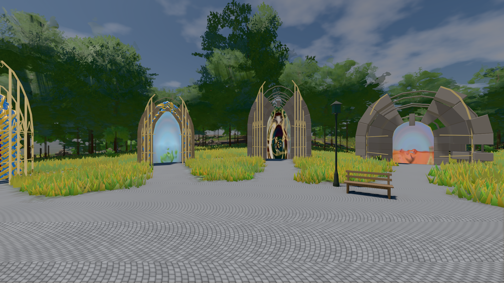
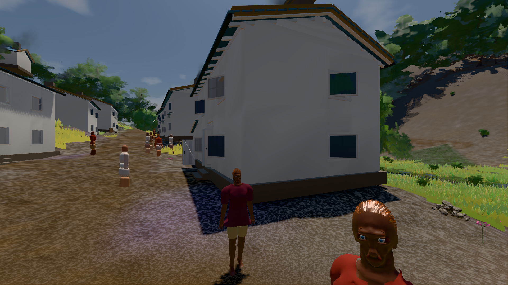

# GPU-PROBE 632fbd8a — GRÜN

Zweig `w28-himmel-flaeche` · Kopf 632fbd8a48afadfb68f183eafd2b9f6e9450a2c8 · Läufer gtx1050-desktop · 14.11. 15:19 · Wanduhr ab Push 318 s · Lauf https://github.com/MiguellD/AnazhRealm/actions/runs/43603808812

Ruf: `bild:genesis@0.5 bild:dorf@0.5`

## Läufer gtx1050-desktop — GRÜN

GPU NVIDIA GeForce GTX 1050 · npm ci 38 s (package-lock 09faa9be)
Schloss /c/Users/User/AppData/Local/Temp/claude/gpu-schloss hält „ci-runner 43603808812/1 probe“
- Hook 2026-11-14 15:14:33 start ci-runner 43603808812/1 probe: Schloss genommen (refs/heads/w28-himmel-flaeche 632fbd8a48afadfb68f183eafd2b9f6e9450a2c8 ws=C:\actions-runner\_work\AnazhRealm\AnazhRealm)

### bild:genesis@0.5 — GRÜN · 75 s · Läufer gtx1050-desktop

Adapter: [linse-gpu] nvidia/pascal

```text
Kamera des Spiels → Blick (10.0 m): 0.00 92.40 0.00 -10.00 92.40 0.00
 "abnahme": "ABNAHME GRÜN · beweis · Sicht 0.0 % · Ziel Blickziel im Bild frei 10 m · Luma 107.4 σ 39 schwarz 0.0 % weiß 0.0 % · Stand 18.546.285 · Bühne summer sunny 0.50 Tiere gehalten · Gerät WebGPU nvidia pascal · Inhalt bodenSatz 36.1 % (≥ 15.0 %) Luma 140, portal-membran 2.7 % (≥ 0.3 %) Luma 140",
```



### bild:dorf@0.5 — GRÜN · 154 s · Läufer gtx1050-desktop

Adapter: [linse-gpu] nvidia/pascal

```text
Kamera des Spiels → Blick (5.2 m): -704.22 39.69 -880.02 -703.03 39.69 -874.96
 "abnahme": "ABNAHME GRÜN · beweis · Sicht 0.0 % · Leib im Vordergrund 2.8 % (Leib bewohner 2.8 %) · Ziel Blickziel im Bild frei 5.2 m · Luma 77 σ 31.6 schwarz 0.4 % weiß 0.0 % · Stand 18.546.285 · Bühne summer sunny 0.50 Tiere gehalten · Gerät WebGPU nvidia pascal · Inhalt bauSatz 29.0 % (≥ 2.0 %) Luma 79",
```


