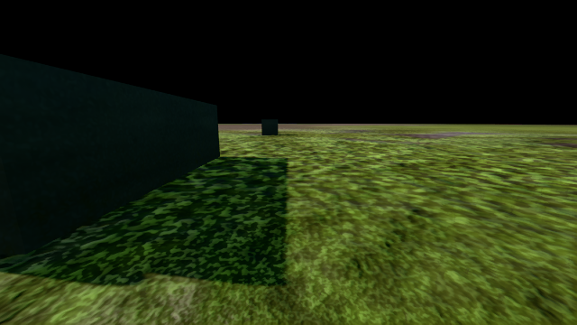
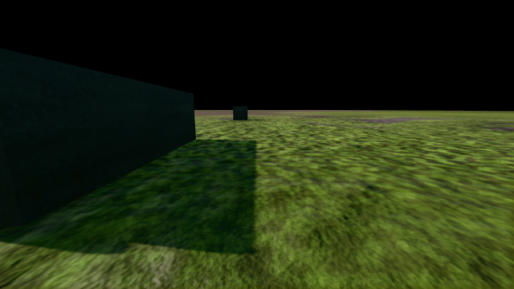
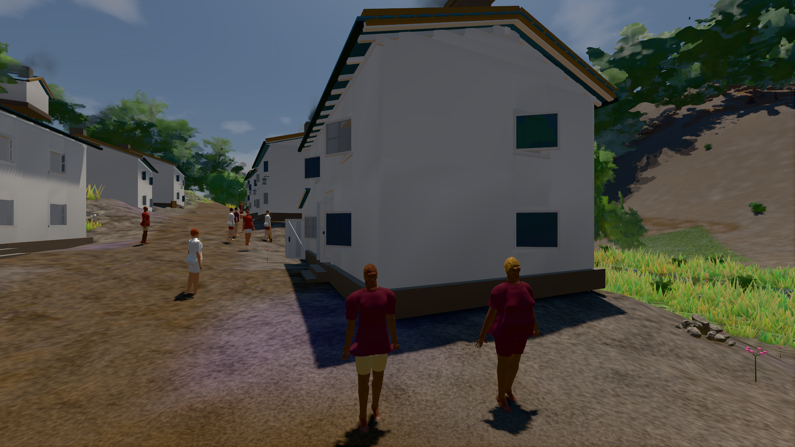

# GPU-PROBE bcef4644 — GRÜN

Zweig `w28-himmel-korn` · Kopf bcef4644d6316feb9f0e97f572fd13a492eacf08 · Läufer gtx1050-desktop · 15.11. 16:56 · Wanduhr ab Push 396 s · Lauf https://github.com/MiguellD/AnazhRealm/actions/runs/43732077266

Ruf: `gate:schatten-terminator bild:dorf@0.5 gate:pruefbuehne-licht`

## Läufer gtx1050-desktop — GRÜN

GPU NVIDIA GeForce GTX 1050 · node_modules bleiben (package-lock 5ba7a8f5)
Schloss /c/Users/User/AppData/Local/Temp/claude/gpu-schloss hält „ci-runner 43732077266/1 probe“
- Hook 2026-11-15 16:50:30 start ci-runner 43732077266/1 probe: Schloss genommen (refs/heads/w28-himmel-korn bcef4644d6316feb9f0e97f572fd13a492eacf08 ws=C:\actions-runner\_work\AnazhRealm\AnazhRealm)

### gate:schatten-terminator — GRÜN · 101 s · Läufer gtx1050-desktop

Adapter: ungenannt (die Probe nannte keinen Browser-Adapter)

```text
✅ SELBSTTEST GRÜN — das Terminator-Urteil nennt die Hang-Akne beim Namen, das Korn-Urteil das zweite Bild im Schlagschatten
✅ GRÜN — der Terminator ohne Akne, die Karte trägt den Grat, im Schlagschatten steht das Korn der Albedo
```





### bild:dorf@0.5 — GRÜN · 153 s · Läufer gtx1050-desktop

Adapter: [linse-gpu] nvidia/pascal

```text
Kamera des Spiels → Blick (5.2 m): -704.22 39.69 -880.02 -703.03 39.69 -874.96
 "abnahme": "ABNAHME GRÜN · beweis · Sicht 0.0 % · Ziel Blickziel im Bild frei 5.2 m · Luma 77.8 σ 30.7 schwarz 0.1 % weiß 0.0 % · Stand 18.546.292 · Bühne summer sunny 0.50 Tiere gehalten · Gerät WebGPU nvidia pascal · Inhalt bauSatz 28.7 % (≥ 2.0 %) Luma 80",
```



### gate:pruefbuehne-licht — GRÜN · 89 s · Läufer gtx1050-desktop

Adapter: [linse-gpu] nvidia/pascal

```text
  S0 BODEN-PROGRAMM 1/1: 97630 Zeichen WGSL (Ratsche ≤ 100062) · Pipeline asynchron → GRÜN · kalt 2076 · 2008 · 2187 · 2072 · 1999 · 1990 · 2169 · 2123 · 2087 ms, Median 2076 ms · ÷ K17 derselben Sitzung 0,77 (Auskunft, kein Zeit-Urteil)
✅ S0 BILD GRÜN: die Feuerstelle trägt den Feuerkreis aus 2 m in der Ausgabe · Nacht {"luma":24.6,"schwarz":0} (77 s, nvidia/pascal · Holz kienspan)
```
