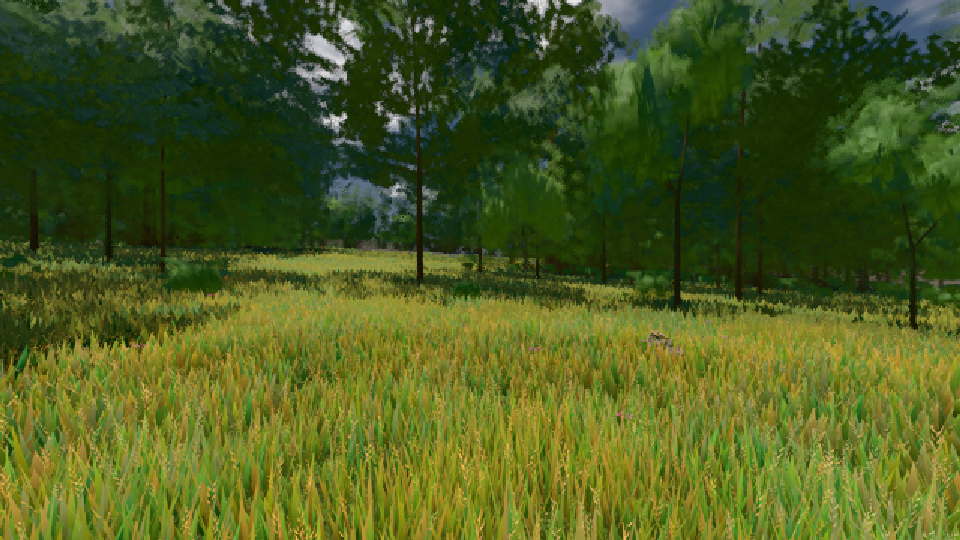

# GPU-PROBE f20a5241 — ROT

Zweig `w28-horizont-gtx` · Kopf f20a52418564a0aa55089f9842766694568c9a7c · Läufer radeon-890m · 11.11. 02:42 · Wanduhr ab Push 786 s · Lauf https://github.com/MiguellD/AnazhRealm/actions/runs/42939328124

Ruf: `bild:gipfel-blick@0.5 bild:wiese@0.5`

## Läufer radeon-890m — ROT

GPU AMD Radeon(TM) 890M Graphics · node_modules bleiben (package-lock df29564e)
Schloss /c/Users/micha/AppData/Local/Temp/claude/gpu-schloss hält „ci-runner 42939328124/1 probe“
- Hook 2026-11-11 02:30:07 start ci-runner 42939328124/1 probe: verwaistes Schloss 'punkte-radeon-sitzungpid=49620' geloest - Halter pid=49620 lebt nicht
- Hook 2026-11-11 02:30:10 start ci-runner 42939328124/1 probe: Schloss genommen (refs/heads/w28-horizont-gtx f20a52418564a0aa55089f9842766694568c9a7c ws=C:\actions-runner\_work\AnazhRealm\AnazhRealm)

### bild:gipfel-blick@0.5 — ROT · 623 s · Läufer radeon-890m

Adapter: [linse-gpu] amd/rdna-3 · DECKEL 480 s

```text
[linse-gpu] amd/rdna-3
```

### bild:wiese@0.5 — NACHGEGEBEN · 47 s · Läufer radeon-890m

Adapter: [linse-gpu] amd/rdna-3 · NACHGEGEBEN: Karten-Job „echt radeon (GPU-Wände auf der Karte)“ (Lauf 42940693081) wartet auf diesen Läufer (radeon-gpu)

```text
Kamera des Spiels → Blick (10.0 m): -280.40 29.71 -1045.60 -289.61 29.71 -1049.50
 "abnahme": "ABNAHME GRÜN · beweis · Sicht 0.0 % · Ziel Blickziel im Bild frei 10 m · Luma 83.8 σ 40.2 schwarz 0.0 % weiß 0.0 % · Stand 18.546.249 · Bühne summer sunny 0.50 · Gerät WebGPU amd rdna-3",
```


