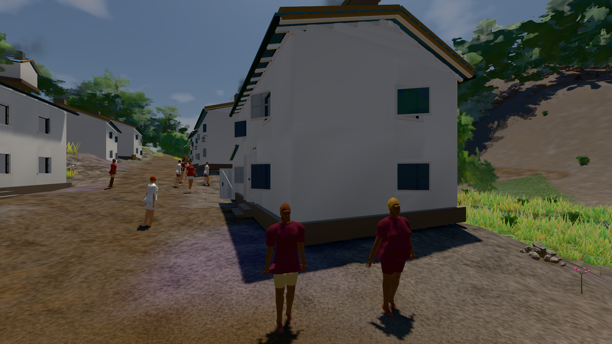

# GPU-PROBE 14957ee6 — NACHGEGEBEN

Zweig `w28-innenlicht` · Kopf 14957ee60c5aa372709c57716684056ba5e41fd8 · Läufer radeon-890m · 16.11. 08:11 · Wanduhr ab Push 630 s · Lauf https://github.com/MiguellD/AnazhRealm/actions/runs/43820814526

Ruf: `bild:dorf@0.5 bild:genesis@0.5`

## Läufer radeon-890m — NACHGEGEBEN

GPU AMD Radeon(TM) 890M Graphics · npm ci 66 s (package-lock 96557b07)
Schloss /c/Users/micha/AppData/Local/Temp/claude/gpu-schloss hält „ci-runner 43820814526/1 probe“
- Hook 2026-11-16 08:01:40 start ci-runner 43820814526/1 probe: wartet auf Schloss von 'heap-dorf-vorher 2026-11-16T07:57:31+01:00 pid=23612'
- Hook 2026-11-16 08:02:18 start ci-runner 43820814526/1 probe: Schloss genommen (refs/heads/w28-innenlicht 14957ee60c5aa372709c57716684056ba5e41fd8 ws=C:\actions-runner\_work\AnazhRealm\AnazhRealm)

### bild:dorf@0.5 — GRÜN · 64 s · Läufer radeon-890m

Adapter: [linse-gpu] amd/rdna-3

```text
Kamera des Spiels → Blick (5.2 m): -704.22 39.69 -880.02 -703.03 39.69 -874.96
 "abnahme": "ABNAHME GRÜN · beweis · Sicht 0.0 % · Ziel Blickziel im Bild frei 5.2 m · Luma 77.8 σ 30.8 schwarz 0.2 % weiß 0.0 % · Stand 18.546.300 · Bühne summer sunny 0.50 Tiere gehalten · Gerät WebGPU amd rdna-3 · Inhalt bauSatz 28.7 % (≥ 2.0 %) Luma 80",
```



### bild:genesis@0.5 — NACHGEGEBEN · 2 s · Läufer radeon-890m

Adapter: ungenannt (die Probe nannte keinen Browser-Adapter) · NACHGEGEBEN: Karten-Job „echt radeon (GPU-Wände auf der Karte)“ (Lauf 43821156739) wartet auf diesen Läufer (radeon-gpu)

```text
NACHGEGEBEN: Karten-Job „echt radeon (GPU-Wände auf der Karte)“ (Lauf 43821156739) wartet auf diesen Läufer (radeon-gpu)
```
