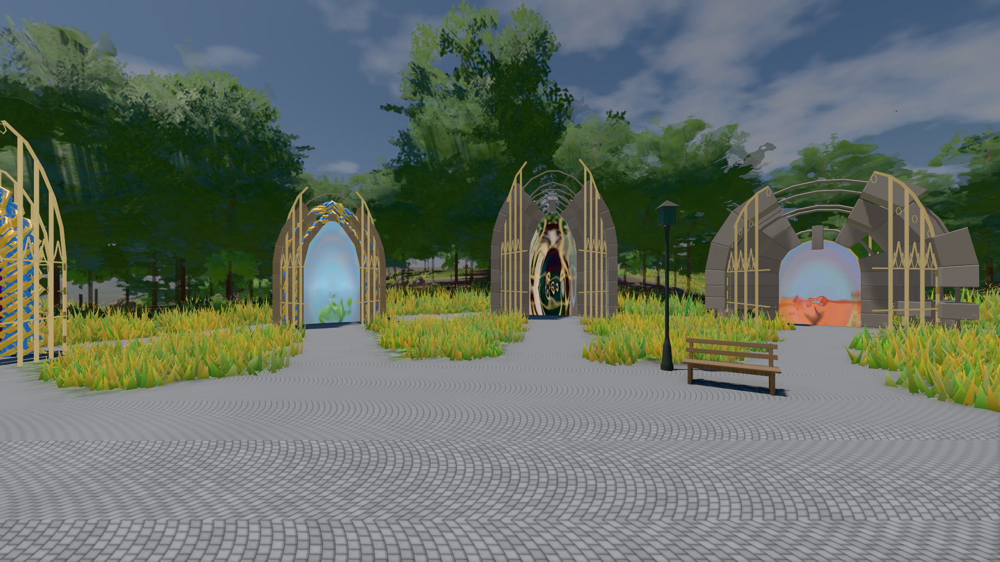
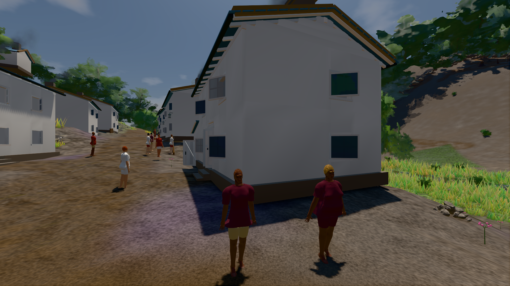

# GPU-PROBE 793f6a16 — GRÜN

Zweig `w28-inseln-fallen` · Kopf 793f6a169c9a7877c4dabb96770ad9f081ed4720 · Läufer omen-gtx1060 · 16.11. 02:09 · Wanduhr ab Push 857 s · Lauf https://github.com/MiguellD/AnazhRealm/actions/runs/43783198567

Ruf: `bild:genesis@0.5 bild:dorf@0.5`

## Läufer omen-gtx1060 — GRÜN

GPU NVIDIA GeForce GTX 1060 · npm ci 58 s (package-lock a62ee566)
Schloss /c/Users/micha/AppData/Local/Temp/claude/gpu-schloss hält „ci-runner 43783198567/1 probe“
- Hook 2026-11-16 01:55:42 start ci-runner 43783198567/1 probe: wartet auf Schloss von 'omen-punkte-gtx-sitzung'
- Hook 2026-11-16 01:57:13 start ci-runner 43783198567/1 probe: Schloss genommen (refs/heads/w28-inseln-fallen 793f6a169c9a7877c4dabb96770ad9f081ed4720 ws=C:\actions-runner\_work\AnazhRealm\AnazhRealm)

### bild:genesis@0.5 — GRÜN · 51 s · Läufer omen-gtx1060

Adapter: [linse-gpu] nvidia/pascal

```text
Kamera des Spiels → Blick (10.0 m): 0.00 92.40 0.00 -10.00 92.40 0.00
 "abnahme": "ABNAHME GRÜN · beweis · Sicht 0.0 % · Ziel Blickziel im Bild frei 10 m · Luma 108.5 σ 38.5 schwarz 0.0 % weiß 0.0 % · Stand 18.546.298 · Bühne summer sunny 0.50 Tiere gehalten · Gerät WebGPU nvidia pascal · Inhalt bodenSatz 36.4 % (≥ 15.0 %) Luma 140, portal-membran 2.7 % (≥ 0.3 %) Luma 140",
```



### bild:dorf@0.5 — GRÜN · 76 s · Läufer omen-gtx1060

Adapter: [linse-gpu] nvidia/pascal

```text
Kamera des Spiels → Blick (5.2 m): -704.22 39.69 -880.02 -703.03 39.69 -874.96
 "abnahme": "ABNAHME GRÜN · beweis · Sicht 0.0 % · Ziel Blickziel im Bild frei 5.2 m · Luma 77.8 σ 30.7 schwarz 0.1 % weiß 0.0 % · Stand 18.546.298 · Bühne summer sunny 0.50 Tiere gehalten · Gerät WebGPU nvidia pascal · Inhalt bauSatz 28.7 % (≥ 2.0 %) Luma 80",
```


