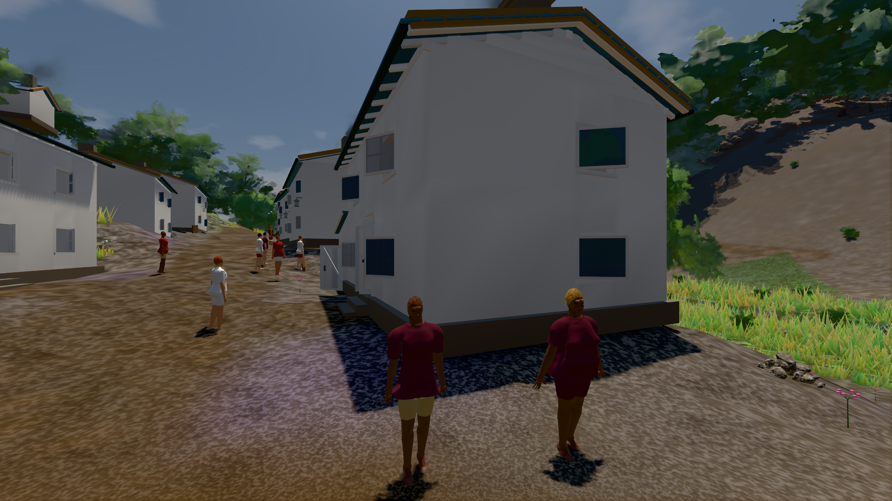
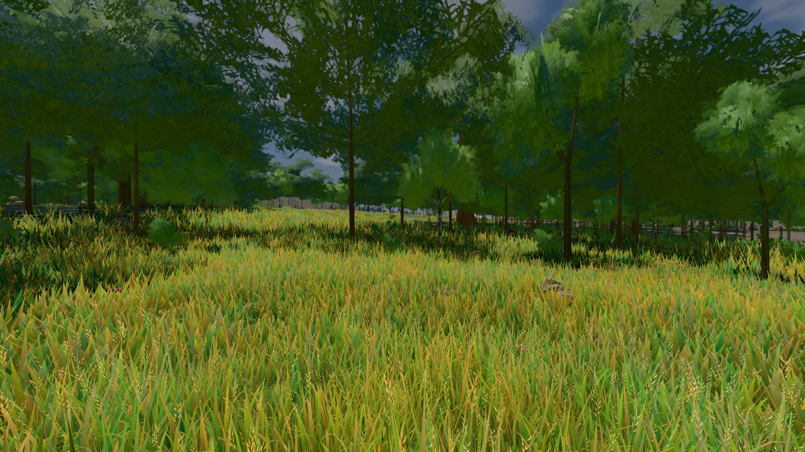

# GPU-PROBE a9861b51 — GRÜN

Zweig `w28-iris-frei` · Kopf a9861b51bffedc3375bedc9570331f43c0a70b6c · Läufer gtx1050-desktop · 15.11. 14:29 · Wanduhr ab Push 441 s · Lauf https://github.com/MiguellD/AnazhRealm/actions/runs/43718639971

Ruf: `bild:dorf@0.5 bild:wiese@0.5 gate:kamera-leib:echt`

## Läufer gtx1050-desktop — GRÜN

GPU NVIDIA GeForce GTX 1050 · node_modules bleiben (package-lock 5ba7a8f5)
Schloss /c/Users/User/AppData/Local/Temp/claude/gpu-schloss hält „ci-runner 43718639971/1 probe“
- Hook 2026-11-15 14:22:27 start ci-runner 43718639971/1 probe: Schloss genommen (refs/heads/w28-iris-frei a9861b51bffedc3375bedc9570331f43c0a70b6c ws=C:\actions-runner\_work\AnazhRealm\AnazhRealm)

### bild:dorf@0.5 — GRÜN · 157 s · Läufer gtx1050-desktop

Adapter: [linse-gpu] nvidia/pascal

```text
Kamera des Spiels → Blick (5.2 m): -704.22 39.69 -880.02 -703.03 39.69 -874.96
 "abnahme": "ABNAHME GRÜN · beweis · Sicht 0.0 % · Ziel Blickziel im Bild frei 5.2 m · Luma 77.8 σ 31 schwarz 0.3 % weiß 0.0 % · Stand 18.546.292 · Bühne summer sunny 0.50 Tiere gehalten · Gerät WebGPU nvidia pascal · Inhalt bauSatz 28.7 % (≥ 2.0 %) Luma 80",
```



### bild:wiese@0.5 — GRÜN · 83 s · Läufer gtx1050-desktop

Adapter: [linse-gpu] nvidia/pascal

```text
Kamera des Spiels → Blick (10.0 m): -280.40 29.71 -1045.60 -289.61 29.71 -1049.50
 "abnahme": "ABNAHME GRÜN · beweis · Sicht 0.0 % · Ziel Blickziel im Bild frei 10 m · Luma 81.9 σ 39 schwarz 0.0 % weiß 0.0 % · Stand 18.546.292 · Bühne summer sunny 0.50 Tiere gehalten · Gerät WebGPU nvidia pascal · Inhalt nahWiese 48.2 % (≥ 15.0 %) h 107° Luma 117",
```



### gate:kamera-leib:echt — GRÜN · 145 s · Läufer gtx1050-desktop

Adapter: [linse-gpu] nvidia/pascal

```text
  ✅ K6 Strafe am Prüfplatz — A0 Kopf 0.0 % Leib 1.4 % (2460 px),A1 Kopf 0.0 % Leib 1.6 % (2484 px),A2 Kopf 0.0 % Leib 1.6 % (2481 px),A3 Kopf 0.9 % Leib 1.1 % (2518 px),D0 Kopf 0.0 % Leib 2.6 % (2496 px),D1 Kopf 0.0 % Leib 1.0 % (2451 px),D2 Kopf 0.0 % Leib 1.0 % (2516 px),D3 Kopf 0.0 % Leib 1.3 % (2582 px) · Rückstrahl 0.1 %
✅ GRÜN — die Kamera steckt nie in Laub, Strauch, Fels oder Boden.
```
