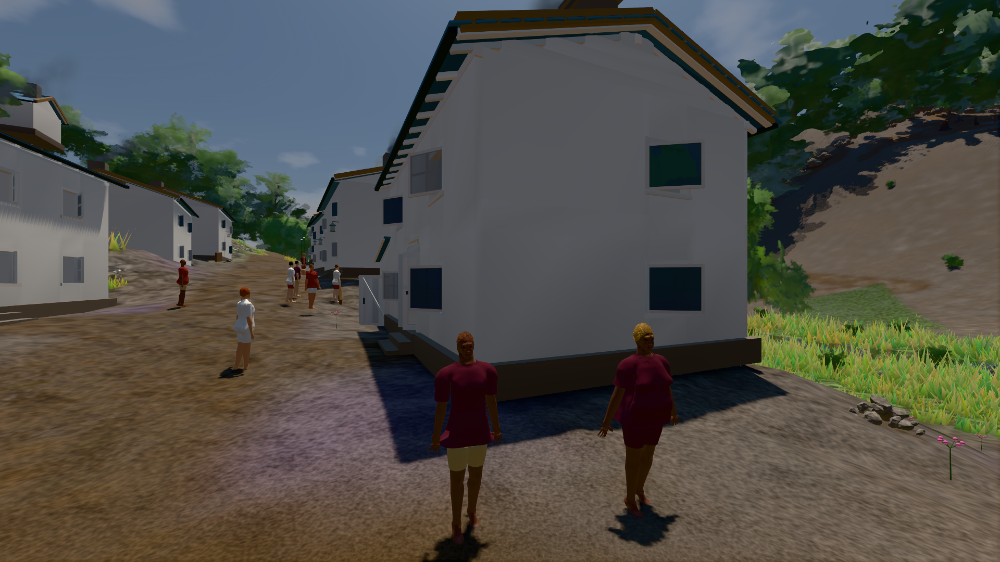
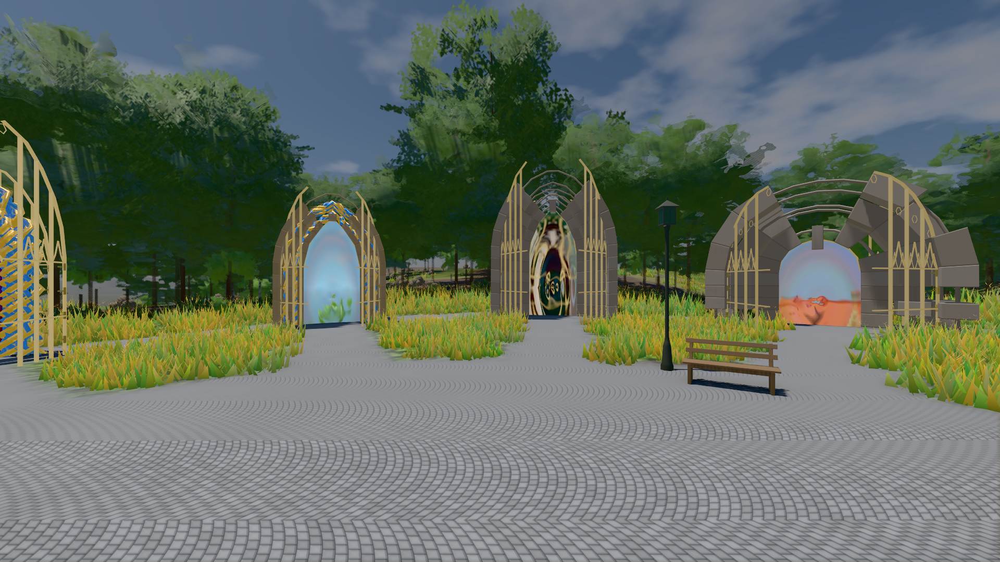

# GPU-PROBE d9740a6b — GRÜN

Zweig `w28-kandidat-1611` · Kopf d9740a6b34be7674dc0b91683e100059ce35d27d · Läufer gtx1050-desktop · 16.11. 06:01 · Wanduhr ab Push 431 s · Lauf https://github.com/MiguellD/AnazhRealm/actions/runs/43806895546

Ruf: `bild:dorf@0.5 bild:genesis@0.5 gate:fern-ring`

## Läufer gtx1050-desktop — GRÜN

GPU NVIDIA GeForce GTX 1050 · node_modules bleiben (package-lock 76b18c39)
Schloss /c/Users/User/AppData/Local/Temp/claude/gpu-schloss hält „ci-runner 43806895546/1 probe“
- Hook 2026-11-16 05:55:02 start ci-runner 43806895546/1 probe: Schloss genommen (refs/heads/w28-kandidat-1611 d9740a6b34be7674dc0b91683e100059ce35d27d ws=C:\actions-runner\_work\AnazhRealm\AnazhRealm)

### bild:dorf@0.5 — GRÜN · 150 s · Läufer gtx1050-desktop

Adapter: [linse-gpu] nvidia/pascal

```text
Kamera des Spiels → Blick (5.2 m): -704.22 39.69 -880.02 -703.03 39.69 -874.96
 "abnahme": "ABNAHME GRÜN · beweis · Sicht 0.0 % · Ziel Blickziel im Bild frei 5.2 m · Luma 77.9 σ 30.7 schwarz 0.1 % weiß 0.0 % · Stand 18.546.299 · Bühne summer sunny 0.50 Tiere gehalten · Gerät WebGPU nvidia pascal · Inhalt bauSatz 28.7 % (≥ 2.0 %) Luma 80",
```



### bild:genesis@0.5 — GRÜN · 74 s · Läufer gtx1050-desktop

Adapter: [linse-gpu] nvidia/pascal

```text
Kamera des Spiels → Blick (10.0 m): 0.00 92.40 0.00 -10.00 92.40 0.00
 "abnahme": "ABNAHME GRÜN · beweis · Sicht 0.0 % · Ziel Blickziel im Bild frei 10 m · Luma 108.5 σ 38.5 schwarz 0.0 % weiß 0.0 % · Stand 18.546.299 · Bühne summer sunny 0.50 Tiere gehalten · Gerät WebGPU nvidia pascal · Inhalt bodenSatz 36.4 % (≥ 15.0 %) Luma 140, portal-membran 2.7 % (≥ 0.3 %) Luma 140",
```



### gate:fern-ring — GRÜN · 154 s · Läufer gtx1050-desktop

Adapter: [linse-gpu] nvidia/pascal

```text
  ✅ 9: DIE NAHT — kein Durchstich: wo der Ring zeichnet, liegt er nicht über dem Deck (im Saum um die Weiche gesenkt — er weicht dem Chunk in die Tiefe); Selbsttest: ohne die Karte sticht seine Sehne durch (> 2 %) — proben=22428 anteil=0.0000 seiten={} weiche=6 stufen={"0":6,"1":30,"2":13} zeit=10787+63248ms maskNode=true karte=49/49 selbsttest-ohne-karte=0.3495
  ✅ 9: DIE NAHT — kein Einschnitt: wo das Deck mehr als 2 m unter der 2D-Höhe liegt (Höhlen-Mündung, Kanal, Edit) und der Ring zeichnet, steht er nicht über ihm — die Naht trägt die Fläche des Feldes, das der Chunk zeichnet, und die Weiche des Saums den Fehler der Masche (`_fernRingWeiche`: Steigung × Durchmesser); Selbsttest: der Ring auf der 2D-Höhe (die alte Naht) schneidet ein — einschnitt=0/0 orte=[] luecke=274 (davon unter der Weiche 224 ["(518.3|-5.4) Deck 116.3 Ring 117.6 Weiche 13.9","(518.5|-5.4) Deck 116.3 Ring 117.7 Weiche 14.0","(517.8|-5.4) Deck 116.3 Ring 117.6 W
  ✅ 10: DIE FERN-FARBE OHNE STREIFEN — Streifen-Index (RMS Nachbar-Sprung / RMS 4er-Sprung) im Median ≤ 0,5 — reihen=24 median=0.436 p90=0.790 selbsttest zufall=0.99 glatt=0.25
  ✅ 11: DAS DACH IST DER BESTAND — die Deckung des Kronendachs trifft die Kronen-Deckung des gepflanzten Waldes (192 × 192 m, je 32-m-Land-Kachel) im Verhältnis 0,8–1,25; Selbsttest: das alte Dach (die Geburt als Deckung) fällt rot — kacheln=36 gepflanzt=0.203 dach=0.196 verhaeltnis=1.039 selbsttest-alt=0.886 (0.229)
  ✅ 12: DIE WEICHE KOSTET NUR AN DER NAHT — kein gezeichnetes Dreieck mit depthNode ohne Rand-Zelle des Gebauten in Reichweite (1½ s_max); Selbsttest: die Weiche über den ganzen Ring findet Dreiecke ohne Naht — weiche=2654 ohne-naht=0 {} ring=18614 rand-zellen=49 selbsttest-weiche-überall=15960
  ✅ 13: DIE TEILUNG IST TREU — ein freies Dreieck trägt nur Regel 0, ein getragenes nur Regel 2 (die Punkte der Loch-Probe und Ecken, Kanten-Mitten, Schwerpunkte); Selbsttest: die Naht als frei zeigt Stiche, verworfen Löcher — proben=94083 stich=0 loch=0 klassen(frei/naht/getragen)=[5976,2654,6346] orte=[] selbsttest stich=12259 loch=8187
  ✅ 14: DAS WASSER DES RINGS IST DAS WASSER DES BODENS — ein See liegt über dem Ring; ein Fluss trägt seinen Anteil der Masche als Wasser-Anteil aNass (≤ 0,05, gezeichnet mit dem Blick des Wassers), seine Boden-Farbe ohne Fern-Blau (≤ 0,01) und seine Höhe als Mittel aus Boden und Spiegel (≤ 0,05 m); Selbsttest: die alte Regel (kein Anteil, keine Senkung) verfehlt den Fluss — see=0 verdeckt=0 fluss=552 deutlich(>=0,25)=18 abweichung=0 zwilling=0 hoehe=0/508 offen=0 orte=[] selbsttest-alt=552 alt-hoehe=84 hub-max=0.241 m karte(mitte/fehl/daneben)=95/0/0
  ✅ 15: DER HORIZONT STEHT NACH DEM SCHNEE — ein Edit-Auftrag fliegt, die Schneegrenze bestellt neu (`_fernRingNeuBestellen`) — [im Flug, Generation vorher, nachher, editFlug] 1,0,1,0
  ✅ 16: DIE REGIONEN GEHEN VOR — der neue Faden antwortet vor dem letzten Chunk — 252.72499999403954,4001.030000001192 ms — TÄTER sonst: hydro-an hinter den Chunks (voxel-worker.js REGIONEN_STAND)
✅ GRÜN — DER FERN-RING STEHT UND DAS FELD ZEICHNET: 3 Schalen aus dem EINEN Höhen-Gesetz (Fern-Wahrheit includeDetail=false, XZ welt-gesnappt), der Fern-Faden rechnet Ring, Feld und Krone in Scheiben aus dem Gelände-Gesetzbuch, der Haupt-Faden hängt nur ein, quantisiertes Re-Zentrieren, headless-default ruhig.
```
