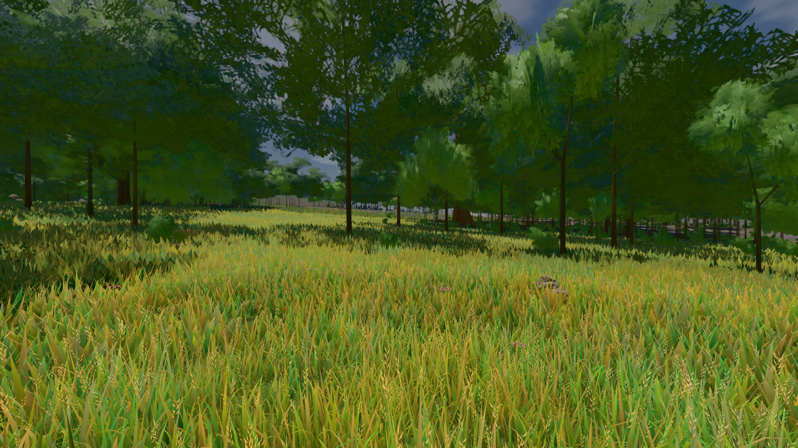

# GPU-PROBE 4c3448a8 — GRÜN

Zweig `w28-kante-mass` · Kopf 4c3448a8a65798aa74d3b034753c77a86fd5a19a · Läufer omen-gtx1060 · 14.11. 06:51 · Wanduhr ab Push 453 s · Lauf https://github.com/MiguellD/AnazhRealm/actions/runs/43562959753

Ruf: `bild:wiese@0.5`

## Läufer omen-gtx1060 — GRÜN

GPU NVIDIA GeForce GTX 1060 · npm ci 55 s (package-lock c9852feb)
Schloss /c/Users/micha/AppData/Local/Temp/claude/gpu-schloss hält „ci-runner 43562959753/1 probe“
- Hook 2026-11-14 06:44:34 start ci-runner 43562959753/1 probe: wartet auf Schloss von 'omen-sg-kreatur-takt'
- Hook 2026-11-14 06:49:36 start ci-runner 43562959753/1 probe: Schloss genommen (refs/heads/w28-kante-mass 4c3448a8a65798aa74d3b034753c77a86fd5a19a ws=C:\actions-runner\_work\AnazhRealm\AnazhRealm)

### bild:wiese@0.5 — GRÜN · 46 s · Läufer omen-gtx1060

Adapter: [linse-gpu] nvidia/pascal

```text
Kamera des Spiels → Blick (10.0 m): -280.40 29.71 -1045.60 -289.61 29.71 -1049.50
 "abnahme": "ABNAHME GRÜN · beweis · Sicht 0.0 % · Ziel Blickziel im Bild frei 10 m · Luma 82.7 σ 38.8 schwarz 0.0 % weiß 0.0 % · Stand 18.546.280 · Bühne summer sunny 0.50 Tiere gehalten · Gerät WebGPU nvidia pascal · Inhalt nahWiese 48.4 % (≥ 15.0 %) h 107° Luma 118",
```


