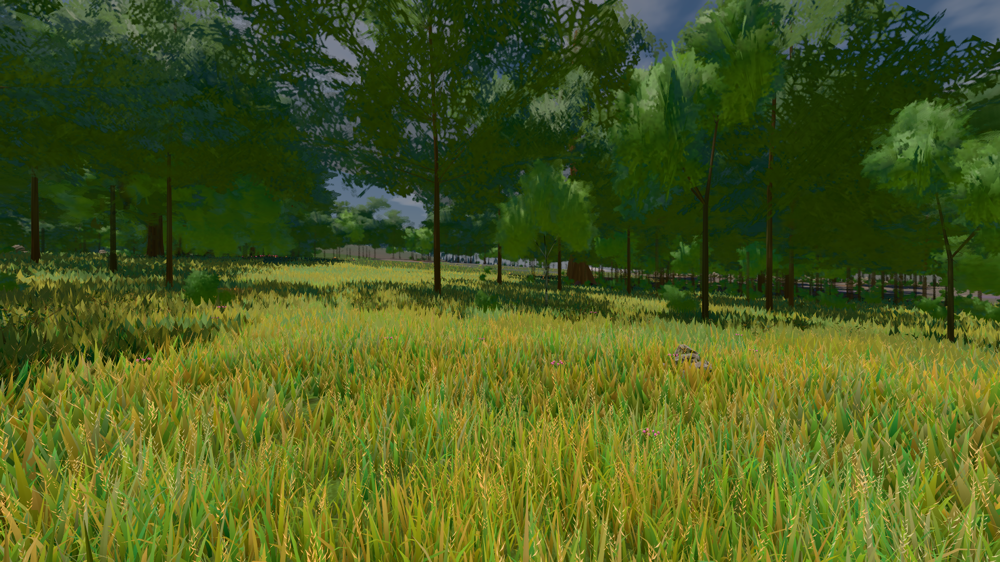

# GPU-PROBE 8c15a7ea — GRÜN

Zweig `w28-kante-mass` · Kopf 8c15a7eafcb166ea44d196d0b58c7aa53911a300 · Läufer gtx1050-desktop · 14.11. 06:54 · Wanduhr ab Push 571 s · Lauf https://github.com/MiguellD/AnazhRealm/actions/runs/43563027453

Ruf: `bild:wiese@0.5`

## Läufer gtx1050-desktop — GRÜN

GPU NVIDIA GeForce GTX 1050 · npm ci 34 s (package-lock c9852feb)
Schloss /c/Users/User/AppData/Local/Temp/claude/gpu-schloss hält „ci-runner 43563027453/1 probe“
- Hook 2026-11-14 06:52:11 start ci-runner 43563027453/1 probe: Schloss genommen (refs/heads/w28-kante-mass 8c15a7eafcb166ea44d196d0b58c7aa53911a300 ws=C:\actions-runner\_work\AnazhRealm\AnazhRealm)

### bild:wiese@0.5 — GRÜN · 89 s · Läufer gtx1050-desktop

Adapter: [linse-gpu] nvidia/pascal

```text
Kamera des Spiels → Blick (10.0 m): -280.40 29.71 -1045.60 -289.61 29.71 -1049.50
 "abnahme": "ABNAHME GRÜN · beweis · Sicht 0.0 % · Ziel Blickziel im Bild frei 10 m · Luma 82.6 σ 38.8 schwarz 0.0 % weiß 0.0 % · Stand 18.546.280 · Bühne summer sunny 0.50 Tiere gehalten · Gerät WebGPU nvidia pascal · Inhalt nahWiese 48.4 % (≥ 15.0 %) h 107° Luma 118",
```


