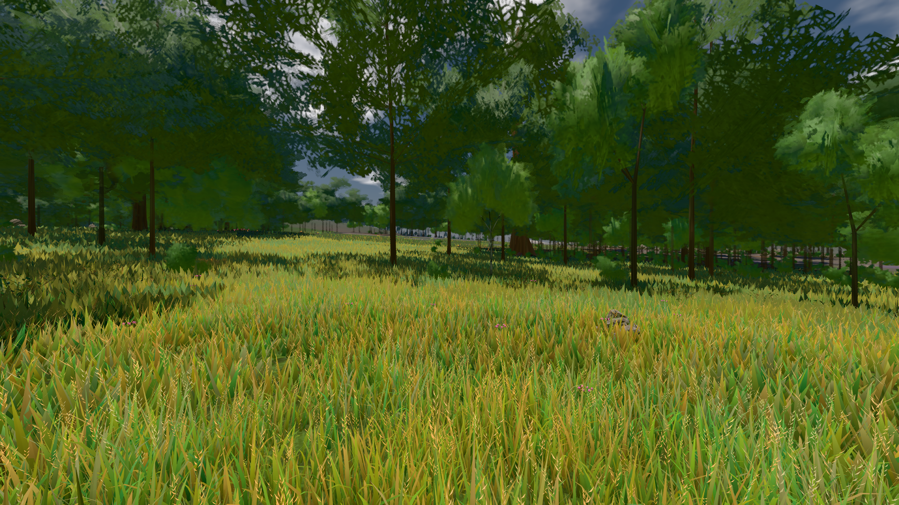

# GPU-PROBE 956764b8 — GRÜN

Zweig `w28-kante-mass` · Kopf 956764b838b04756ee67c4f9b6b6535d18512f8d · Läufer radeon-890m · 14.11. 06:24 · Wanduhr ab Push 493 s · Lauf https://github.com/MiguellD/AnazhRealm/actions/runs/43560719436

Ruf: `bild:wiese@0.5`

## Läufer radeon-890m — GRÜN

GPU AMD Radeon(TM) 890M Graphics · npm ci 51 s (package-lock ba467c8f)
Schloss /c/Users/micha/AppData/Local/Temp/claude/gpu-schloss hält „ci-runner 43560719436/1 probe“
- Hook 2026-11-14 06:16:48 start ci-runner 43560719436/1 probe: wartet auf Schloss von 'takt-beweis 2026-11-14T06:14:39+01:00 pid=94408'
- Hook 2026-11-14 06:20:08 start ci-runner 43560719436/1 probe: Schloss genommen (refs/heads/w28-kante-mass 956764b838b04756ee67c4f9b6b6535d18512f8d ws=C:\actions-runner\_work\AnazhRealm\AnazhRealm)

### bild:wiese@0.5 — GRÜN · 58 s · Läufer radeon-890m

Adapter: [linse-gpu] amd/rdna-3

```text
Kamera des Spiels → Blick (10.0 m): -280.40 29.71 -1045.60 -289.61 29.71 -1049.50
 "abnahme": "ABNAHME GRÜN · beweis · Sicht 0.0 % · Ziel Blickziel im Bild frei 10 m · Luma 83.2 σ 39.8 schwarz 0.0 % weiß 0.0 % · Stand 18.546.278 · Bühne summer sunny 0.50 Tiere gehalten · Gerät WebGPU amd rdna-3 · Inhalt nahWiese 48.4 % (≥ 15.0 %) h 107° Luma 118",
```


