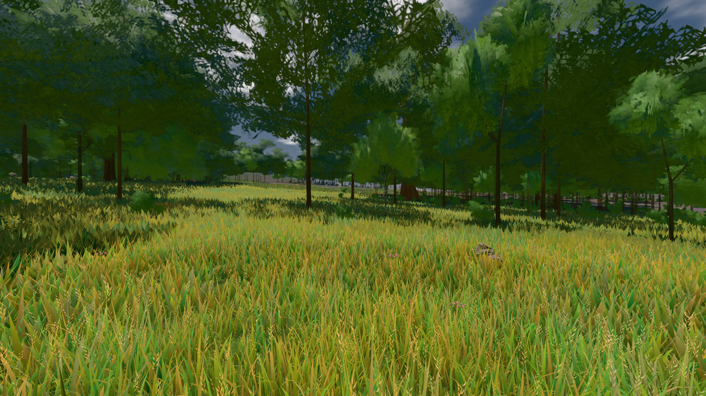
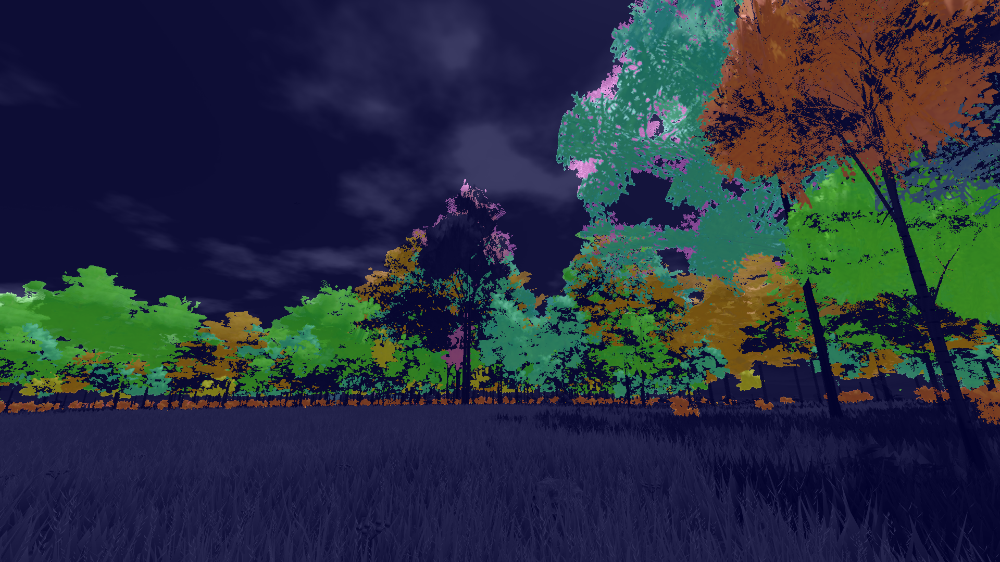
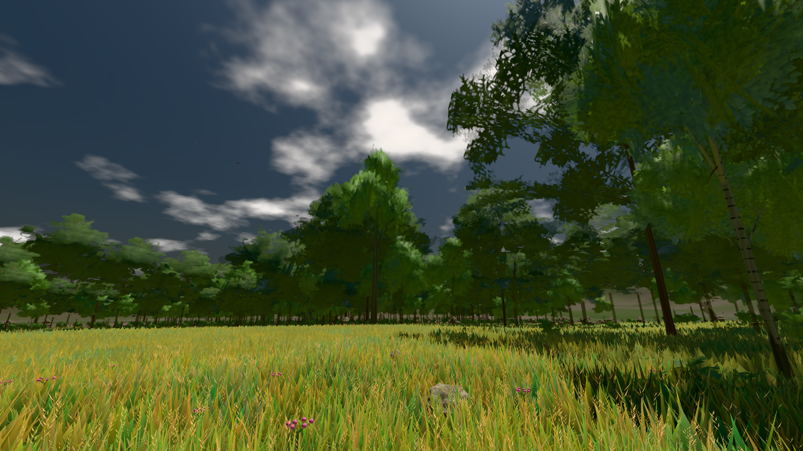

# GPU-PROBE a9b7a0d9 — NACHGEGEBEN

Zweig `w28-karte-stamm` · Kopf a9b7a0d973239c2780b15c04e292515194263204 · Läufer radeon-890m · 13.11. 19:21 · Wanduhr ab Push 738 s · Lauf https://github.com/MiguellD/AnazhRealm/actions/runs/43479820849

Ruf: `bild:wiese@0.5 gate:pop gate:laub-kante`

## Läufer radeon-890m — NACHGEGEBEN

GPU AMD Radeon(TM) 890M Graphics · npm ci 85 s (package-lock cc78bc14)
Schloss /c/Users/micha/AppData/Local/Temp/claude/gpu-schloss hält „ci-runner 43479820849/1 probe“
- Hook 2026-11-13 19:09:57 start ci-runner 43479820849/1 probe: verwaistes Schloss 'punkte-radeon-sitzungpid=57144' geloest - Halter pid=57144 lebt nicht
- Hook 2026-11-13 19:10:00 start ci-runner 43479820849/1 probe: Schloss genommen (refs/heads/w28-karte-stamm a9b7a0d973239c2780b15c04e292515194263204 ws=C:\actions-runner\_work\AnazhRealm\AnazhRealm)

### bild:wiese@0.5 — GRÜN · 59 s · Läufer radeon-890m

Adapter: [linse-gpu] amd/rdna-3

```text
Kamera des Spiels → Blick (10.0 m): -280.40 29.71 -1045.60 -289.61 29.71 -1049.50
 "abnahme": "ABNAHME GRÜN · beweis · Sicht 0.0 % · Ziel Blickziel im Bild frei 10 m · Luma 83.2 σ 39.8 schwarz 0.0 % weiß 0.0 % · Stand 18.546.274 · Bühne summer sunny 0.50 Tiere gehalten · Gerät WebGPU amd rdna-3 · Inhalt nahWiese 48.1 % (≥ 15.0 %) h 107° Luma 118",
```



### gate:pop — GRÜN · 100 s · Läufer radeon-890m

Adapter: ungenannt (die Probe nannte keinen Browser-Adapter)

```text
lod.K2#1 GRÜN 0.0358 % Pop-Pixel/s (742 px) · 35*+1@189/29*/49*+2@154/476*/55*/35*+2@192/30*+1@155/33*+1@189 · Laub 216 · dc, Dreiecke 99,425899 · GPU 46.07 ms, CPU 4.39 ms je Bild
BLOCK-TREUE GRÜN 233 Blöcke treu · Selbsttest nennt MeshStandardNodeMaterial · nahWiese:L1:0:0 · instanzFarbe: 1/880 Instanzen fremd
```

### gate:laub-kante — NACHGEGEBEN · 171 s · Läufer radeon-890m

Adapter: ungenannt (die Probe nannte keinen Browser-Adapter) · NACHGEGEBEN: Karten-Job „echt radeon (GPU-Wände auf der Karte)“ (Lauf 43481035887) wartet auf diesen Läufer (radeon-gpu)

```text
lod.K1#1 Tafel-Pose ROT [["f:birke:L0",0.1921,127662,0,0,0],["f:birke:L1",0.2279,79066,0,0,0],["f:fichte:L0",0.1404,15832,0,0.0001,1],["f:fichte:L1",0.1826,132571,0,0,0],["f:tanne:L1",0.2129,15122,0,0,0],["fimp:birke:L2",0.1704,10123,0,0,0],["fimp:buche:L2",0.1859,5458,0,0.0037,3],["fimp:eiche:L2",0.1867,52034,0,0.0001,2],["fimp:fichte:L2",0.222,74025,0,0.0004,1],["fimp:strauch:L2",0.2362,17933,0,0.0063,1],["fimp:tanne:L2",0.1969,115270,0,0.0002,1]]
```




