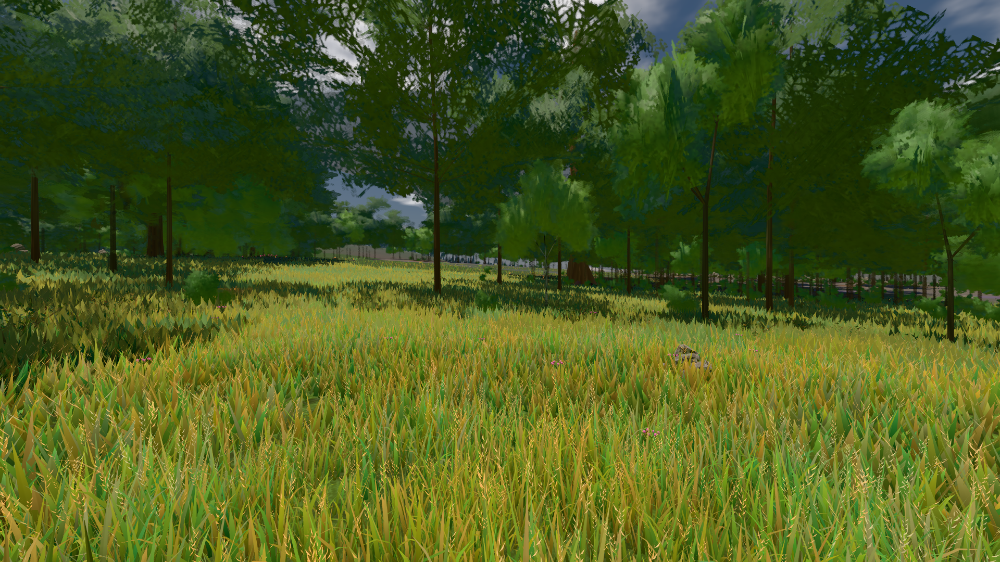

# GPU-PROBE d730ad9d — GRÜN

Zweig `w28-karte-stamm` · Kopf d730ad9de5a499ddfc2ab20a22b89466076054f0 · Läufer gtx1050-desktop · 13.11. 19:35 · Wanduhr ab Push 1349 s · Lauf https://github.com/MiguellD/AnazhRealm/actions/runs/43480427147

Ruf: `bild:wiese@0.5 gate:pop gate:nah-fern`

## Läufer gtx1050-desktop — GRÜN

GPU NVIDIA GeForce GTX 1050 · npm ci 40 s (package-lock cc78bc14)
Schloss /c/Users/User/AppData/Local/Temp/claude/gpu-schloss hält „ci-runner 43480427147/1 probe“
- Hook 2026-11-13 19:28:30 start ci-runner 43480427147/1 probe: Schloss genommen (refs/heads/w28-karte-stamm d730ad9de5a499ddfc2ab20a22b89466076054f0 ws=C:\actions-runner\_work\AnazhRealm\AnazhRealm)

### bild:wiese@0.5 — GRÜN · 101 s · Läufer gtx1050-desktop

Adapter: [linse-gpu] nvidia/pascal

```text
Kamera des Spiels → Blick (10.0 m): -280.40 29.71 -1045.60 -289.61 29.71 -1049.50
 "abnahme": "ABNAHME GRÜN · beweis · Sicht 0.0 % · Ziel Blickziel im Bild frei 10 m · Luma 83.3 σ 39.4 schwarz 0.0 % weiß 0.0 % · Stand 18.546.274 · Bühne summer sunny 0.50 Tiere gehalten · Gerät WebGPU nvidia pascal · Inhalt nahWiese 48.1 % (≥ 15.0 %) h 107° Luma 118",
```



### gate:pop — GRÜN · 128 s · Läufer gtx1050-desktop

Adapter: ungenannt (die Probe nannte keinen Browser-Adapter)

```text
lod.K2#1 GRÜN 0.0414 % Pop-Pixel/s (859 px) · 54*+1@189/27*/49*+1@207/56*+1@154/404*/77*+2@192/65*/127*+2@154 · Laub 216 · dc, Dreiecke 100,427248 · GPU 43.45 ms, CPU 6.73 ms je Bild
BLOCK-TREUE GRÜN 233 Blöcke treu · Selbsttest nennt MeshStandardNodeMaterial · nahWiese:Lf:0:0 · instanzFarbe: 1/6497 Instanzen fremd
```

### gate:nah-fern — GRÜN · 111 s · Läufer gtx1050-desktop

Adapter: ungenannt (die Probe nannte keinen Browser-Adapter)

```text
✅ SELBSTTEST GRÜN — das Nah-Fern-Urteil nennt die zwei Farben derselben Stelle beim Namen
✅ NAH-FERN GRÜN — EINE Boden-Farbe je Ort
```
