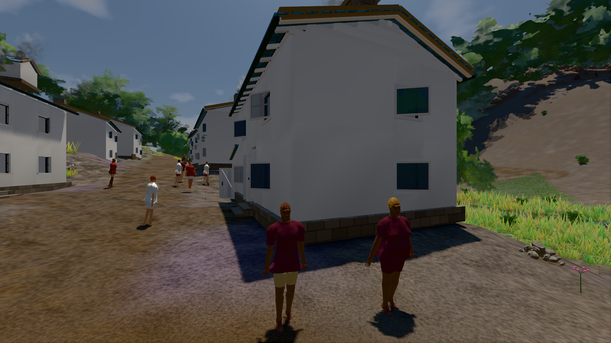
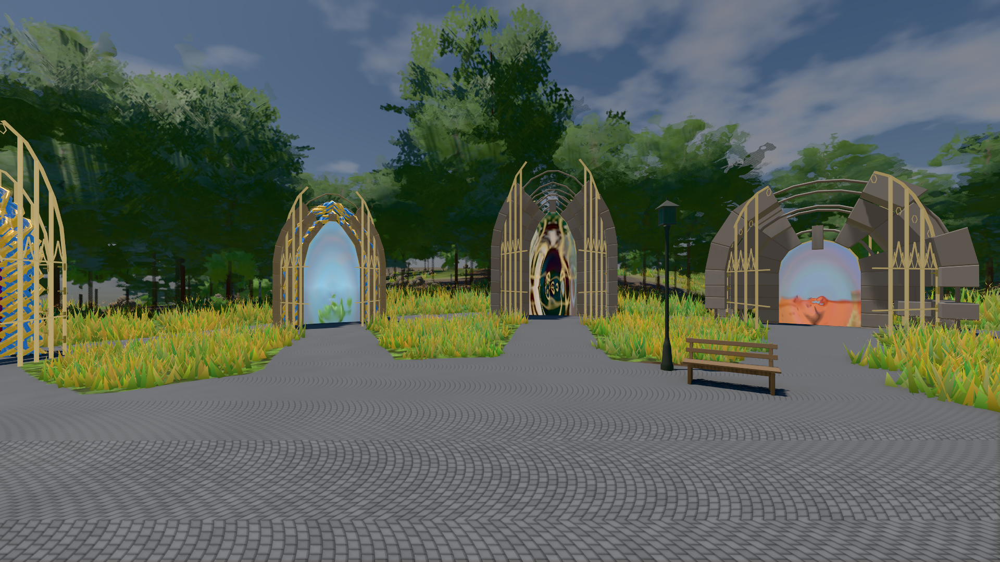

# GPU-PROBE df03a17c — GRÜN

Zweig `w28-kern-sprossen` · Kopf df03a17c062d3176472e4bc528698e7c80efb223 · Läufer omen-gtx1060 · 18.11. 14:19 · Wanduhr ab Push 616 s · Lauf https://github.com/MiguellD/AnazhRealm/actions/runs/44310806627

Ruf: `bild:dorf@0.5 bild:genesis@0.5`

## Läufer omen-gtx1060 — GRÜN

GPU NVIDIA GeForce GTX 1060 · node_modules bleiben (package-lock a57f7437)
Schloss /c/Users/micha/AppData/Local/Temp/claude/gpu-schloss hält „ci-runner 44310806627/1 probe“
- Hook 2026-11-18 14:13:36 start ci-runner 44310806627/1 probe: wartet auf Schloss von 'omen-landung-wache'
- Hook 2026-11-18 14:13:51 start ci-runner 44310806627/1 probe: Schloss genommen (refs/heads/w28-kern-sprossen df03a17c062d3176472e4bc528698e7c80efb223 ws=C:\actions-runner\_work\AnazhRealm\AnazhRealm)

### bild:dorf@0.5 — GRÜN · 70 s · Läufer omen-gtx1060

Adapter: [linse-gpu] nvidia/pascal

```text
Kamera des Spiels → Blick (5.2 m): -704.22 39.69 -880.02 -703.03 39.69 -874.96
 "abnahme": "ABNAHME GRÜN · beweis · Sicht 0.0 % · Ziel Blickziel im Bild frei 5.2 m · Luma 77.7 σ 31 schwarz 0.2 % weiß 0.0 % · Stand 18.546.335 · Bühne summer sunny 0.50 Tiere gehalten · Gerät WebGPU nvidia pascal · Inhalt bauSatz 28.7 % (≥ 2.0 %) Luma 79",
```



### bild:genesis@0.5 — GRÜN · 51 s · Läufer omen-gtx1060

Adapter: [linse-gpu] nvidia/pascal

```text
Kamera des Spiels → Blick (10.0 m): 0.00 92.40 0.00 -10.00 92.40 0.00
 "abnahme": "ABNAHME GRÜN · beweis · Sicht 0.0 % · Ziel Blickziel im Bild frei 10 m · Luma 95.9 σ 33.2 schwarz 0.0 % weiß 0.0 % · Stand 18.546.335 · Bühne summer sunny 0.50 Tiere gehalten · Gerät WebGPU nvidia pascal · Inhalt bodenSatz 36.9 % (≥ 15.0 %) Luma 109, portal-membran 2.7 % (≥ 0.3 %) Luma 140",
```


