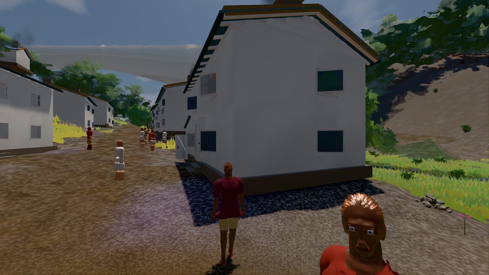
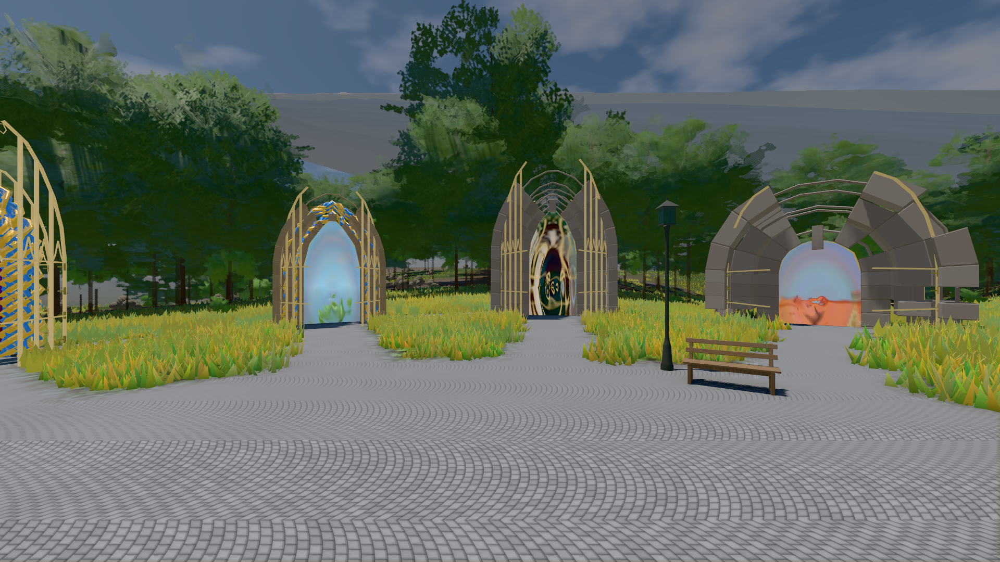

# GPU-PROBE a8716776 — NACHGEGEBEN

Zweig `w28-kopf-kalotte` · Kopf a87167761c796a43ae4fabe81d7a3946e72aba36 · Läufer gtx1050-desktop · 14.11. 07:46 · Wanduhr ab Push 590 s · Lauf https://github.com/MiguellD/AnazhRealm/actions/runs/43567148894

Ruf: `bild:dorf@0.5 bild:genesis@0.5 gate:kamera-leib:echt`

## Läufer gtx1050-desktop — NACHGEGEBEN

GPU NVIDIA GeForce GTX 1050 · npm ci 35 s (package-lock 5f3fc96f)
Schloss /c/Users/User/AppData/Local/Temp/claude/gpu-schloss hält „ci-runner 43567148894/1 probe“
- Hook 2026-11-14 07:36:30 start ci-runner 43567148894/1 probe: Schloss genommen (refs/heads/w28-kopf-kalotte a87167761c796a43ae4fabe81d7a3946e72aba36 ws=C:\actions-runner\_work\AnazhRealm\AnazhRealm)

### bild:dorf@0.5 — GRÜN · 160 s · Läufer gtx1050-desktop

Adapter: [linse-gpu] nvidia/pascal

```text
Kamera des Spiels → Blick (5.2 m): -704.22 39.69 -880.02 -703.03 39.69 -874.96
 "abnahme": "ABNAHME GRÜN · beweis · Sicht 0.0 % · Leib im Vordergrund 2.9 % (Leib bewohner 2.9 %) · Ziel Blickziel im Bild frei 5.2 m · Luma 76.8 σ 31.4 schwarz 0.4 % weiß 0.0 % · Stand 18.546.281 · Bühne summer sunny 0.50 Tiere gehalten · Gerät WebGPU nvidia pascal · Inhalt bauSatz 29.3 % (≥ 2.0 %) Luma 78",
```



### bild:genesis@0.5 — GRÜN · 102 s · Läufer gtx1050-desktop

Adapter: [linse-gpu] nvidia/pascal

```text
Kamera des Spiels → Blick (10.0 m): 0.00 92.40 0.00 -10.00 92.40 0.00
 "abnahme": "ABNAHME GRÜN · beweis · Sicht 0.0 % · Ziel Blickziel im Bild frei 10 m · Luma 106.6 σ 39 schwarz 0.0 % weiß 0.0 % · Stand 18.546.281 · Bühne summer sunny 0.50 Tiere gehalten · Gerät WebGPU nvidia pascal · Inhalt bodenSatz 36.2 % (≥ 15.0 %) Luma 140, portal-membran 2.8 % (≥ 0.3 %) Luma 139",
```



### gate:kamera-leib:echt — NACHGEGEBEN · 191 s · Läufer gtx1050-desktop

Adapter: [linse-gpu] nvidia/pascal · NACHGEGEBEN: Karten-Job „echt gtx1050 (GPU-Wände auf der Karte)“ (Lauf 43567722122) wartet auf diesen Läufer (gtx1050-gpu)

```text

> anazhrealm@18.546.281 gate:kamera-leib:echt
> node scripts/diag-kamera-laub.cjs --teile strafe --bild

[linse-gpu] nvidia/pascal
```
