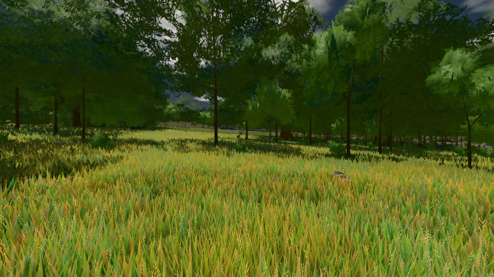

# GPU-PROBE 0a228f7b — GRÜN

Zweig `w28-krone-vor-kachel` · Kopf 0a228f7bdd034a0f7ae091f81010339c12bf9148 · Läufer radeon-890m + omen-gtx1060 (Band-Gerät) · 12.11. 19:57 · Wanduhr ab Push 368 s · Lauf https://github.com/MiguellD/AnazhRealm/actions/runs/43284112497

Ruf: `bild:wiese@0.5 gate:weltbild-frost:echt zeit:gate:ankunft`

## Läufer radeon-890m — GRÜN

GPU AMD Radeon(TM) 890M Graphics · node_modules bleiben (package-lock 7bd472a8)
Schloss /c/Users/micha/AppData/Local/Temp/claude/gpu-schloss hält „ci-runner 43284112497/1 probe“
- Hook 2026-11-12 19:51:35 start ci-runner 43284112497/1 probe: wartet auf Schloss von 'punkte-radeon-sitzungpid=50416'
- Hook 2026-11-12 19:51:50 start ci-runner 43284112497/1 probe: Schloss genommen (refs/heads/w28-krone-vor-kachel 0a228f7bdd034a0f7ae091f81010339c12bf9148 ws=C:\actions-runner\_work\AnazhRealm\AnazhRealm)

### bild:wiese@0.5 — GRÜN · 59 s · Läufer radeon-890m

Adapter: [linse-gpu] amd/rdna-3

```text
Kamera des Spiels → Blick (10.0 m): -280.40 29.71 -1045.60 -289.61 29.71 -1049.50
 "abnahme": "ABNAHME GRÜN · beweis · Sicht 0.0 % · Ziel Blickziel im Bild frei 10 m · Luma 80.8 σ 43 schwarz 0.0 % weiß 0.0 % · Stand 18.546.267 · Bühne summer sunny 0.50 Tiere gehalten · Gerät WebGPU amd rdna-3 · Inhalt nahWiese 48.0 % (≥ 15.0 %) h 106° Luma 120",
```



### gate:weltbild-frost:echt — GRÜN · 123 s · Läufer radeon-890m

Adapter: [linse-gpu] amd/rdna-3

```text
  ✅ S6 der JS-Speicher fällt mit dem Abschied zurück — 396.5 → 400.5 MB nach 10 Erscheinungen und Abschied (Soll ≤ +20 MB)
  ✅ Nachlauf: kein verspätetes Wort einer Validierung
  ✅ P2 kein writeBuffer schief: der Pfad und ein Index ungerader Länge der Ich-Bühne — 192194 writeBuffer, keiner schief
  ✅ T1 die Index-Wache nennt den Index über der Vertex-Zahl beim Namen — ["Scene/frost-taeter-bereich: Index 3 ≥ 3 Vertices im gezeichneten Bereich"]
  ✅ T3 die Puffer-Wache nennt den schiefen writeBuffer beim Namen, WebGPU wirft — frost-taeter-puffer · Uint16Array · Versatz 0 · 6 B · q.writeBuffer (stamm/dirigent-ankunft.js:250:36) < pptr:;page.%3Ccomputed%3E%20%5Bas%20evaluate%5D%20(C%3A%5Cactions-runner%5C_work%5CAnazhRealm%5Cgpu-probe%5Cscripts%5Clib%5Cwelt-boot.cjs%3A954%3A22):6:23 · geworfen: Failed to execute 'writeBuffer' on 'GPUQueue': Number of bytes to write must be a multiple of 4
  ✅ T2 die Index-Wache nennt den geweiteten Index beim Pfad — Group/BundleGroup/Group/mensch/torso/head/Mesh: 7962 × Uint32Array = 31848 B gebunden, der Puffer trägt 15924 B
  ✅ T2 die GPU-Wache des Spiels zählt die Validierung — {"n":337}
  ✅ T2 der eigene Hörer hört die Validierung (Device oder r184-Fehler-Bereich) — 674 Meldungen: device 0: Index range (first: 0, count: 7962, format: IndexFormat::Uint32) does not fit in index buffer size (15924). | device 0: [Invalid RenderBundle from RenderBundleEncoder "renderBundleEncoder"] is invalid due to a previous error.
  ✅ T2 die Bild-Probe erkennt das stehende Bild — 0.00 % der Blöcke bewegt
✅ GRÜN — DIE FROST-WAND steht — durch Werkstatt, Ich- und Hof-Bühne trägt jeder Index-Puffer der Welt-GPU sein Format, kein Device meldet, das Bild folgt der Kamera; die Täter (Index über der Vertex-Zahl, ein fremd geweiteter Mensch-Index) nennen die Wachen beim Namen, und das stehende Bild wird erkannt.
```

## Läufer omen-gtx1060 (Band-Gerät) — GRÜN

GPU NVIDIA GeForce GTX 1060 · node_modules bleiben (package-lock 7bd472a8)
Schloss /c/Users/micha/AppData/Local/Temp/claude/gpu-schloss hält „ci-runner 43284112497/1 probe“
- Hook 2026-11-12 19:51:29 start ci-runner 43284112497/1 probe: wartet auf Schloss von 'omen-punkte-gtx-sitzung'
- Hook 2026-11-12 19:53:30 start ci-runner 43284112497/1 probe: Schloss genommen (refs/heads/w28-krone-vor-kachel 0a228f7bdd034a0f7ae091f81010339c12bf9148 ws=C:\actions-runner\_work\AnazhRealm\AnazhRealm)

### zeit:gate:ankunft — GRÜN · 118 s · Läufer omen-gtx1060 (Band-Gerät)

Adapter: ungenannt (die Probe nannte keinen Browser-Adapter)

```text
  ✅ LH was das Bild nicht liest, hält es nicht: die Hülle am Leib, der Ring außer Bild im Leerlauf — Hülle 0,0,0,1,0 · Ring [hinten ohne Leerlauf, vorn, Ruf, hinten mit] false,true,true,true · Kacheln {"_tickNahWiese":[0,1],"_nahWieseFernTakt":[0,4],"_tickNahStreu":[0,3]} · Krone vor der Kachel [gebaut, stehend, unter der kommenden, unter der gelandeten] {"_tickNahWiese":[24,24,0,10],"_nahWieseFernTakt":[852,852,0,4],"_tickNahStreu":[148,148,0,36]} · Mutante {"_tickNahWiese":[34,24,10,10],"_nahWieseFernTakt":[856,852,4,4],"_tickNahStreu":[184,148,36,36]} · Chunk [offen, gepflanzt]
  ✅ L1 das Fadenkreuz steht in der Bildmitte und weicht der Schublade — da true · Mitte 0/0 px · mit Werkstatt false · danach true
  ✅ L2b „hilfe" nennt die EINEN Tafeln und die Tasten — „hilfe": 0 fehlen · „help": 0 fehlen · „?": 0 fehlen
  ✅ L3 Enter öffnet das Gespräch, Enter sendet und gibt die Welt zurück, Enter auf einem Knopf gehört dem Knopf — Enter → chat-input · gesendet true · danach BODY · W true · Esc → BODY · Enter auf dem Knopf → knopf
  ✅ L7 der Start-Gurt liest den Katalog (je Studio-Art ein Werk) — baum_eiche · fahrzeug_gt · tor_drachentor · haus_alemannisch · bank_sitzbank · leiter_podestleiter · bruecke_jochfeld · schaukel_doppelschaukel (Arten im Katalog: tree, vehicle, ort:tor, haus, ort:platz, ort:wand, ort:weg, ort:spielplatz)
  ✅ LK die 3rd-Kamera rückt nur vor Boden und Bau ein, gleitet hinaus, jeder Pflanzen-Stoff trägt die Durchsicht — baum_kiefer · Stamm × 3.977 (Welt × 3.977) · fuss: 496 Proben, Pflanze hält 0, Arm 6.11/6.11 m (Ist/Soll), < 3 m 0, Sprünge 0 (Soll 0, hinaus 0) · ritt: 496 Proben, Pflanze hält 0, Arm 9.38/9.38 m (Ist/Soll), < 3 m 0, Sprünge 0 (Soll 0, hinaus 0) · Pflanzen-Stoffe 16, ohne Durchsicht 0, Ziel 0.6 m neben der Brust, Fadenkreuz 0.6 m neben der Brust · Fadenkreuz-Strahl: 96 Stellungen, hinter dem Spieler {}, Ziel neben dem Blick 0 m · Durchsicht: 1st 0/8 Anläufe mit
  ✅ D8 der Spieler-Chat trägt Worte, das Log die Zahlen — 6 Zeilen · Log true
  ✅ D6 die KI nennt die Ursache (Dienst · Schlüssel · Proxy) — Status „Fehler (Ollama (lokal oder gehostet)): Keine Antwort von 127" · ohne Schlüssel „(Grok schweigt: für Claude (Anthropic, kostet) fehlt der Sch" · Proxy http://127.0.0.1:4601/api/proxy/llm
  ✅ D9 das Dorf steht vor dir, ein gesperrter Slot fällt an seinem Ort — 25 Häuser (Log: 25 platziert, 0 übersprungen) · hinten 0 · außer Bild 0 · gesperrter Slot steht false, laut true · „„Villaalto" steht vor dir: 25 Häuser." · baue dorf hier: 44.4–120.9 m, beim Mitspieler 0 m daneben (Häuser 14 / 14)
✅ GRÜN — die Ankunft trägt ihre benannten Schnitte.
```
