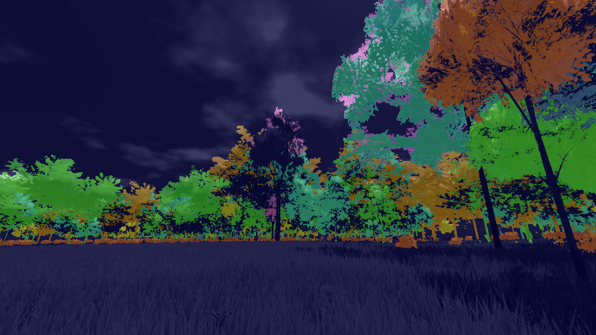
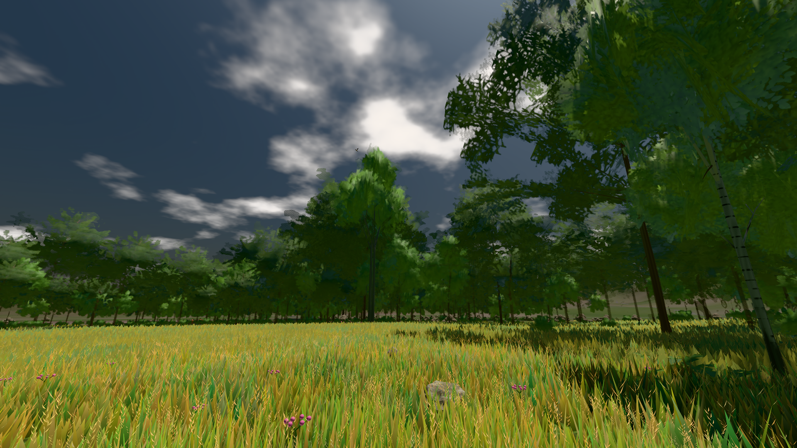
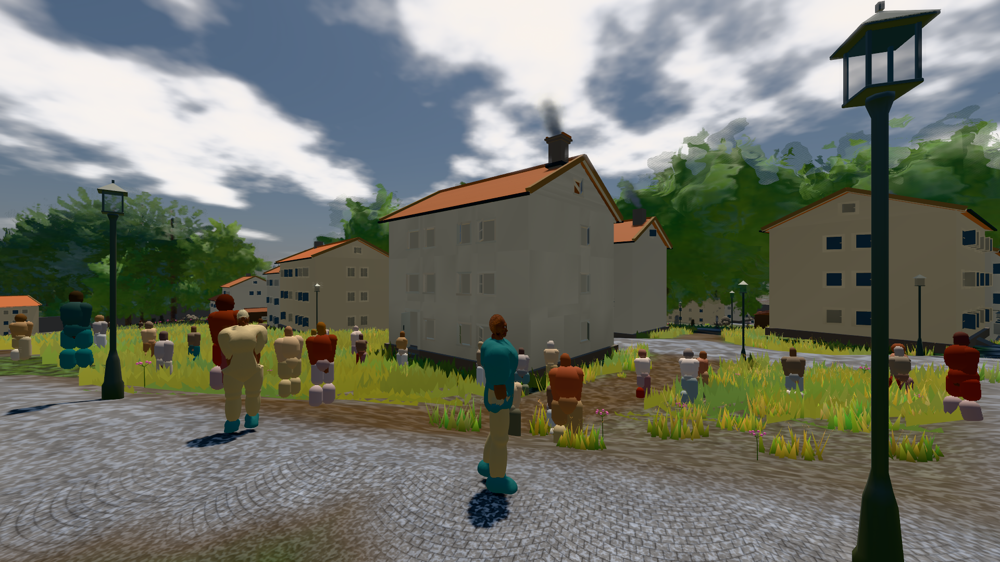
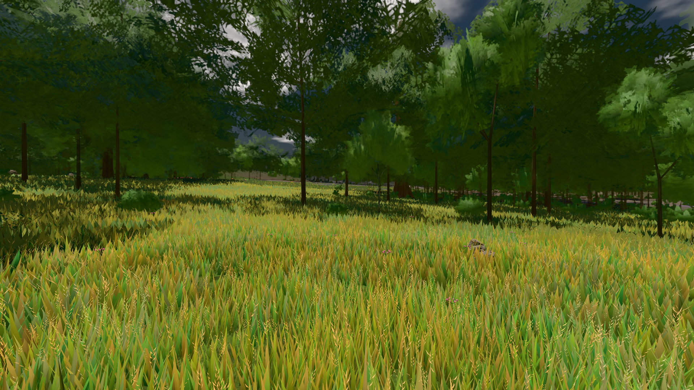

# GPU-PROBE 0cdb68d2 — ROT

Zweig `w28-laub-deckung` · Kopf 0cdb68d2ffcb628e3ec7bc4f7ea65d707c16d111 · Läufer radeon-890m · 12.11. 07:05 · Wanduhr ab Push 499 s · Lauf https://github.com/MiguellD/AnazhRealm/actions/runs/43164749565

Ruf: `gate:laub-kante bild:stadt-voll@0.5 bild:wiese@0.5`

## Läufer radeon-890m — ROT

GPU AMD Radeon(TM) 890M Graphics · npm ci 49 s (package-lock db0dbb29)
Schloss /c/Users/micha/AppData/Local/Temp/claude/gpu-schloss hält „ci-runner 43164749565/1 probe“
- Hook 2026-11-12 06:57:21 start ci-runner 43164749565/1 probe: Schloss genommen (refs/heads/w28-laub-deckung 0cdb68d2ffcb628e3ec7bc4f7ea65d707c16d111 ws=C:\actions-runner\_work\AnazhRealm\AnazhRealm)

### gate:laub-kante — ROT · 137 s · Läufer radeon-890m

Adapter: ungenannt (die Probe nannte keinen Browser-Adapter) · werkbank.cjs ABSTURZ: Error: Tafel-Pose: /bild ohne Klasse: ABNAHME ROT [Ziel tanne nicht gezeichnet: tanne fehlt (keine Gestalt binnen 1.5 m)] · beweis · Sicht 0.0 % · Ziel tanne im Bild frei 16.81 m · Luma 77.3 σ 44.2  — keine Station beim Namen

```text
werkbank.cjs ABSTURZ: Error: Tafel-Pose: /bild ohne Klasse: ABNAHME ROT [Ziel tanne nicht gezeichnet: tanne fehlt (keine Gestalt binnen 1.5 m)] · beweis · Sicht 0.0 % · Ziel tanne im Bild frei 16.81 m · Luma 77.3 σ 44.2 schwarz 0.0 % weiß 0.0 % · Stand 18.546.261 · Bühne summer sunny 0.50 Tiere gehalten · Gerät WebGPU amd rdna-3 · Blick-Wahl 42 Posen · ROT-Bild C:\actions-runner\_work\_temp\probe\tafel-rot.png at IncomingMessage.<anonymous> (C:\actions-runner\_work\AnazhRealm\gpu-probe\scripts\werkbank.cjs:2002:46)
```





### bild:stadt-voll@0.5 — GRÜN · 191 s · Läufer radeon-890m

Adapter: [linse-gpu] amd/rdna-3

```text
Kamera des Spiels → Blick (14.6 m): 837.84 58.51 445.42 842.31 58.51 459.32
 "abnahme": "ABNAHME GRÜN · bekannt stadt-voll.leib hält jetzt (der Eintrag fällt) · beweis · Sicht 1.6 % (Leib bewohner (≤ 7.3 m) 1.6 %) · Ziel Blickziel im Bild frei 14.6 m, verdeckt nur von Leibern: 1 Punkt, nächster 3.72 m (Leib bewohner) · Luma 114 σ 57.2 schwarz 0.0 % weiß 0.0 % · Stand 18.546.261 · Bühne summer sunny 0.50 Tiere gehalten · Gerät WebGPU amd rdna-3 · Inhalt bauSatz 19.6 % (≥ 2.0 %) Luma 78, bewohner 1.7 % (≥ 1.0 %) Luma 77",
```



### bild:wiese@0.5 — GRÜN · 56 s · Läufer radeon-890m

Adapter: [linse-gpu] amd/rdna-3

```text
Kamera des Spiels → Blick (10.0 m): -280.40 29.71 -1045.60 -289.61 29.71 -1049.50
 "abnahme": "ABNAHME GRÜN · beweis · Sicht 0.0 % · Ziel Blickziel im Bild frei 10 m · Luma 81.5 σ 43.3 schwarz 0.0 % weiß 0.0 % · Stand 18.546.261 · Bühne summer sunny 0.50 Tiere gehalten · Gerät WebGPU amd rdna-3 · Inhalt nahWiese 47.9 % (≥ 15.0 %) h 106° Luma 121",
```


