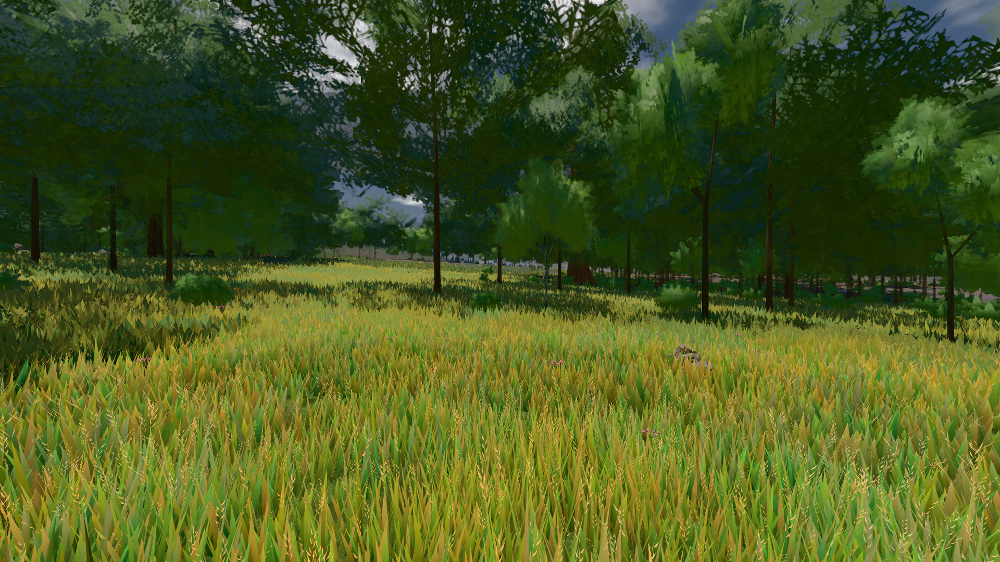
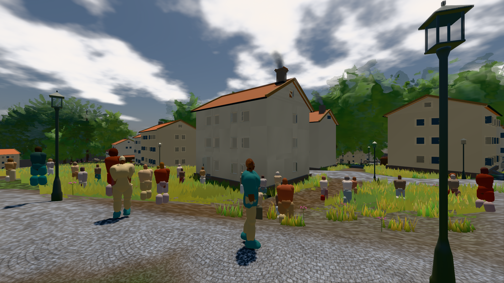

# GPU-PROBE 17ef8b76 — GRÜN

Zweig `w28-laub-deckung` · Kopf 17ef8b76d8136e8a97c08625d985ef888558c1d0 · Läufer gtx1050-desktop · 12.11. 09:21 · Wanduhr ab Push 2526 s · Lauf https://github.com/MiguellD/AnazhRealm/actions/runs/43176835110

Ruf: `bild:wiese@0.5 bild:stadt-voll@0.5`

## Läufer gtx1050-desktop — GRÜN

GPU NVIDIA GeForce GTX 1050 · node_modules bleiben (package-lock db0dbb29)
Schloss /c/Users/User/AppData/Local/Temp/claude/gpu-schloss hält „ci-runner 43176835110/2 probe“
- Hook 2026-11-12 09:14:16 start ci-runner 43176835110/2 probe: wartet auf Schloss von 'hand bild main (Claude)'
- Hook 2026-11-12 09:14:47 start ci-runner 43176835110/2 probe: Schloss genommen (refs/heads/w28-laub-deckung 17ef8b76d8136e8a97c08625d985ef888558c1d0 ws=C:\actions-runner\_work\AnazhRealm\AnazhRealm)

### bild:wiese@0.5 — GRÜN · 86 s · Läufer gtx1050-desktop

Adapter: [linse-gpu] nvidia/pascal

```text
Kamera des Spiels → Blick (10.0 m): -280.40 29.71 -1045.60 -289.61 29.71 -1049.50
 "abnahme": "ABNAHME GRÜN · beweis · Sicht 0.0 % · Ziel Blickziel im Bild frei 10 m · Luma 82.3 σ 42.7 schwarz 0.0 % weiß 0.0 % · Stand 18.546.261 · Bühne summer sunny 0.50 Tiere gehalten · Gerät WebGPU nvidia pascal · Inhalt nahWiese 48.1 % (≥ 15.0 %) h 107° Luma 120",
```



### bild:stadt-voll@0.5 — GRÜN · 270 s · Läufer gtx1050-desktop

Adapter: [linse-gpu] nvidia/pascal

```text
Kamera des Spiels → Blick (14.6 m): 837.84 58.51 445.42 842.31 58.51 459.32
 "abnahme": "ABNAHME GRÜN · bekannt stadt-voll.leib hält jetzt (der Eintrag fällt) · beweis · Sicht 1.6 % (Leib bewohner (≤ 7.3 m) 1.6 %) · Ziel Blickziel im Bild frei 14.6 m, verdeckt nur von Leibern: 1 Punkt, nächster 3.7 m (Leib bewohner) · Luma 114.2 σ 57.1 schwarz 0.0 % weiß 0.0 % · Stand 18.546.261 · Bühne summer sunny 0.50 Tiere gehalten · Gerät WebGPU nvidia pascal · Inhalt bauSatz 19.6 % (≥ 2.0 %) Luma 79, bewohner 1.7 % (≥ 1.0 %) Luma 77",
```


