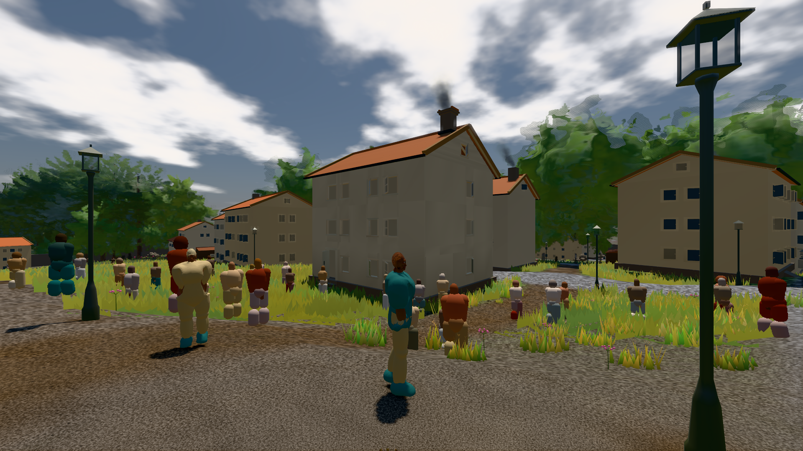
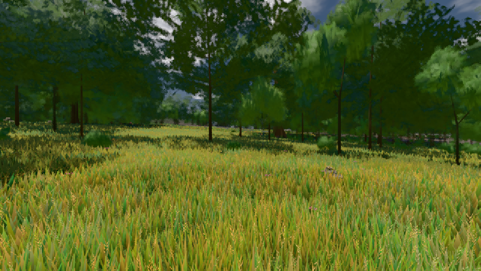

# GPU-PROBE 5ef5539f — GRÜN

Zweig `w28-laub-deckung` · Kopf 5ef5539f151d93af6b3bf34feaf74cec6d080f50 · Läufer gtx1050-desktop · 12.11. 05:38 · Wanduhr ab Push 1000 s · Lauf https://github.com/MiguellD/AnazhRealm/actions/runs/43154302883

Ruf: `gate:laub-kante bild:stadt-voll@0.5 bild:wiese@0.5`

## Läufer gtx1050-desktop — GRÜN

GPU NVIDIA GeForce GTX 1050 · node_modules bleiben (package-lock 657462dc)
Schloss /c/Users/User/AppData/Local/Temp/claude/gpu-schloss hält „ci-runner 43154302883/1 probe“
- Hook 2026-11-12 05:22:22 start ci-runner 43154302883/1 probe: wartet auf Schloss von 'hand lauf linse-kopf (Claude)'
- Hook 2026-11-12 05:23:07 start ci-runner 43154302883/1 probe: Schloss genommen (refs/heads/w28-laub-deckung 5ef5539f151d93af6b3bf34feaf74cec6d080f50 ws=C:\actions-runner\_work\AnazhRealm\AnazhRealm)

### gate:laub-kante — GRÜN · 295 s · Läufer gtx1050-desktop

Adapter: ungenannt (die Probe nannte keinen Browser-Adapter)

```text
lod.K1#1 Tafel-Pose ROT [["f:birke:L0",0.1958,140199,0,0,0],["f:birke:L1",0.2102,80828,0,0,0],["f:fichte:L0",0.1447,15925,0,0.0001,1],["f:fichte:L1",0.184,136927,0,0,0],["f:tanne:L1",0.2112,16723,0,0,0],["fimp:birke:L2",0.1852,12740,0,0,0],["fimp:buche:L2",0.2318,6387,0,0.0005,3],["fimp:eiche:L2",0.1781,59805,0,0,0],["fimp:fichte:L2",0.1893,99124,0,0.0001,2],["fimp:strauch:L2",0.3468,21896,0.0016,0,0],["fimp:tanne:L2",0.189,141215,0,0.0003,11]]
lod.K1#1 Spielgang ROT [["f:birke:L1",0.176,125406,0,0,0],["f:fichte:L1",0.1775,152628,0,0,1],["f:tanne:L1",0.1828,8207,0,0,0],["fimp:birke:L2",0.206,22930,0,0,0],["fimp:buche:L2",0.2026,6884,0,0.0006,2],["fimp:eiche:L2",0.1678,58582,0,0,0],["fimp:fichte:L2",0.1848,100134,0,0.0005,6],["fimp:strauch:L2",0.2998,26898,0,0,0],["fimp:tanne:L2",0.1868,132554,0,0.0002,3]]
ABNAHME GRÜN · beweis · Sicht 0.0 % · Ziel Blickziel im Bild frei 12 m · Luma 91.8 σ 45.3 schwarz 0.0 % weiß 0.0 % · Stand 18.546.259 · Bühne summer sunny 0.50 Tiere gehalten · Gerät WebGPU nvidia pascal
```

### bild:stadt-voll@0.5 — GRÜN · 394 s · Läufer gtx1050-desktop

Adapter: [linse-gpu] nvidia/pascal

```text
Kamera des Spiels → Blick (14.6 m): 837.84 58.51 445.42 842.31 58.51 459.32
 "abnahme": "ABNAHME GRÜN · beweis · Sicht 0.0 % · Ziel Blickziel im Bild frei 14.6 m, verdeckt nur von Leibern: 1 Punkt, nächster 3.72 m (Leib bewohner) · Luma 106 σ 59.4 schwarz 0.1 % weiß 0.0 % · Stand 18.546.259 · Bühne summer sunny 0.50 · Gerät WebGPU nvidia pascal",
```



### bild:wiese@0.5 — GRÜN · 110 s · Läufer gtx1050-desktop

Adapter: [linse-gpu] nvidia/pascal

```text
Kamera des Spiels → Blick (10.0 m): -280.40 29.71 -1045.60 -289.61 29.71 -1049.50
 "abnahme": "ABNAHME GRÜN · beweis · Sicht 0.0 % · Ziel Blickziel im Bild frei 10 m · Luma 84.1 σ 40.4 schwarz 0.0 % weiß 0.0 % · Stand 18.546.259 · Bühne summer sunny 0.50 · Gerät WebGPU nvidia pascal",
```


