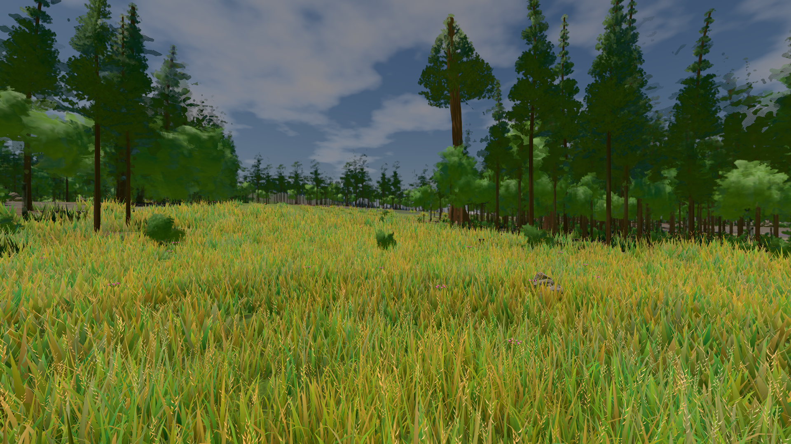

# GPU-PROBE 80471c53 — GRÜN

Zweig `w28-laub-kante-2` · Kopf 80471c5335e343eaea236e251b0a6bfc94dc0498 · Läufer gtx1050-desktop · 19.11. 16:28 · Wanduhr ab Push 135 s · Lauf https://github.com/MiguellD/AnazhRealm/actions/runs/44554750969

Ruf: `bild:wiese@0.5`

## Läufer gtx1050-desktop — GRÜN

GPU NVIDIA GeForce GTX 1050 · node_modules bleiben (package-lock b38d03a8)
Schloss /c/Users/User/AppData/Local/Temp/claude/gpu-schloss hält „ci-runner 44554750969/1 probe“
- Hook 2026-11-19 16:26:27 start ci-runner 44554750969/1 probe: Schloss genommen (refs/heads/w28-laub-kante-2 80471c5335e343eaea236e251b0a6bfc94dc0498 ws=C:\actions-runner\_work\AnazhRealm\AnazhRealm)

### bild:wiese@0.5 — GRÜN · 90 s · Läufer gtx1050-desktop

Adapter: [linse-gpu] nvidia/pascal

```text
Kamera des Spiels → Blick (10.0 m): -280.40 29.71 -1045.60 -289.61 29.71 -1049.50
 "abnahme": "ABNAHME GRÜN · beweis · Sicht 0.0 % · Ziel Blickziel im Bild frei 10 m · Luma 97.4 σ 36.4 schwarz 0.0 % weiß 0.0 % · Stand 18.546.343 · Bühne summer sunny 0.50 Tiere gehalten · Gerät WebGPU nvidia pascal · Inhalt nahWiese 48.4 % (≥ 15.0 %) h 107° Luma 123",
```


