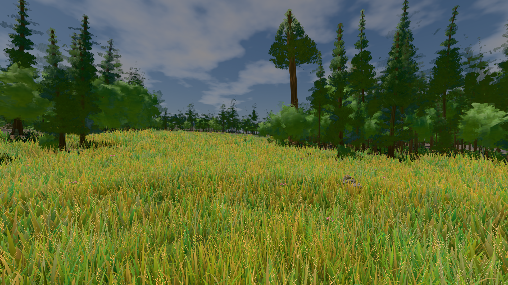
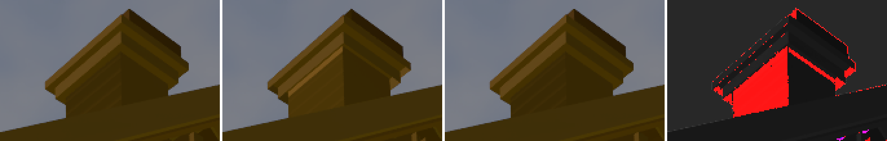

# GPU-PROBE 6caef93d — ROT

Zweig `w28-laub-kante-4` · Kopf 6caef93d394477b66b33e1dd92898a8a60729b9a · Läufer gtx1050-desktop · 20.11. 13:28 · Wanduhr ab Push 1086 s · Lauf https://github.com/MiguellD/AnazhRealm/actions/runs/44733607882

Ruf: `bild:wiese@0.5 gate:pruefbuehne-licht gate:weltbild-frost:echt`

## Läufer gtx1050-desktop — ROT

GPU NVIDIA GeForce GTX 1050 · npm ci 48 s (package-lock 983fa64e)
Schloss /c/Users/User/AppData/Local/Temp/claude/gpu-schloss hält „ci-runner 44733607882/1 probe“
- Hook 2026-11-20 13:11:16 start ci-runner 44733607882/1 probe: wartet auf Schloss von 'hand stufe-b1 (Claude)'
- Hook 2026-11-20 13:15:18 start ci-runner 44733607882/1 probe: Schloss genommen (refs/heads/w28-laub-kante-4 6caef93d394477b66b33e1dd92898a8a60729b9a ws=C:\actions-runner\_work\AnazhRealm\AnazhRealm)

### bild:wiese@0.5 — GRÜN · 89 s · Läufer gtx1050-desktop

Adapter: [linse-gpu] nvidia/pascal

```text
Kamera des Spiels → Blick (10.0 m): -280.40 29.71 -1045.60 -289.61 29.71 -1049.50
 "abnahme": "ABNAHME GRÜN · beweis · Sicht 0.0 % · Ziel Blickziel im Bild frei 10 m · Luma 99.4 σ 35.4 schwarz 0.0 % weiß 0.0 % · Stand 18.546.347 · Bühne summer sunny 0.50 Tiere gehalten · Gerät WebGPU nvidia pascal · Inhalt nahWiese 48.4 % (≥ 15.0 %) h 107° Luma 123",
```



### gate:pruefbuehne-licht — GRÜN · 98 s · Läufer gtx1050-desktop

Adapter: [linse-gpu] nvidia/pascal

```text
  S0 BODEN-PROGRAMM 1/1: 101568 Zeichen WGSL (Ratsche ≤ 104162) · Pipeline asynchron → GRÜN · kalt 1771 · 1792 · 1973 · 1808 · 1749 · 2359 · 1812 · 1819 · 1802 ms, Median 1808 ms · ÷ K17 derselben Sitzung 0,72 (Auskunft, kein Zeit-Urteil)
✅ S0 BILD GRÜN: die Feuerstelle trägt den Feuerkreis aus 2 m in der Ausgabe · Nacht {"luma":22.4,"schwarz":0} (71 s, nvidia/pascal · Holz kienspan)
```

### gate:weltbild-frost:echt — ROT · 533 s · Läufer gtx1050-desktop

Adapter: [linse-gpu] nvidia/pascal · Exit 2 ohne ROTE Zeile: at <anonymous> (:358:18)

```text
diag-weltbild-frost.cjs ABSTURZ: Error: DER BAU STEHT NICHT: das erste Weltbild nach 1641 Takten — die Welt hat nichts mehr offen
```


