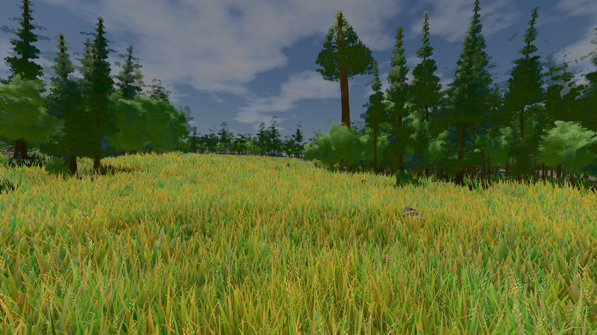

# GPU-PROBE 1d28eb2b — ROT

Zweig `w28-laub-kante-5` · Kopf 1d28eb2bf7a1a858edc05117ef98325391609f25 · Läufer omen-gtx1060 · 20.11. 14:47 · Wanduhr ab Push 968 s · Lauf https://github.com/MiguellD/AnazhRealm/actions/runs/44745034895

Ruf: `bild:wiese@0.5 gate:pruefbuehne-licht gate:weltbild-frost:echt`

## Läufer omen-gtx1060 — ROT

GPU NVIDIA GeForce GTX 1060 · npm ci 34 s (package-lock 983fa64e)
Schloss /c/Users/micha/AppData/Local/Temp/claude/gpu-schloss hält „ci-runner 44745034895/1 probe“
- Hook 2026-11-20 14:33:54 start ci-runner 44745034895/1 probe: wartet auf Schloss von 'omen-samen-heil3-kt-3'
- Hook 2026-11-20 14:34:09 start ci-runner 44745034895/1 probe: Schloss genommen (refs/heads/w28-laub-kante-5 1d28eb2bf7a1a858edc05117ef98325391609f25 ws=C:\actions-runner\_work\AnazhRealm\AnazhRealm)

### bild:wiese@0.5 — GRÜN · 47 s · Läufer omen-gtx1060

Adapter: [linse-gpu] nvidia/pascal

```text
Kamera des Spiels → Blick (10.0 m): -280.40 29.71 -1045.60 -289.61 29.71 -1049.50
 "abnahme": "ABNAHME GRÜN · beweis · Sicht 0.0 % · Ziel Blickziel im Bild frei 10 m · Luma 99.4 σ 35.4 schwarz 0.0 % weiß 0.0 % · Stand 18.546.347 · Bühne summer sunny 0.50 Tiere gehalten · Gerät WebGPU nvidia pascal · Inhalt nahWiese 48.4 % (≥ 15.0 %) h 107° Luma 123",
```



### gate:pruefbuehne-licht — GRÜN · 49 s · Läufer omen-gtx1060

Adapter: [linse-gpu] nvidia/pascal

```text
  S0 BODEN-PROGRAMM 1/1: 101568 Zeichen WGSL (Ratsche ≤ 104162) · Pipeline asynchron → GRÜN · kalt 1137 · 1232 · 1053 · 1076 · 1227 · 1169 · 1046 · 1023 · 1207 ms, Median 1137 ms · ÷ K17 derselben Sitzung 0,75 (Auskunft, kein Zeit-Urteil)
✅ S0 BILD GRÜN: die Feuerstelle trägt den Feuerkreis aus 2 m in der Ausgabe · Nacht {"luma":22.3,"schwarz":0} (39 s, nvidia/pascal · Holz kienspan)
```

### gate:weltbild-frost:echt — ROT · 439 s · Läufer omen-gtx1060

Adapter: [linse-gpu] nvidia/pascal · Exit 2 ohne ROTE Zeile: at <anonymous> (:358:18)

```text
diag-weltbild-frost.cjs ABSTURZ: Error: DER BAU STEHT NICHT: das erste Weltbild nach 1380 Takten — die Welt hat nichts mehr offen
```
