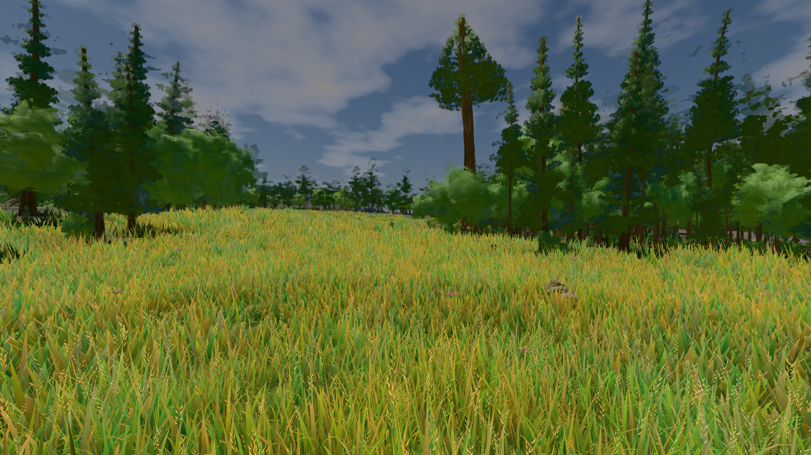

# GPU-PROBE a1055e31 — GRÜN

Zweig `w28-laub-kante-5` · Kopf a1055e31ec65e5d15d5ce1b6d65dda8c52c321fe · Läufer radeon-890m · 20.11. 10:03 · Wanduhr ab Push 553 s · Lauf https://github.com/MiguellD/AnazhRealm/actions/runs/44706193256

Ruf: `gate:post-kette bild:wiese@0.5`

## Läufer radeon-890m — GRÜN

GPU AMD Radeon(TM) 890M Graphics · npm ci 110 s (package-lock 983fa64e)
Schloss /c/Users/micha/AppData/Local/Temp/claude/gpu-schloss hält „ci-runner 44706193256/1 probe“
- Hook 2026-11-20 09:55:20 start ci-runner 44706193256/1 probe: wartet auf Schloss von 'taeter-z637-laub-kante-4 2026-11-20T09:52:55+01:00 pid=33200'
- Hook 2026-11-20 09:57:24 start ci-runner 44706193256/1 probe: Schloss genommen (refs/heads/w28-laub-kante-5 a1055e31ec65e5d15d5ce1b6d65dda8c52c321fe ws=C:\actions-runner\_work\AnazhRealm\AnazhRealm)

### gate:post-kette — GRÜN · 67 s · Läufer radeon-890m

Adapter: [linse-gpu] amd/rdna-3

```text
  ✅ Selbsttest „GPU-Validierung im Rauch" → rot: RAUCH: 1 GPU-Validierungs-Fehler: Binding size mismatch
  ✅ Selbsttest „Rauch-Probe bricht ab" → rot: RAUCH: ABBRUCH — TypeError: r._rauchZeichnen is not a function
  ✅ Selbsttest „Rauch-Probe fehlt" → rot: RAUCH: die Probe lief nicht
  ✅ Selbsttest „aus trägt die Farbsicht" → rot: ZUGANG: aus trägt den Knoten der Farbsicht (vp-0611g)
  ✅ Selbsttest „Tritanopie färbt den Himmel" → rot: ZUGANG: tritanopie färbt den Himmel {"himmel":9,"himmelPx":4700,"kiste":90,"kistePx":100}
  ✅ Selbsttest „Zugang blind" → rot: ZUGANG: blind {"himmel":["himmel"],"anTraegt":true,"tritanopie":{"himmel":0,"himmelPx":4700,"kiste":0,"kistePx":100}}
  ✅ Selbsttest „Zugang fehlt" → rot: ZUGANG: lief nicht
✅ SELBSTTEST GRÜN — jeder injizierte Täter fällt rot und wird beim Namen genannt.
  [17 s] Tor-Zielbild DUNKELROT (Wert [0.12,0.012,0.01], Belichtung 20000): Tag [94,8,2] (Farbton 3.9°, Sättigung 0.979) ↔ Nacht [93,8,2] (Farbton 4°, Sättigung 0.978) · Δ 1 je Kanal · MUTANTE-TOR ohne Umkehr [47,4,3] (Sättigung 0.936) · Δ 47
✅ GRÜN — fünf Wege durch die Weiche ohne Fehler (mit der Drift ohne r184s Abschied), der Direktpfad zeichnet mit Tiefe, die Post-Kette ohne Leinwand-Tiefe und ohne Rahmen-Ziel; die Ausgabe tastet unbedingt 9×, 9× nur hinter ihrer Stärke; die Godrays tragen mit der Sonne im Bild (73.57 % der Pixel gegen 0 % Rauschen), ihr Schacht lief 14× mit und 0× ohne Stärke; das Wasser liest das Tiefen-Abbild wie r184s Tiefe ([103.4,106.4,107.8] gegen [103.4,106.4,107.8], ohne Grund [0.9,25.4,33.7]); das Dunkel trägt (Luma 33 bei Belichtung 1, 33 bei 4, die Nacht 8); die Flamme steht vor dem Au
```

### bild:wiese@0.5 — GRÜN · 83 s · Läufer radeon-890m

Adapter: [linse-gpu] amd/rdna-3

```text
Kamera des Spiels → Blick (10.0 m): -280.40 29.71 -1045.60 -289.61 29.71 -1049.50
 "abnahme": "ABNAHME GRÜN · beweis · Sicht 0.0 % · Ziel Blickziel im Bild frei 10 m · Luma 99.3 σ 35.6 schwarz 0.0 % weiß 0.0 % · Stand 18.546.347 · Bühne summer sunny 0.50 Tiere gehalten · Gerät WebGPU amd rdna-3 · Inhalt nahWiese 48.4 % (≥ 15.0 %) h 107° Luma 123",
```


