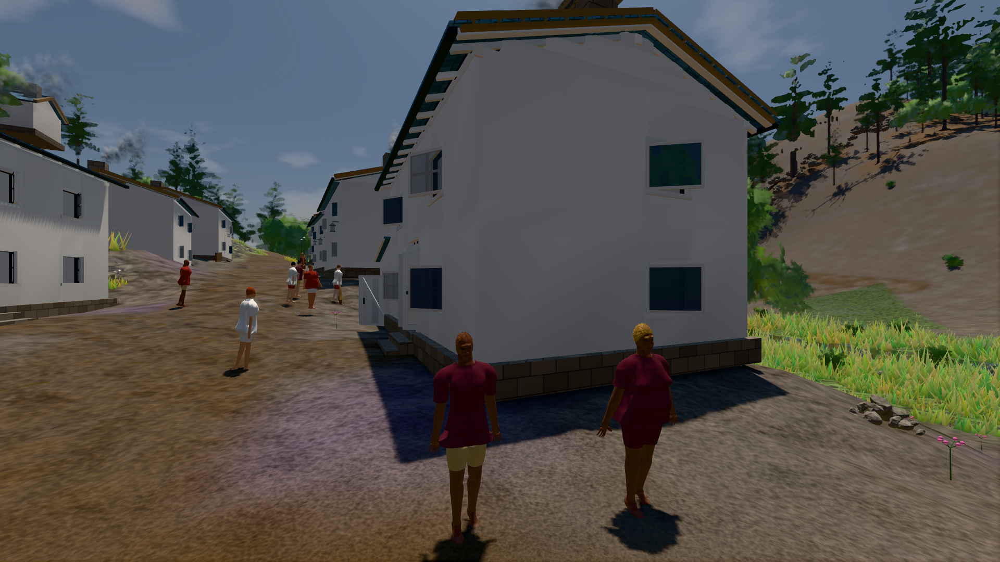

# GPU-PROBE 76d36e57 — GRÜN

Zweig `w28-laub-kante` · Kopf 76d36e57f34b6d78618346e9072b30c62b193dc5 · Läufer omen-gtx1060 · 19.11. 07:33 · Wanduhr ab Push 1862 s · Lauf https://github.com/MiguellD/AnazhRealm/actions/runs/44469285986

Ruf: `bild:dorf@0.5`

## Läufer omen-gtx1060 — GRÜN

GPU NVIDIA GeForce GTX 1060 · node_modules bleiben (package-lock 1a063c02)
Schloss /c/Users/micha/AppData/Local/Temp/claude/gpu-schloss hält „ci-runner 44469285986/2 probe“
- Hook 2026-11-19 07:31:41 start ci-runner 44469285986/2 probe: Schloss genommen (refs/heads/w28-laub-kante 76d36e57f34b6d78618346e9072b30c62b193dc5 ws=C:\actions-runner\_work\AnazhRealm\AnazhRealm)

### bild:dorf@0.5 — GRÜN · 84 s · Läufer omen-gtx1060

Adapter: [linse-gpu] nvidia/pascal

```text
Kamera des Spiels → Blick (5.2 m): -704.22 39.69 -880.02 -703.03 39.69 -874.96
 "abnahme": "ABNAHME GRÜN · beweis · Sicht 0.0 % · Ziel Blickziel im Bild frei 5.2 m · Luma 80.4 σ 30.2 schwarz 0.2 % weiß 0.0 % · Stand 18.546.342 · Bühne summer sunny 0.50 Tiere gehalten · Gerät WebGPU nvidia pascal · Inhalt bauSatz 28.7 % (≥ 2.0 %) Luma 79",
```


