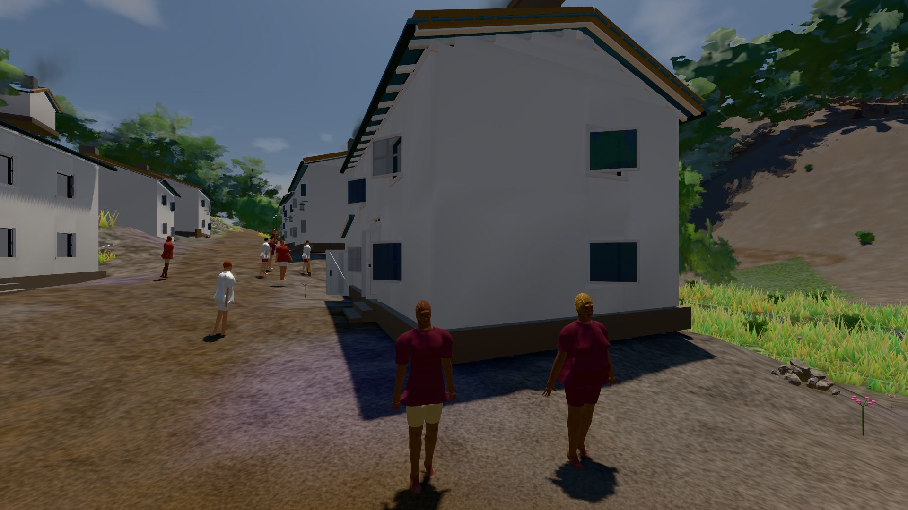
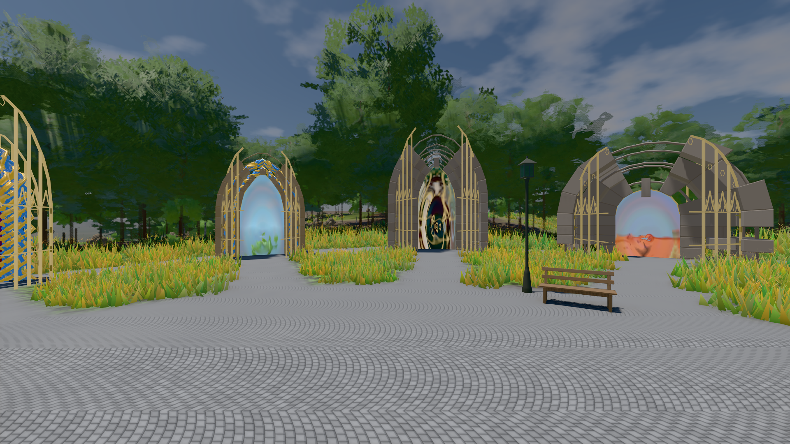

# GPU-PROBE 0e8efb0c — GRÜN

Zweig `w28-lava-kruste` · Kopf 0e8efb0c4b764bfca09ab1bcba0a8998daabac90 · Läufer radeon-890m · 17.11. 08:06 · Wanduhr ab Push 340 s · Lauf https://github.com/MiguellD/AnazhRealm/actions/runs/44035379981

Ruf: `bild:dorf@0.5 bild:genesis@0.5 gate:pruefbuehne-licht`

## Läufer radeon-890m — GRÜN

GPU AMD Radeon(TM) 890M Graphics · npm ci 55 s (package-lock b4630fa6)
Schloss /c/Users/micha/AppData/Local/Temp/claude/gpu-schloss hält „ci-runner 44035379981/1 probe“
- Hook 2026-11-17 08:00:47 start ci-runner 44035379981/1 probe: Schloss genommen (refs/heads/w28-lava-kruste 0e8efb0c4b764bfca09ab1bcba0a8998daabac90 ws=C:\actions-runner\_work\AnazhRealm\AnazhRealm)

### bild:dorf@0.5 — GRÜN · 66 s · Läufer radeon-890m

Adapter: [linse-gpu] amd/rdna-3

```text
Kamera des Spiels → Blick (5.2 m): -704.22 39.69 -880.02 -703.03 39.69 -874.96
 "abnahme": "ABNAHME GRÜN · beweis · Sicht 0.0 % · Ziel Blickziel im Bild frei 5.2 m · Luma 77.7 σ 30.9 schwarz 0.2 % weiß 0.0 % · Stand 18.546.318 · Bühne summer sunny 0.50 Tiere gehalten · Gerät WebGPU amd rdna-3 · Inhalt bauSatz 28.7 % (≥ 2.0 %) Luma 80",
```



### bild:genesis@0.5 — GRÜN · 47 s · Läufer radeon-890m

Adapter: [linse-gpu] amd/rdna-3

```text
Kamera des Spiels → Blick (10.0 m): 0.00 92.40 0.00 -10.00 92.40 0.00
 "abnahme": "ABNAHME GRÜN · beweis · Sicht 0.0 % · Ziel Blickziel im Bild frei 10 m · Luma 108.5 σ 38.5 schwarz 0.0 % weiß 0.0 % · Stand 18.546.318 · Bühne summer sunny 0.50 Tiere gehalten · Gerät WebGPU amd rdna-3 · Inhalt bodenSatz 36.4 % (≥ 15.0 %) Luma 140, portal-membran 2.7 % (≥ 0.3 %) Luma 140",
```



### gate:pruefbuehne-licht — GRÜN · 53 s · Läufer radeon-890m

Adapter: [linse-gpu] amd/rdna-3

```text
  S0 BODEN-PROGRAMM 1/1: 98747 Zeichen WGSL (Ratsche ≤ 100062) · Pipeline asynchron → GRÜN · kalt 696 · 725 · 692 · 734 · 725 · 708 · 660 · 655 · 682 ms, Median 696 ms · ÷ K17 derselben Sitzung 0,82 (Auskunft, kein Zeit-Urteil)
✅ S0 BILD GRÜN: die Feuerstelle trägt den Feuerkreis aus 2 m in der Ausgabe · Nacht {"luma":24.7,"schwarz":0} (27 s, amd/rdna-3 · Holz kienspan)
```
