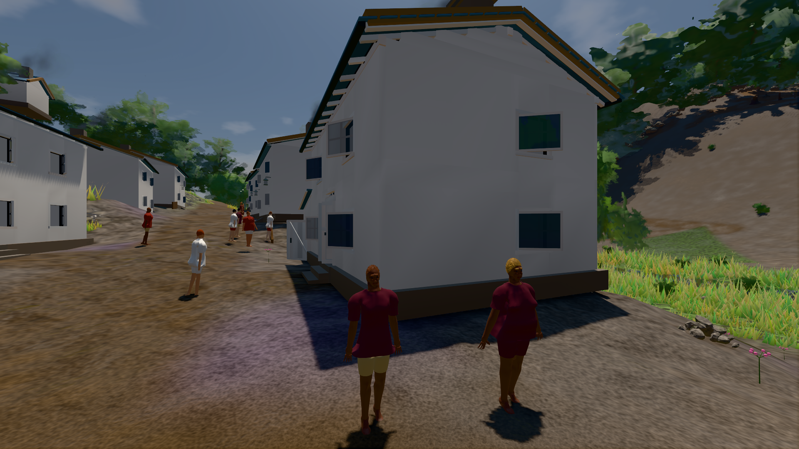
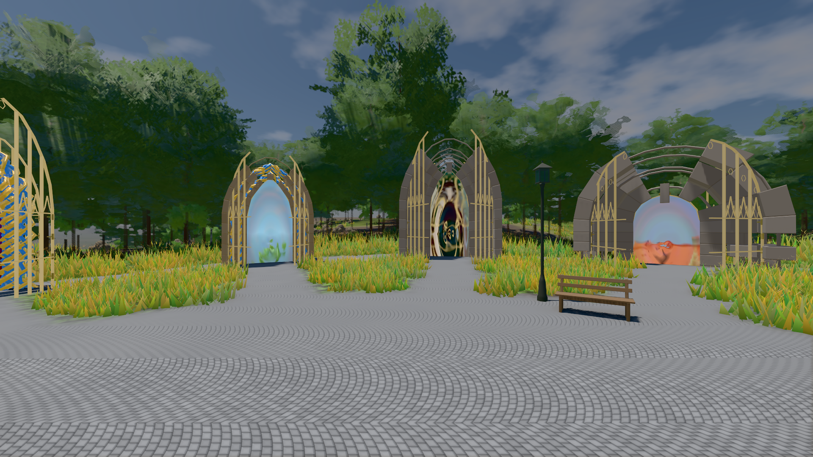

# GPU-PROBE a14a5edb — GRÜN

Zweig `w28-lava-kruste` · Kopf a14a5edbf42c2424b730c9e250aa681b53fc0bcf · Läufer gtx1050-desktop · 17.11. 07:31 · Wanduhr ab Push 504 s · Lauf https://github.com/MiguellD/AnazhRealm/actions/runs/44030786897

Ruf: `bild:dorf@0.5 bild:genesis@0.5 gate:pruefbuehne-licht`

## Läufer gtx1050-desktop — GRÜN

GPU NVIDIA GeForce GTX 1050 · npm ci 35 s (package-lock b4630fa6)
Schloss /c/Users/User/AppData/Local/Temp/claude/gpu-schloss hält „ci-runner 44030786897/1 probe“
- Hook 2026-11-17 07:23:13 start ci-runner 44030786897/1 probe: Schloss genommen (refs/heads/w28-lava-kruste a14a5edbf42c2424b730c9e250aa681b53fc0bcf ws=C:\actions-runner\_work\AnazhRealm\AnazhRealm)

### bild:dorf@0.5 — GRÜN · 153 s · Läufer gtx1050-desktop

Adapter: [linse-gpu] nvidia/pascal

```text
Kamera des Spiels → Blick (5.2 m): -704.22 39.69 -880.02 -703.03 39.69 -874.96
 "abnahme": "ABNAHME GRÜN · beweis · Sicht 0.0 % · Ziel Blickziel im Bild frei 5.2 m · Luma 77.6 σ 30.9 schwarz 0.2 % weiß 0.0 % · Stand 18.546.318 · Bühne summer sunny 0.50 Tiere gehalten · Gerät WebGPU nvidia pascal · Inhalt bauSatz 28.7 % (≥ 2.0 %) Luma 79",
```



### bild:genesis@0.5 — GRÜN · 76 s · Läufer gtx1050-desktop

Adapter: [linse-gpu] nvidia/pascal

```text
Kamera des Spiels → Blick (10.0 m): 0.00 92.40 0.00 -10.00 92.40 0.00
 "abnahme": "ABNAHME GRÜN · beweis · Sicht 0.0 % · Ziel Blickziel im Bild frei 10 m · Luma 108.5 σ 38.5 schwarz 0.0 % weiß 0.0 % · Stand 18.546.318 · Bühne summer sunny 0.50 Tiere gehalten · Gerät WebGPU nvidia pascal · Inhalt bodenSatz 36.4 % (≥ 15.0 %) Luma 140, portal-membran 2.7 % (≥ 0.3 %) Luma 140",
```



### gate:pruefbuehne-licht — GRÜN · 186 s · Läufer gtx1050-desktop

Adapter: [linse-gpu] nvidia/pascal

```text
  S0 BODEN-PROGRAMM 1/1: 98522 Zeichen WGSL (Ratsche ≤ 100062) · Pipeline asynchron → GRÜN · kalt 2066 · 2369 · 2088 · 2134 · 2341 · 2082 · 2088 · 2201 · 2275 ms, Median 2134 ms · ÷ K17 derselben Sitzung 0,77 (Auskunft, kein Zeit-Urteil)
✅ S0 BILD GRÜN: die Feuerstelle trägt den Feuerkreis aus 2 m in der Ausgabe · Nacht {"luma":24.6,"schwarz":0} (73 s, nvidia/pascal · Holz kienspan)
```
