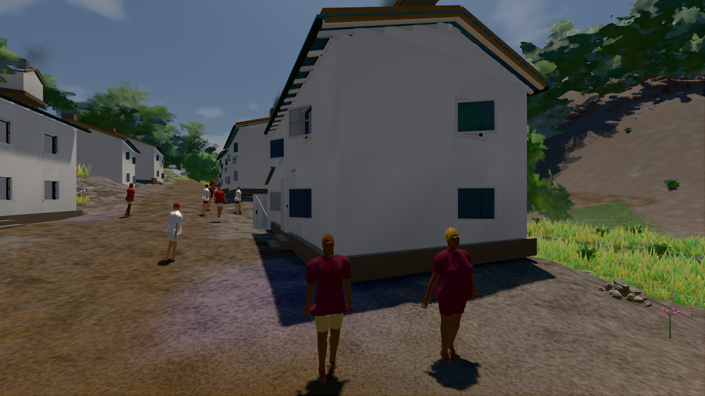
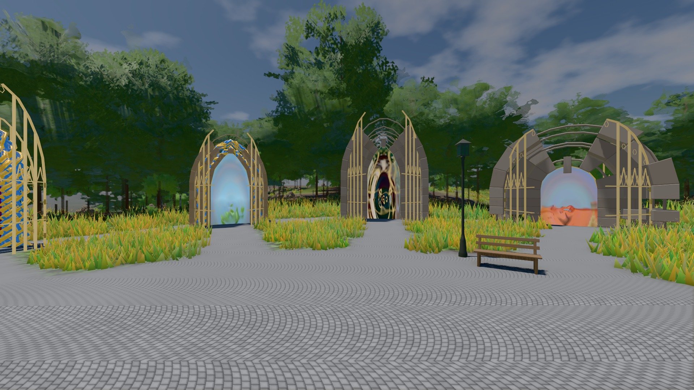

# GPU-PROBE fc948843 — GRÜN

Zweig `w28-lava-kruste` · Kopf fc9488436dfd5af1ea60393cfcdf2587610e0210 · Läufer gtx1050-desktop · 17.11. 01:31 · Wanduhr ab Push 294 s · Lauf https://github.com/MiguellD/AnazhRealm/actions/runs/43987624190

Ruf: `bild:dorf@0.5 bild:genesis@0.5`

## Läufer gtx1050-desktop — GRÜN

GPU NVIDIA GeForce GTX 1050 · node_modules bleiben (package-lock a24c6e37)
Schloss /c/Users/User/AppData/Local/Temp/claude/gpu-schloss hält „ci-runner 43987624190/1 probe“
- Hook 2026-11-17 01:26:40 start ci-runner 43987624190/1 probe: Schloss genommen (refs/heads/w28-lava-kruste fc9488436dfd5af1ea60393cfcdf2587610e0210 ws=C:\actions-runner\_work\AnazhRealm\AnazhRealm)

### bild:dorf@0.5 — GRÜN · 146 s · Läufer gtx1050-desktop

Adapter: [linse-gpu] nvidia/pascal

```text
Kamera des Spiels → Blick (5.2 m): -704.22 39.69 -880.02 -703.03 39.69 -874.96
 "abnahme": "ABNAHME GRÜN · beweis · Sicht 0.0 % · Ziel Blickziel im Bild frei 5.2 m · Luma 77.6 σ 30.9 schwarz 0.2 % weiß 0.0 % · Stand 18.546.313 · Bühne summer sunny 0.50 Tiere gehalten · Gerät WebGPU nvidia pascal · Inhalt bauSatz 28.7 % (≥ 2.0 %) Luma 79",
```



### bild:genesis@0.5 — GRÜN · 95 s · Läufer gtx1050-desktop

Adapter: [linse-gpu] nvidia/pascal

```text
Kamera des Spiels → Blick (10.0 m): 0.00 92.40 0.00 -10.00 92.40 0.00
 "abnahme": "ABNAHME GRÜN · beweis · Sicht 0.0 % · Ziel Blickziel im Bild frei 10 m · Luma 108.5 σ 38.5 schwarz 0.0 % weiß 0.0 % · Stand 18.546.313 · Bühne summer sunny 0.50 Tiere gehalten · Gerät WebGPU nvidia pascal · Inhalt bodenSatz 36.4 % (≥ 15.0 %) Luma 140, portal-membran 2.7 % (≥ 0.3 %) Luma 140",
```


