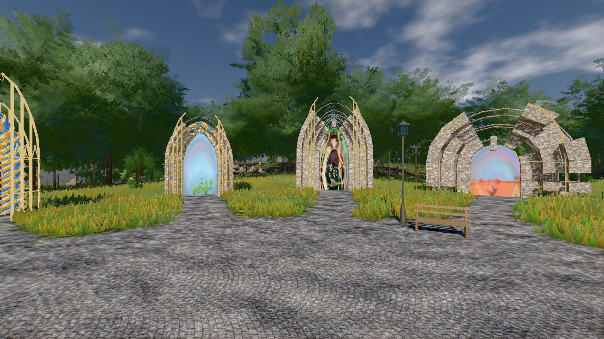
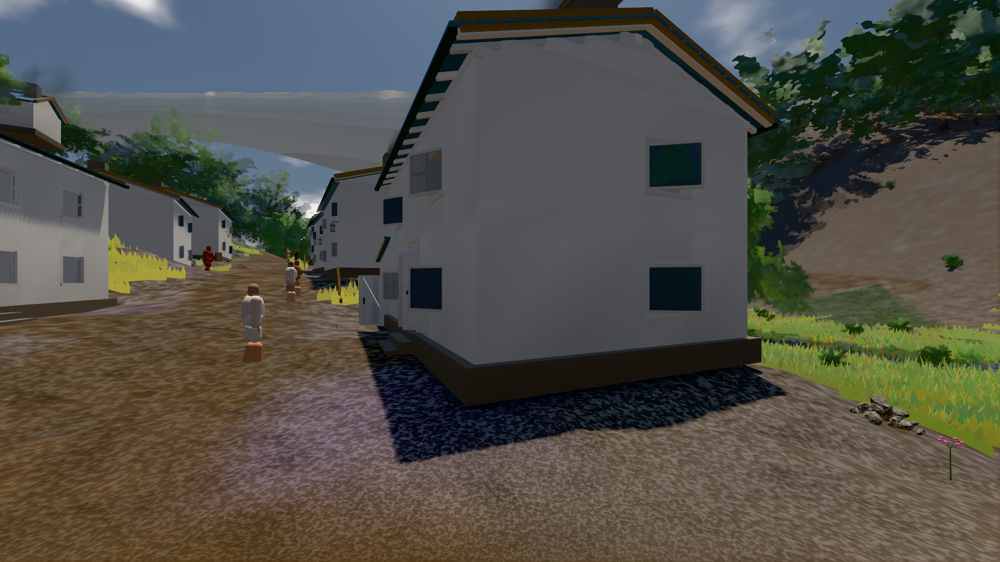

# GPU-PROBE 3087540f — GRÜN

Zweig `w28-leib-genom` · Kopf 3087540fe5c63d69579045714dc655e34902e994 · Läufer gtx1050-desktop · 13.11. 17:44 · Wanduhr ab Push 501 s · Lauf https://github.com/MiguellD/AnazhRealm/actions/runs/43464441759

Ruf: `bild:genesis@0.36 bild:dorf@0.5 gate:kamera-leib:echt`

## Läufer gtx1050-desktop — GRÜN

GPU NVIDIA GeForce GTX 1050 · npm ci 55 s (package-lock 3887454d)
Schloss /c/Users/User/AppData/Local/Temp/claude/gpu-schloss hält „ci-runner 43464441759/1 probe“
- Hook 2026-11-13 17:36:57 start ci-runner 43464441759/1 probe: Schloss genommen (refs/heads/w28-leib-genom 3087540fe5c63d69579045714dc655e34902e994 ws=C:\actions-runner\_work\AnazhRealm\AnazhRealm)

### bild:genesis@0.36 — GRÜN · 72 s · Läufer gtx1050-desktop

Adapter: [linse-gpu] nvidia/pascal

```text
Kamera des Spiels → Blick (10.0 m): 0.00 92.40 0.00 -10.00 92.40 0.00
 "abnahme": "ABNAHME GRÜN · beweis · Sicht 0.0 % · Ziel Blickziel im Bild frei 10 m · Luma 106.9 σ 38.2 schwarz 0.0 % weiß 0.0 % · Stand 18.546.273 · Bühne summer sunny 0.36 Tiere gehalten · Gerät WebGPU nvidia pascal · Inhalt bodenSatz 35.4 % (≥ 15.0 %) Luma 121, portal-membran 2.8 % (≥ 0.3 %) Luma 169",
```



### bild:dorf@0.5 — GRÜN · 153 s · Läufer gtx1050-desktop

Adapter: [linse-gpu] nvidia/pascal

```text
Kamera des Spiels → Blick (5.2 m): -704.22 39.69 -880.02 -703.03 39.69 -874.96
 "abnahme": "ABNAHME GRÜN · beweis · Sicht 0.0 % · Ziel Blickziel im Bild frei 5.2 m · Luma 78.9 σ 30.6 schwarz 0.3 % weiß 0.0 % · Stand 18.546.273 · Bühne summer sunny 0.50 Tiere gehalten · Gerät WebGPU nvidia pascal · Inhalt bauSatz 29.9 % (≥ 2.0 %) Luma 78",
```



### gate:kamera-leib:echt — GRÜN · 148 s · Läufer gtx1050-desktop

Adapter: [linse-gpu] nvidia/pascal

```text
  ✅ K6 Strafe am Prüfplatz — A0 Kopf 1.9 % Leib 1.6 % (2416 px),A1 Kopf 0.0 % Leib 0.8 % (2430 px),A2 Kopf 0.0 % Leib 1.8 % (2513 px),A3 Kopf 0.0 % Leib 0.8 % (2563 px),D0 Kopf 0.0 % Leib 2.0 % (2443 px),D1 Kopf 0.0 % Leib 0.6 % (2427 px),D2 Kopf 0.0 % Leib 1.2 % (2513 px),D3 Kopf 0.0 % Leib 0.7 % (2578 px) · Rückstrahl 0.1 %
✅ GRÜN — die Kamera steckt nie in Laub, Strauch, Fels oder Boden.
```
