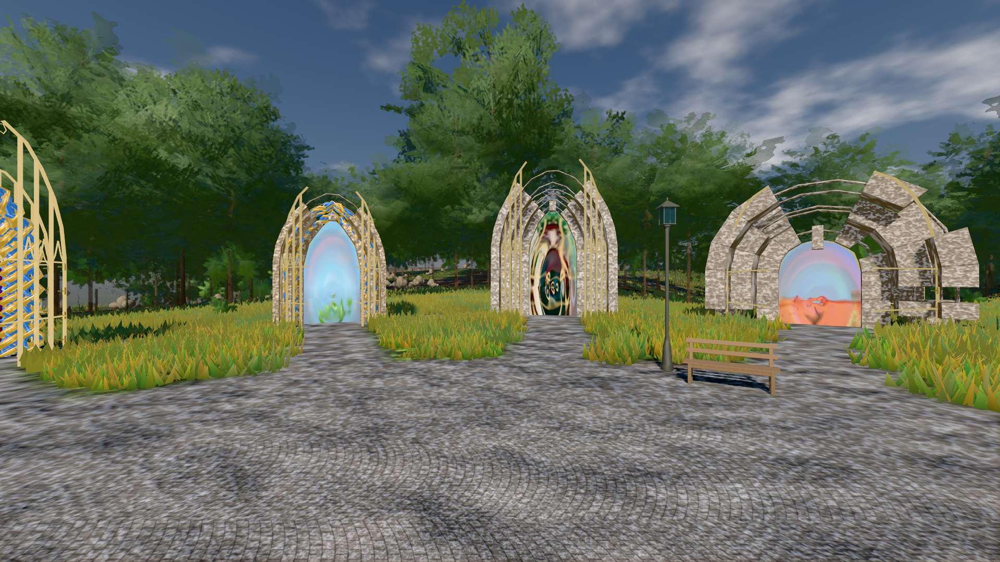

# GPU-PROBE 49175b32 — GRÜN

Zweig `w28-leib-kanon` · Kopf 49175b32f70a5225c2909a1c4f466c725db314b3 · Läufer gtx1050-desktop · 13.11. 04:01 · Wanduhr ab Push 318 s · Lauf https://github.com/MiguellD/AnazhRealm/actions/runs/43355534303

Ruf: `bild:genesis@0.36 gate:kamera-leib:echt`

## Läufer gtx1050-desktop — GRÜN

GPU NVIDIA GeForce GTX 1050 · npm ci 60 s (package-lock 2ab17da4)
Schloss /c/Users/User/AppData/Local/Temp/claude/gpu-schloss hält „ci-runner 43355534303/1 probe“
- Hook 2026-11-13 03:56:24 start ci-runner 43355534303/1 probe: Schloss genommen (refs/heads/w28-leib-kanon 49175b32f70a5225c2909a1c4f466c725db314b3 ws=C:\actions-runner\_work\AnazhRealm\AnazhRealm)

### bild:genesis@0.36 — GRÜN · 73 s · Läufer gtx1050-desktop

Adapter: [linse-gpu] nvidia/pascal

```text
Kamera des Spiels → Blick (10.0 m): 0.00 92.40 0.00 -10.00 92.40 0.00
 "abnahme": "ABNAHME GRÜN · beweis · Sicht 0.0 % · Ziel Blickziel im Bild frei 10 m · Luma 106.9 σ 38.2 schwarz 0.0 % weiß 0.0 % · Stand 18.546.268 · Bühne summer sunny 0.36 Tiere gehalten · Gerät WebGPU nvidia pascal · Inhalt bodenSatz 35.4 % (≥ 15.0 %) Luma 121, portal-membran 2.8 % (≥ 0.3 %) Luma 169",
```



### gate:kamera-leib:echt — GRÜN · 139 s · Läufer gtx1050-desktop

Adapter: [linse-gpu] nvidia/pascal

```text
  ✅ K6 Strafe am Prüfplatz — A0 Kopf 1.0 % Leib 1.3 % (2396 px),A1 Kopf 0.0 % Leib 0.7 % (2413 px),A2 Kopf 0.0 % Leib 1.7 % (2519 px),A3 Kopf 1.2 % Leib 0.7 % (2566 px),D0 Kopf 0.0 % Leib 2.0 % (2439 px),D1 Kopf 0.0 % Leib 0.7 % (2437 px),D2 Kopf 1.2 % Leib 1.4 % (2511 px),D3 Kopf 1.0 % Leib 0.8 % (2561 px) · Rückstrahl 0.1 %
✅ GRÜN — die Kamera steckt nie in Laub, Strauch, Fels oder Boden.
```
