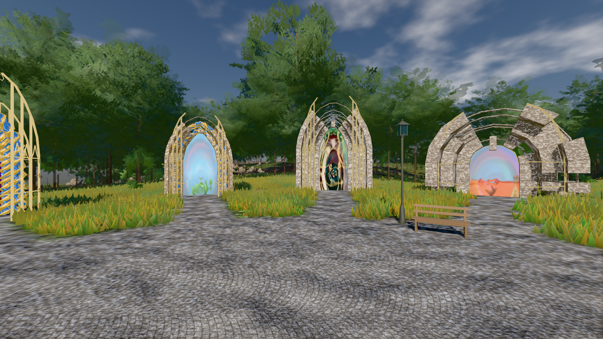

# GPU-PROBE 8f95537e — GRÜN

Zweig `w28-leib-kanon` · Kopf 8f95537e85732179d3d865d8b757f1d2585a9d4e · Läufer gtx1050-desktop · 13.11. 12:09 · Wanduhr ab Push 835 s · Lauf https://github.com/MiguellD/AnazhRealm/actions/runs/43412908665

Ruf: `bild:genesis@0.36 gate:kamera-leib:echt gate:tier-gang`

## Läufer gtx1050-desktop — GRÜN

GPU NVIDIA GeForce GTX 1050 · node_modules bleiben (package-lock 2ab17da4)
Schloss /c/Users/User/AppData/Local/Temp/claude/gpu-schloss hält „ci-runner 43412908665/1 probe“
- Hook 2026-11-13 12:01:54 start ci-runner 43412908665/1 probe: Schloss genommen (refs/heads/w28-leib-kanon 8f95537e85732179d3d865d8b757f1d2585a9d4e ws=C:\actions-runner\_work\AnazhRealm\AnazhRealm)

### bild:genesis@0.36 — GRÜN · 85 s · Läufer gtx1050-desktop

Adapter: [linse-gpu] nvidia/pascal

```text
Kamera des Spiels → Blick (10.0 m): 0.00 92.40 0.00 -10.00 92.40 0.00
 "abnahme": "ABNAHME GRÜN · beweis · Sicht 0.0 % · Ziel Blickziel im Bild frei 10 m · Luma 106.9 σ 38.2 schwarz 0.0 % weiß 0.0 % · Stand 18.546.268 · Bühne summer sunny 0.36 Tiere gehalten · Gerät WebGPU nvidia pascal · Inhalt bodenSatz 35.4 % (≥ 15.0 %) Luma 121, portal-membran 2.8 % (≥ 0.3 %) Luma 169",
```



### gate:kamera-leib:echt — GRÜN · 138 s · Läufer gtx1050-desktop

Adapter: [linse-gpu] nvidia/pascal

```text
  ✅ K6 Strafe am Prüfplatz — A0 Kopf 2.1 % Leib 1.3 % (2390 px),A1 Kopf 0.0 % Leib 0.7 % (2415 px),A2 Kopf 1.2 % Leib 1.7 % (2531 px),A3 Kopf 0.0 % Leib 0.6 % (2564 px),D0 Kopf 0.0 % Leib 2.0 % (2443 px),D1 Kopf 0.0 % Leib 0.8 % (2435 px),D2 Kopf 0.0 % Leib 1.3 % (2510 px),D3 Kopf 0.0 % Leib 0.8 % (2569 px) · Rückstrahl 0.1 %
✅ GRÜN — die Kamera steckt nie in Laub, Strauch, Fels oder Boden.
```

### gate:tier-gang — GRÜN · 154 s · Läufer gtx1050-desktop

Adapter: [linse-gpu] nvidia/pascal

```text
  ✅ Gangart Labor fox v̂ 3.5 · galopp [0 0.15 0.6 0.45] · Tastgrad 0.29 · Welt − Labor 0.01 Zyklus · Satz − Labor 0.02 Zyklus
  ✅ Gangart Labor bear v̂ 0.3 · schritt-lateral [0 0.5 0.25 0.75] · Tastgrad 0.64 · Welt − Labor 0.00 Zyklus · Satz − Labor 0.00 Zyklus
  ✅ Gangart Labor bear v̂ 0.74 · schritt-lateral [0 0.5 0.25 0.75] · Tastgrad 0.65 · Welt − Labor 0.01 Zyklus · Satz − Labor 0.00 Zyklus
  ✅ Gangart Labor bear v̂ 1.2 · trab [0 0.5 0.5 0] · Tastgrad 0.49 · Welt − Labor 0.00 Zyklus · Satz − Labor 0.01 Zyklus
  ✅ Gangart Labor bear v̂ 3.5 · galopp [0 0.15 0.59 0.44] · Tastgrad 0.27 · Welt − Labor 0.05 Zyklus · Satz − Labor 0.02 Zyklus
  ✅ Gangart Labor deer v̂ 0.3 · schritt-lateral [0 0.5 0.25 0.75] · Tastgrad 0.64 · Welt − Labor 0.01 Zyklus · Satz − Labor 0.00 Zyklus
  ✅ Gangart Labor deer v̂ 0.74 · schritt-lateral [0 0.5 0.25 0.75] · Tastgrad 0.66 · Welt − Labor 0.00 Zyklus · Satz − Labor 0.00 Zyklus
  ✅ Gangart Labor deer v̂ 1.2 · trab [0 0.49 0.49 0.99] · Tastgrad 0.49 · Welt − Labor 0.01 Zyklus · Satz − Labor 0.02 Zyklus
  ✅ Gangart Labor deer v̂ 3.5 · galopp [0 0.15 0.6 0.45] · Tastgrad 0.28 · Welt − Labor 0.00 Zyklus · Satz − Labor 0.01 Zyklus
✅ GRÜN — jede Gattung setzt ihre Pfoten (Schlupf ≤ 0.05) in Schritt, Trab und Galopp; der Mensch geht und läuft nach demselben Gesetz (Kadenz ≥ 1.5, Töne ± 15 %), in der Welt und im Körper-Studio.
```
