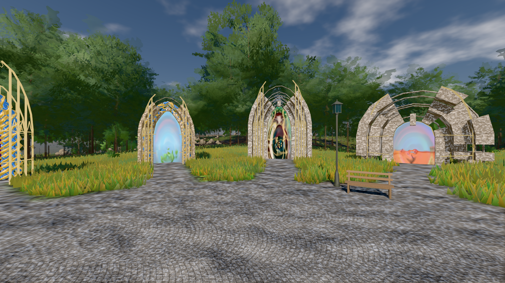

# GPU-PROBE e80d8529 — GRÜN

Zweig `w28-leib-kanon` · Kopf e80d8529629af75a7a34454214462f1d672afe53 · Läufer omen-gtx1060 · 13.11. 07:17 · Wanduhr ab Push 372 s · Lauf https://github.com/MiguellD/AnazhRealm/actions/runs/43376992131

Ruf: `bild:genesis@0.36 gate:kamera-leib:echt`

## Läufer omen-gtx1060 — GRÜN

GPU NVIDIA GeForce GTX 1060 · npm ci 37 s (package-lock 2ab17da4)
Schloss /c/Users/micha/AppData/Local/Temp/claude/gpu-schloss hält „ci-runner 43376992131/1 probe“
- Hook 2026-11-13 07:13:29 start ci-runner 43376992131/1 probe: wartet auf Schloss von 'omen-sg-haus-welt'
- Hook 2026-11-13 07:15:02 start ci-runner 43376992131/1 probe: Schloss genommen (refs/heads/w28-leib-kanon e80d8529629af75a7a34454214462f1d672afe53 ws=C:\actions-runner\_work\AnazhRealm\AnazhRealm)

### bild:genesis@0.36 — GRÜN · 42 s · Läufer omen-gtx1060

Adapter: [linse-gpu] nvidia/pascal

```text
Kamera des Spiels → Blick (10.0 m): 0.00 92.40 0.00 -10.00 92.40 0.00
 "abnahme": "ABNAHME GRÜN · beweis · Sicht 0.0 % · Ziel Blickziel im Bild frei 10 m · Luma 106.9 σ 38.2 schwarz 0.0 % weiß 0.0 % · Stand 18.546.268 · Bühne summer sunny 0.36 Tiere gehalten · Gerät WebGPU nvidia pascal · Inhalt bodenSatz 35.4 % (≥ 15.0 %) Luma 121, portal-membran 2.8 % (≥ 0.3 %) Luma 169",
```



### gate:kamera-leib:echt — GRÜN · 64 s · Läufer omen-gtx1060

Adapter: [linse-gpu] nvidia/pascal

```text
  ✅ K6 Strafe am Prüfplatz — A0 Kopf 2.9 % Leib 1.5 % (2409 px),A1 Kopf 0.0 % Leib 0.6 % (2428 px),A2 Kopf 1.4 % Leib 1.8 % (2507 px),A3 Kopf 0.0 % Leib 0.8 % (2567 px),D0 Kopf 0.0 % Leib 2.1 % (2441 px),D1 Kopf 0.0 % Leib 0.6 % (2430 px),D2 Kopf 0.0 % Leib 1.7 % (2513 px),D3 Kopf 0.0 % Leib 0.7 % (2567 px) · Rückstrahl 0.1 %
✅ GRÜN — die Kamera steckt nie in Laub, Strauch, Fels oder Boden.
```
