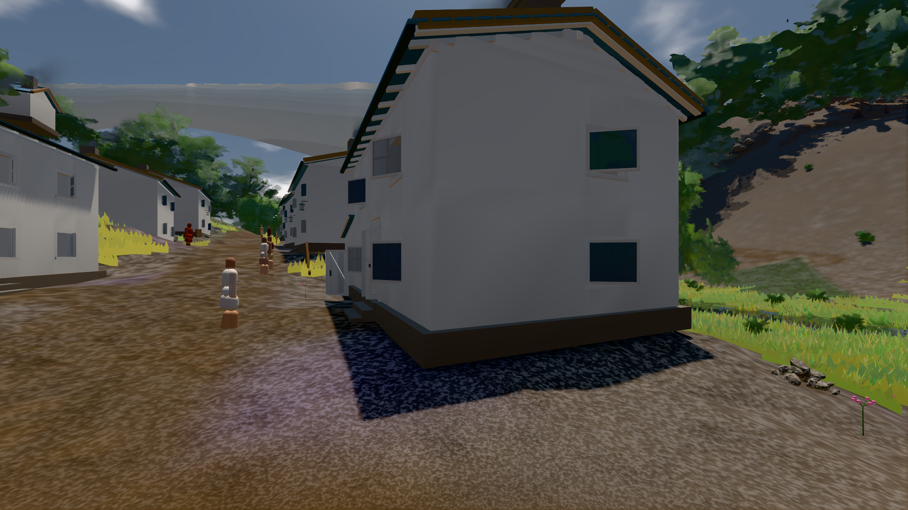
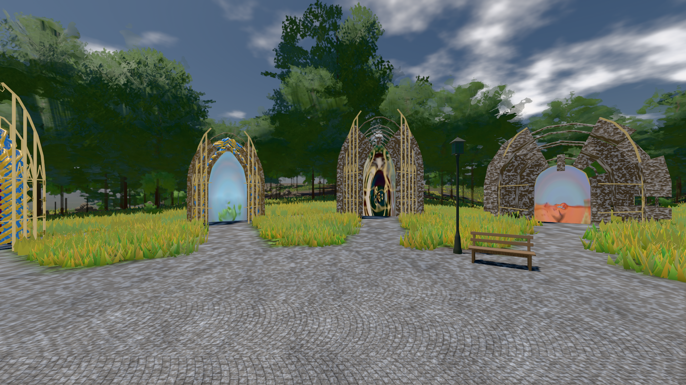

# GPU-PROBE 19b8793e — GRÜN

Zweig `w28-leib-nah` · Kopf 19b8793ec9e946b492e9f6c05db2d5cb5ee63a3d · Läufer gtx1050-desktop · 14.11. 01:12 · Wanduhr ab Push 548 s · Lauf https://github.com/MiguellD/AnazhRealm/actions/runs/43531498830

Ruf: `bild:dorf@0.5 bild:genesis@0.5 gate:kamera-leib:echt`

## Läufer gtx1050-desktop — GRÜN

GPU NVIDIA GeForce GTX 1050 · npm ci 54 s (package-lock 95130897)
Schloss /c/Users/User/AppData/Local/Temp/claude/gpu-schloss hält „ci-runner 43531498830/1 probe“
- Hook 2026-11-14 01:03:22 start ci-runner 43531498830/1 probe: Schloss genommen (refs/heads/w28-leib-nah 19b8793ec9e946b492e9f6c05db2d5cb5ee63a3d ws=C:\actions-runner\_work\AnazhRealm\AnazhRealm)

### bild:dorf@0.5 — GRÜN · 149 s · Läufer gtx1050-desktop

Adapter: [linse-gpu] nvidia/pascal

```text
Kamera des Spiels → Blick (5.2 m): -704.22 39.69 -880.02 -703.03 39.69 -874.96
 "abnahme": "ABNAHME GRÜN · beweis · Sicht 0.0 % · Ziel Blickziel im Bild frei 5.2 m · Luma 79 σ 30.7 schwarz 0.3 % weiß 0.0 % · Stand 18.546.276 · Bühne summer sunny 0.50 Tiere gehalten · Gerät WebGPU nvidia pascal · Inhalt bauSatz 30.0 % (≥ 2.0 %) Luma 78",
```



### bild:genesis@0.5 — GRÜN · 78 s · Läufer gtx1050-desktop

Adapter: [linse-gpu] nvidia/pascal

```text
Kamera des Spiels → Blick (10.0 m): 0.00 92.40 0.00 -10.00 92.40 0.00
 "abnahme": "ABNAHME GRÜN · beweis · Sicht 0.0 % · Ziel Blickziel im Bild frei 10 m · Luma 105.8 σ 41.3 schwarz 0.0 % weiß 0.0 % · Stand 18.546.276 · Bühne summer sunny 0.50 Tiere gehalten · Gerät WebGPU nvidia pascal · Inhalt bodenSatz 35.4 % (≥ 15.0 %) Luma 129, portal-membran 2.8 % (≥ 0.3 %) Luma 139",
```



### gate:kamera-leib:echt — GRÜN · 152 s · Läufer gtx1050-desktop

Adapter: [linse-gpu] nvidia/pascal

```text
  ✅ K6 Strafe am Prüfplatz — A0 Kopf 0.0 % Leib 0.9 % (2371 px),A1 Kopf 0.0 % Leib 0.6 % (2372 px),A2 Kopf 0.0 % Leib 2.1 % (2460 px),A3 Kopf 0.0 % Leib 0.5 % (2450 px),D0 Kopf 0.0 % Leib 2.1 % (2418 px),D1 Kopf 0.0 % Leib 1.0 % (2368 px),D2 Kopf 0.0 % Leib 1.3 % (2451 px),D3 Kopf 0.0 % Leib 1.1 % (2503 px) · Rückstrahl 0.1 %
✅ GRÜN — die Kamera steckt nie in Laub, Strauch, Fels oder Boden.
```
