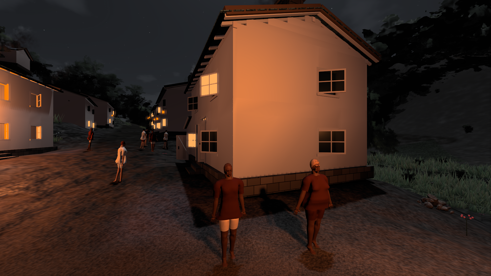

# GPU-PROBE cec1add5 — GRÜN

Zweig `w28-licht-eine-skala` · Kopf cec1add5dbb5c197076abad5bd0890848704acfb · Läufer omen-gtx1060 · 19.11. 15:03 · Wanduhr ab Push 184 s · Lauf https://github.com/MiguellD/AnazhRealm/actions/runs/44539155969

Ruf: `bild:dorf@0.0`

## Läufer omen-gtx1060 — GRÜN

GPU NVIDIA GeForce GTX 1060 · node_modules bleiben (package-lock b38d03a8)
Schloss /c/Users/micha/AppData/Local/Temp/claude/gpu-schloss hält „ci-runner 44539155969/1 probe“
- Hook 2026-11-19 15:01:08 start ci-runner 44539155969/1 probe: wartet auf Schloss von 'omen-punkte-gtx-sitzung'
- Hook 2026-11-19 15:01:38 start ci-runner 44539155969/1 probe: Schloss genommen (refs/heads/w28-licht-eine-skala cec1add5dbb5c197076abad5bd0890848704acfb ws=C:\actions-runner\_work\AnazhRealm\AnazhRealm)

### bild:dorf@0.0 — GRÜN · 89 s · Läufer omen-gtx1060

Adapter: [linse-gpu] nvidia/pascal

```text
Kamera des Spiels → Blick (5.2 m): -704.22 39.69 -880.02 -703.03 39.69 -874.96
 "abnahme": "ABNAHME GRÜN · beweis · Sicht 0.0 % · Ziel Blickziel im Bild frei 5.2 m · Luma 43.8 σ 34.6 schwarz 9.1 % weiß 0.0 % · Stand 18.546.343 · Bühne summer sunny 0.00 Tiere gehalten · Gerät WebGPU nvidia pascal · Inhalt bauSatz 28.7 % (≥ 2.0 %) (Nacht: Farbe ungefordert)",
```


