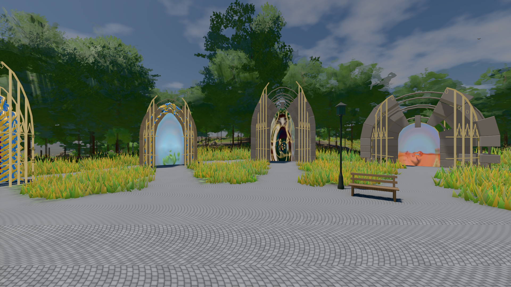
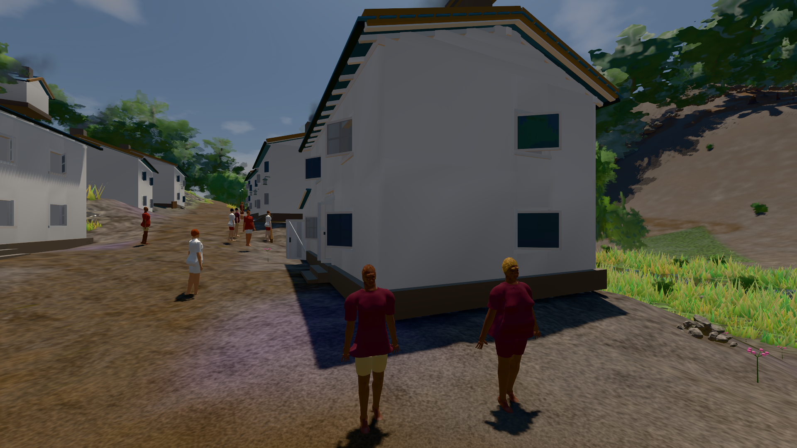

# GPU-PROBE 1062f898 — GRÜN

Zweig `w28-licht-kern` · Kopf 1062f89876e88dcff6f55583e01b2527bc591e22 · Läufer radeon-890m · 16.11. 03:56 · Wanduhr ab Push 283 s · Lauf https://github.com/MiguellD/AnazhRealm/actions/runs/43794664257

Ruf: `bild:genesis@0.5 bild:dorf@0.5`

## Läufer radeon-890m — GRÜN

GPU AMD Radeon(TM) 890M Graphics · node_modules bleiben (package-lock a62ee566)
Schloss /c/Users/micha/AppData/Local/Temp/claude/gpu-schloss hält „ci-runner 43794664257/1 probe“
- Hook 2026-11-16 03:51:51 start ci-runner 43794664257/1 probe: Schloss genommen (refs/heads/w28-licht-kern 1062f89876e88dcff6f55583e01b2527bc591e22 ws=C:\actions-runner\_work\AnazhRealm\AnazhRealm)

### bild:genesis@0.5 — GRÜN · 63 s · Läufer radeon-890m

Adapter: [linse-gpu] amd/rdna-3

```text
Kamera des Spiels → Blick (10.0 m): 0.00 92.40 0.00 -10.00 92.40 0.00
 "abnahme": "ABNAHME GRÜN · beweis · Sicht 0.0 % · Ziel Blickziel im Bild frei 10 m · Luma 108 σ 39 schwarz 0.0 % weiß 0.0 % · Stand 18.546.298 · Bühne summer sunny 0.50 Tiere gehalten · Gerät WebGPU amd rdna-3 · Inhalt bodenSatz 36.4 % (≥ 15.0 %) Luma 140, portal-membran 2.7 % (≥ 0.3 %) Luma 140",
```



### bild:dorf@0.5 — GRÜN · 69 s · Läufer radeon-890m

Adapter: [linse-gpu] amd/rdna-3

```text
Kamera des Spiels → Blick (5.2 m): -704.22 39.69 -880.02 -703.03 39.69 -874.96
 "abnahme": "ABNAHME GRÜN · beweis · Sicht 0.0 % · Ziel Blickziel im Bild frei 5.2 m · Luma 78 σ 30.6 schwarz 0.1 % weiß 0.0 % · Stand 18.546.298 · Bühne summer sunny 0.50 Tiere gehalten · Gerät WebGPU amd rdna-3 · Inhalt bauSatz 28.7 % (≥ 2.0 %) Luma 80",
```


