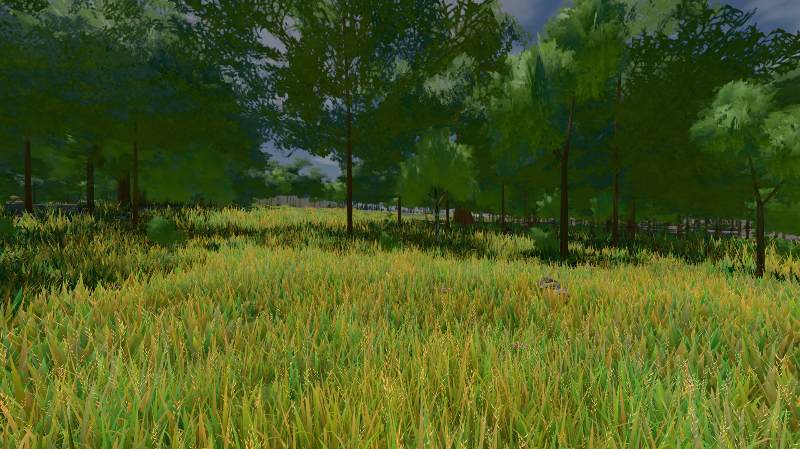
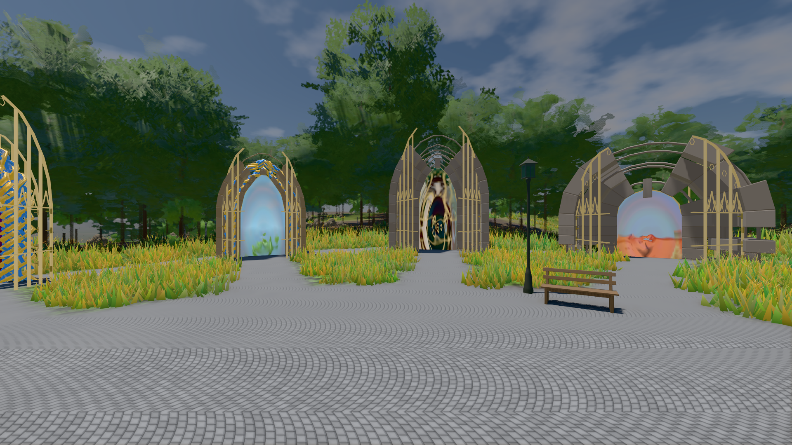

# GPU-PROBE 2b5ea349 — GRÜN

Zweig `w28-licht-stetig` · Kopf 2b5ea349eb4af44d4ed4ab8de76a2170340e5402 · Läufer omen-gtx1060 · 16.11. 04:12 · Wanduhr ab Push 312 s · Lauf https://github.com/MiguellD/AnazhRealm/actions/runs/43796174209

Ruf: `bild:wiese@0.5 bild:genesis@0.5 gate:tag-achse:echt`

## Läufer omen-gtx1060 — GRÜN

GPU NVIDIA GeForce GTX 1060 · node_modules bleiben (package-lock 76b18c39)
Schloss /c/Users/micha/AppData/Local/Temp/claude/gpu-schloss hält „ci-runner 43796174209/1 probe“
- Hook 2026-11-16 04:08:25 start ci-runner 43796174209/1 probe: Schloss genommen (refs/heads/w28-licht-stetig 2b5ea349eb4af44d4ed4ab8de76a2170340e5402 ws=C:\actions-runner\_work\AnazhRealm\AnazhRealm)

### bild:wiese@0.5 — GRÜN · 47 s · Läufer omen-gtx1060

Adapter: [linse-gpu] nvidia/pascal

```text
Kamera des Spiels → Blick (10.0 m): -280.40 29.71 -1045.60 -289.61 29.71 -1049.50
 "abnahme": "ABNAHME GRÜN · beweis · Sicht 0.0 % · Ziel Blickziel im Bild frei 10 m · Luma 81.9 σ 39 schwarz 0.0 % weiß 0.0 % · Stand 18.546.299 · Bühne summer sunny 0.50 Tiere gehalten · Gerät WebGPU nvidia pascal · Inhalt nahWiese 48.2 % (≥ 15.0 %) h 107° Luma 117",
```



### bild:genesis@0.5 — GRÜN · 44 s · Läufer omen-gtx1060

Adapter: [linse-gpu] nvidia/pascal

```text
Kamera des Spiels → Blick (10.0 m): 0.00 92.40 0.00 -10.00 92.40 0.00
 "abnahme": "ABNAHME GRÜN · beweis · Sicht 0.0 % · Ziel Blickziel im Bild frei 10 m · Luma 108.5 σ 38.5 schwarz 0.0 % weiß 0.0 % · Stand 18.546.299 · Bühne summer sunny 0.50 Tiere gehalten · Gerät WebGPU nvidia pascal · Inhalt bodenSatz 36.4 % (≥ 15.0 %) Luma 140, portal-membran 2.7 % (≥ 0.3 %) Luma 140",
```



### gate:tag-achse:echt — GRÜN · 78 s · Läufer omen-gtx1060

Adapter: ungenannt (die Probe nannte keinen Browser-Adapter)

```text
TAG genesis GRUEN: Karte 126.4 · Sprung -0.03 (Uhr 0.744) · Buckel 0.00 (Uhr 0) · Sonne 10° -0.73 EV R/B ×0.91 | -0.66 EV R/B ×0.94 · Nacht -1.66 EV Luma 69.7 · REF 0.86 (Uhr 0) · nur die Wand (--kurz)
TAG wiese GRUEN: Karte 125.6 · Sprung 0.09 (Uhr 0.276) · Buckel 0.00 (Uhr 0) · Sonne 10° -1.04 EV R/B ×1.07 | -1.30 EV R/B ×0.81 · Nacht -3.13 EV Luma 35.7 · REF 0.14 (Uhr 0) · nur die Wand (--kurz)
TAG-ACHSE GRUEN
```
