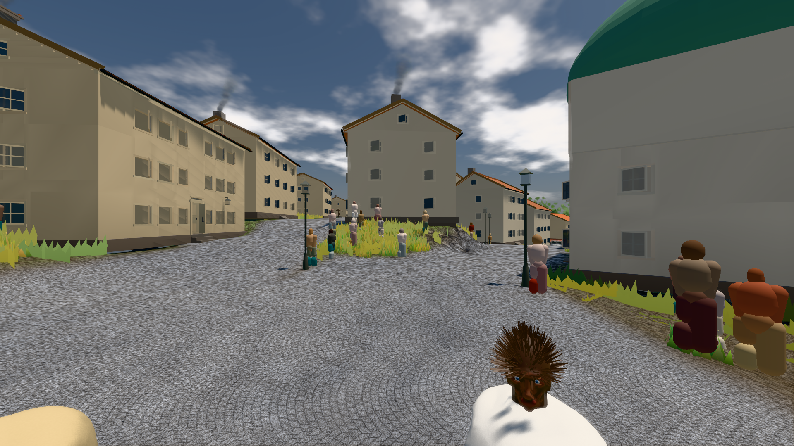
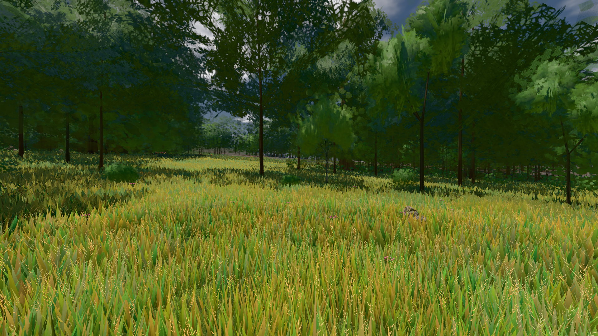
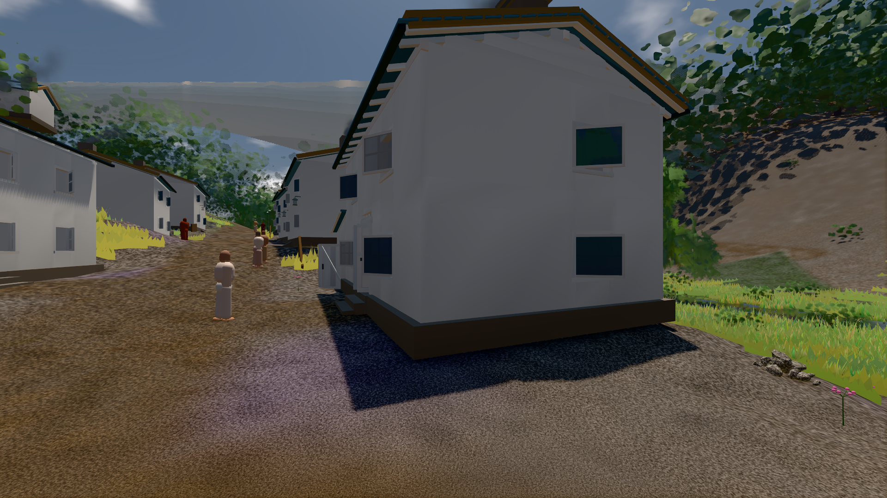

# GPU-PROBE 00d6624d — GRÜN · ROT wie an main (bekannt): bild:stadt: stadt.leib (Messort, haushalt.json bekannt) auf gtx1050-desktop

Zweig `w28-linse-wahr` · Kopf 00d6624d2e5bcee09c9d7b4529a7f2454450dcc5 · Läufer gtx1050-desktop · 12.11. 03:12 · Wanduhr ab Push 791 s · Lauf https://github.com/MiguellD/AnazhRealm/actions/runs/43138217695

Ruf: `bild:stadt bild:wiese@0.5 bild:dorf`

## Läufer gtx1050-desktop — GRÜN

GPU NVIDIA GeForce GTX 1050 · node_modules bleiben (package-lock 657462dc)
Schloss /c/Users/User/AppData/Local/Temp/claude/gpu-schloss hält „ci-runner 43138217695/1 probe“
- Hook 2026-11-12 02:59:30 start ci-runner 43138217695/1 probe: Schloss genommen (refs/heads/w28-linse-wahr 00d6624d2e5bcee09c9d7b4529a7f2454450dcc5 ws=C:\actions-runner\_work\AnazhRealm\AnazhRealm)

### bild:stadt — BEKANNT · 336 s · Läufer gtx1050-desktop

Adapter: [linse-gpu] nvidia/pascal · ROT wie an main (bekannt): stadt.leib (Messort, haushalt.json bekannt)

```text
Kamera des Spiels → Blick (23.9 m): 662.72 63.28 429.48 686.59 63.28 428.39
❌ URTEILS-WACHE: 1 ROTE Zeile(n) bei Exit 0 — die erste: "abnahme": "ABNAHME BEKANNT · ROT wie an main (bekannt): stadt.leib Sicht verdeckt 3.6 % (Laub · Rinde · Fels · Böschung näher als 2 m, Bau als 1 m): Leib bewohner (≤ 8 m) 3.6 % · beweis · Sicht 3.6 % (Leib bewohner (≤ 8 m) 3.6 %) · Ziel Blickziel im Bild frei 23.89 m · Luma 113.5 σ 40.3 schwarz 0.0 (Exit wird 1; ein Vermerk heißt nie ROT/❌)
 "abnahme": "ABNAHME BEKANNT · ROT wie an main (bekannt): stadt.leib Sicht verdeckt 3.6 % (Laub · Rinde · Fels · Böschung näher als 2 m, Bau als 1 m): Leib bewohner (≤ 8 m) 3.6 % · beweis · Sicht 3.6 % (Leib bewohner (≤ 8 m) 3.6 %) · Ziel Blickziel im Bild frei 23.89 m · Luma 113.5 σ 40.3 schwarz 0.0 % weiß 0.0 % · Stand 18.546.259 · Bühne summer sunny 0.50 Tiere gehalten · Gerät WebGPU nvidia pascal · Inhalt bauSatz 35.2 % (≥ 2.0 %) Luma 103",
```



### bild:wiese@0.5 — GRÜN · 158 s · Läufer gtx1050-desktop

Adapter: [linse-gpu] nvidia/pascal

```text
Kamera des Spiels → Blick (10.0 m): -280.40 29.71 -1045.60 -289.61 29.71 -1049.50
 "abnahme": "ABNAHME GRÜN · beweis · Sicht 0.0 % · Ziel Blickziel im Bild frei 10 m · Luma 81.8 σ 42.9 schwarz 0.0 % weiß 0.0 % · Stand 18.546.259 · Bühne summer sunny 0.50 Tiere gehalten · Gerät WebGPU nvidia pascal · Inhalt nahWiese 48.3 % (≥ 15.0 %) h 107° Luma 120",
```



### bild:dorf — GRÜN · 222 s · Läufer gtx1050-desktop

Adapter: [linse-gpu] nvidia/pascal

```text
Kamera des Spiels → Blick (5.2 m): -704.22 39.69 -880.02 -703.03 39.69 -874.96
 "abnahme": "ABNAHME GRÜN · beweis · Sicht 0.0 % · Ziel Blickziel im Bild frei 5.2 m · Luma 79.1 σ 30.7 schwarz 0.2 % weiß 0.0 % · Stand 18.546.259 · Bühne summer sunny 0.50 Tiere gehalten · Gerät WebGPU nvidia pascal · Inhalt bauSatz 29.8 % (≥ 2.0 %) Luma 78",
```


