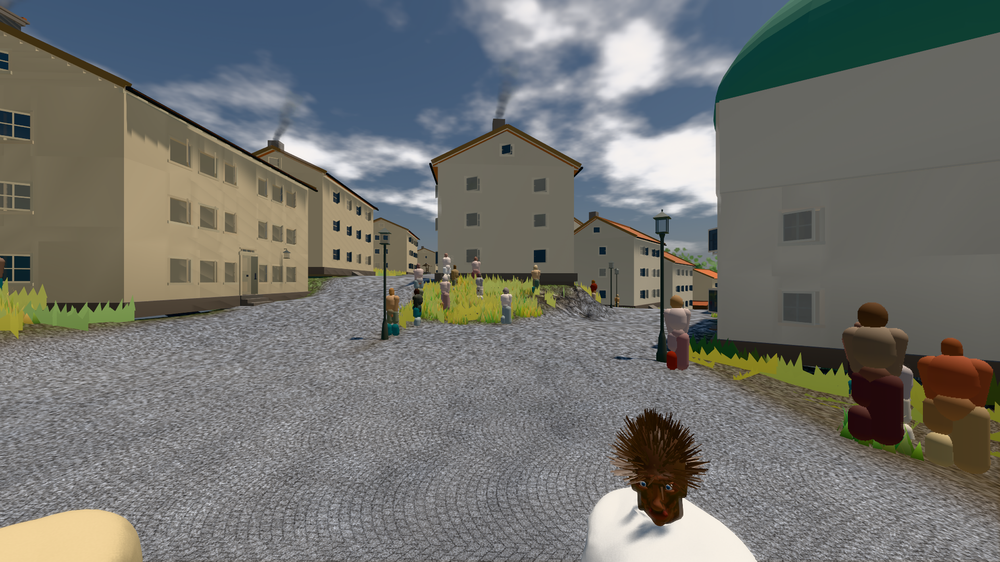

# GPU-PROBE 1393218c — GRÜN · ROT wie an main (bekannt): bild:stadt: stadt.leib (Messort, haushalt.json bekannt) auf omen-gtx1060

Zweig `w28-linse-wahr` · Kopf 1393218cfcfd5650765d709993e4fc0c882f4c41 · Läufer omen-gtx1060 · 12.11. 03:19 · Wanduhr ab Push 216 s · Lauf https://github.com/MiguellD/AnazhRealm/actions/runs/43140171562

Ruf: `bild:stadt`

## Läufer omen-gtx1060 — GRÜN

GPU NVIDIA GeForce GTX 1060 · npm ci 45 s (package-lock 657462dc)
Schloss /c/Users/micha/AppData/Local/Temp/claude/gpu-schloss hält „ci-runner 43140171562/1 probe“
- Hook 2026-11-12 03:16:08 start ci-runner 43140171562/1 probe: wartet auf Schloss von 'omen-wb3-statik'
- Hook 2026-11-12 03:16:24 start ci-runner 43140171562/1 probe: Schloss genommen (refs/heads/w28-linse-wahr 1393218cfcfd5650765d709993e4fc0c882f4c41 ws=C:\actions-runner\_work\AnazhRealm\AnazhRealm)

### bild:stadt — BEKANNT · 112 s · Läufer omen-gtx1060

Adapter: [linse-gpu] nvidia/pascal · ROT wie an main (bekannt): stadt.leib (Messort, haushalt.json bekannt)

```text
Kamera des Spiels → Blick (23.9 m): 662.72 63.28 429.48 686.59 63.28 428.39
 "abnahme": "ABNAHME BEKANNT · ROT wie an main (bekannt): stadt.leib Sicht verdeckt 3.8 % (Laub · Rinde · Fels · Böschung näher als 2 m, Bau als 1 m): Leib bewohner (≤ 8 m) 3.8 % · beweis · Sicht 3.8 % (Leib bewohner (≤ 8 m) 3.8 %) · Ziel Blickziel im Bild frei 23.89 m · Luma 113.5 σ 40.4 schwarz 0.0 % weiß 0.0 % · Stand 18.546.259 · Bühne summer sunny 0.50 Tiere gehalten · Gerät WebGPU nvidia pascal · Inhalt bauSatz 35.2 % (≥ 2.0 %) Luma 103",
```


