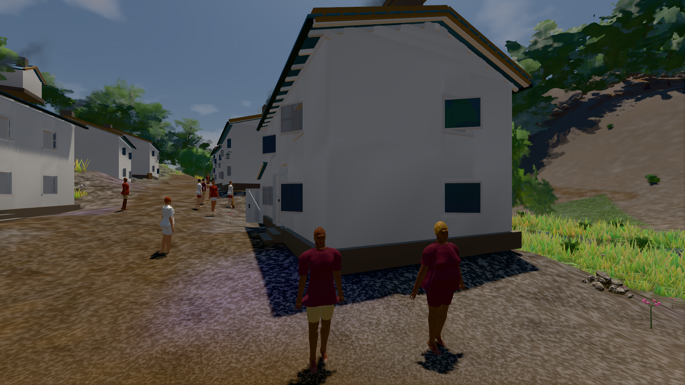
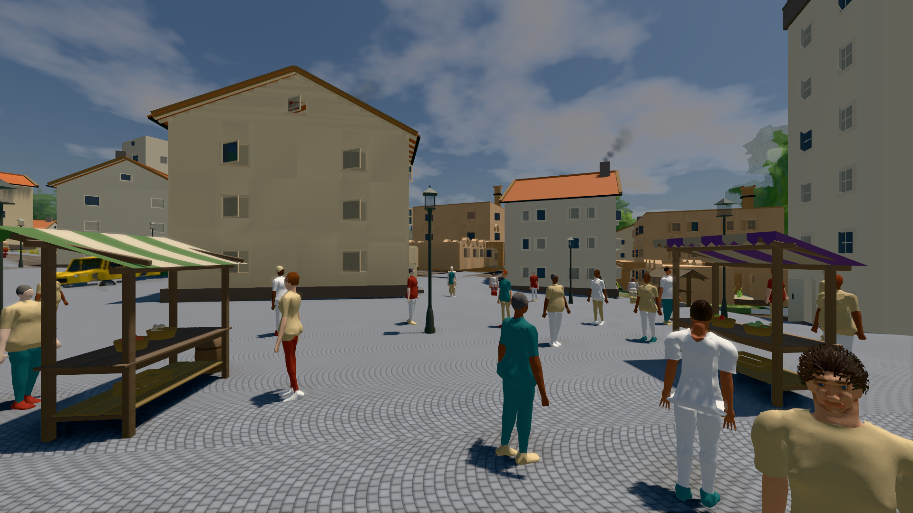

# GPU-PROBE a16016c4 — GRÜN · ROT wie an main (bekannt): gate:pop: lod.K2#1 (main gtx: ungemessen) auf gtx1050-desktop

Zweig `w28-march-schirm` · Kopf a16016c4fe9319bae7d16b560e91f12d6867a07a · Läufer gtx1050-desktop · 15.11. 17:50 · Wanduhr ab Push 783 s · Lauf https://github.com/MiguellD/AnazhRealm/actions/runs/43736495048

Ruf: `gate:pop bild:dorf@0.5 bild:stadt-voll@0.5`

## Läufer gtx1050-desktop — GRÜN

GPU NVIDIA GeForce GTX 1050 · npm ci 49 s (package-lock 604b0b39)
Schloss /c/Users/User/AppData/Local/Temp/claude/gpu-schloss hält „ci-runner 43736495048/1 probe“
- Hook 2026-11-15 17:39:23 start ci-runner 43736495048/1 probe: wartet auf Schloss von 'hand stoff-spike b1115pr (Claude)'
- Hook 2026-11-15 17:39:38 start ci-runner 43736495048/1 probe: Schloss genommen (refs/heads/w28-march-schirm a16016c4fe9319bae7d16b560e91f12d6867a07a ws=C:\actions-runner\_work\AnazhRealm\AnazhRealm)

### gate:pop — BEKANNT · 151 s · Läufer gtx1050-desktop

Adapter: ungenannt (die Probe nannte keinen Browser-Adapter) · ROT wie an main (bekannt): lod.K2#1 (main gtx: ungemessen)

```text
lod.K2#1 ROT 1.6209 % Pop-Pixel/s (33610 px) · 83+92@103/555*+91@117/646*+56@131/7867*+29@139/4631*+74@143/12620*+93@146/6633*+62@155/575*+79@154 · Laub 216 · dc, Dreiecke 98,355431 · GPU 40.04 ms, CPU 4.96 ms je Bild
BLOCK-TREUE GRÜN 231 Blöcke treu · Selbsttest nennt MeshStandardNodeMaterial · nahWiese:L1:0:0 · instanzFarbe: 1/880 Instanzen fremd
 "fehler": "lod.K2#1 ROT 1.6209 % Pop-Pixel/s > 0,05"
```

### bild:dorf@0.5 — GRÜN · 139 s · Läufer gtx1050-desktop

Adapter: [linse-gpu] nvidia/pascal

```text
Kamera des Spiels → Blick (5.2 m): -704.22 39.69 -880.02 -703.03 39.69 -874.96
 "abnahme": "ABNAHME GRÜN · beweis · Sicht 0.0 % · Ziel Blickziel im Bild frei 5.2 m · Luma 77.8 σ 31 schwarz 0.3 % weiß 0.0 % · Stand 18.546.294 · Bühne summer sunny 0.50 Tiere gehalten · Gerät WebGPU nvidia pascal · Inhalt bauSatz 28.7 % (≥ 2.0 %) Luma 80",
```



### bild:stadt-voll@0.5 — GRÜN · 261 s · Läufer gtx1050-desktop

Adapter: [linse-gpu] nvidia/pascal

```text
Kamera des Spiels → Blick (29.4 m): 842.49 57.57 451.79 871.75 57.57 454.60
 "abnahme": "ABNAHME GRÜN · beweis · Sicht 0.0 % · Leib im Vordergrund 7.3 % (Leib bewohner 7.3 %) · Ziel Blickziel im Bild frei 29.39 m · Luma 104.1 σ 35.6 schwarz 0.1 % weiß 0.0 % · Stand 18.546.294 · Bühne summer sunny 0.50 Tiere gehalten · Gerät WebGPU nvidia pascal · Inhalt bauSatz 34.1 % (≥ 2.0 %) Luma 92, bewohner 9.7 % (≥ 1.0 %) Luma 97",
```


