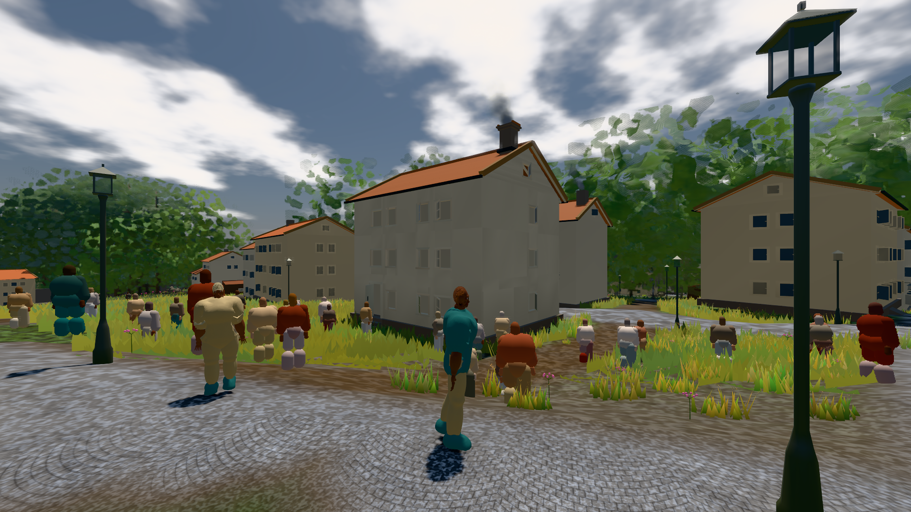
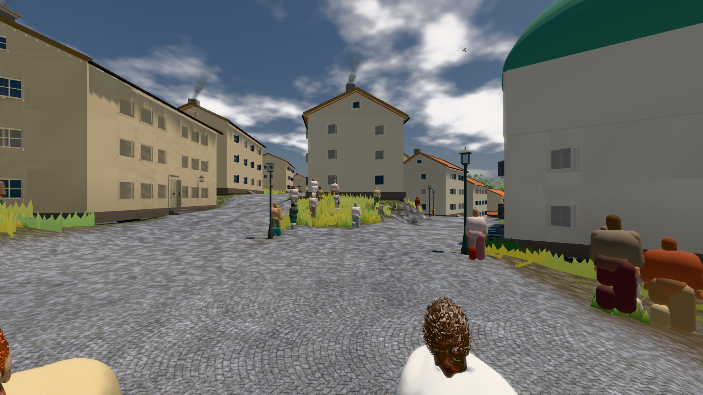
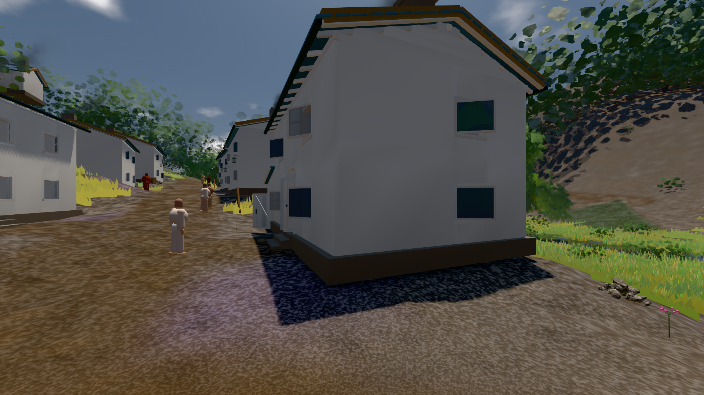

# GPU-PROBE d27d7c3c — GRÜN · ROT wie an main (bekannt): bild:stadt@0.5: stadt.leib (Messort, haushalt.json bekannt) auf radeon-890m

Zweig `w28-mensch-menge` · Kopf d27d7c3c11afe55cd181a5206e06de13ad0c26b9 · Läufer radeon-890m · 12.11. 11:00 · Wanduhr ab Push 441 s · Lauf https://github.com/MiguellD/AnazhRealm/actions/runs/43195422005

Ruf: `bild:stadt-voll@0.5 bild:stadt@0.5 bild:dorf@0.5`

## Läufer radeon-890m — GRÜN

GPU AMD Radeon(TM) 890M Graphics · node_modules bleiben (package-lock db0dbb29)
Schloss /c/Users/micha/AppData/Local/Temp/claude/gpu-schloss hält „ci-runner 43195422005/1 probe“
- Hook 2026-11-12 10:53:34 start ci-runner 43195422005/1 probe: Schloss genommen (refs/heads/w28-mensch-menge d27d7c3c11afe55cd181a5206e06de13ad0c26b9 ws=C:\actions-runner\_work\AnazhRealm\AnazhRealm)

### bild:stadt-voll@0.5 — GRÜN · 144 s · Läufer radeon-890m

Adapter: [linse-gpu] amd/rdna-3

```text
Kamera des Spiels → Blick (14.6 m): 837.84 58.51 445.42 842.31 58.51 459.32
 "abnahme": "ABNAHME GRÜN · bekannt stadt-voll.leib hält jetzt (der Eintrag fällt) · beweis · Sicht 1.6 % (Leib bewohner (≤ 7.3 m) 1.6 %) · Ziel Blickziel im Bild frei 14.6 m, verdeckt nur von Leibern: 1 Punkt, nächster 3.65 m (Leib bewohner) · Luma 113.6 σ 56.8 schwarz 0.0 % weiß 0.0 % · Stand 18.546.261 · Bühne summer sunny 0.50 Tiere gehalten · Gerät WebGPU amd rdna-3 · Inhalt bauSatz 19.5 % (≥ 2.0 %) Luma 78, bewohner 1.8 % (≥ 1.0 %) Luma 77",
```



### bild:stadt@0.5 — BEKANNT · 123 s · Läufer radeon-890m

Adapter: [linse-gpu] amd/rdna-3 · ROT wie an main (bekannt): stadt.leib (Messort, haushalt.json bekannt)

```text
Kamera des Spiels → Blick (23.9 m): 662.72 63.28 429.48 686.59 63.28 428.39
 "abnahme": "ABNAHME BEKANNT · ROT wie an main (bekannt): stadt.leib Sicht verdeckt 3.5 % (Laub · Rinde · Fels · Böschung näher als 2 m, Bau als 1 m): Leib bewohner (≤ 8 m) 3.5 % · beweis · Sicht 3.5 % (Leib bewohner (≤ 8 m) 3.5 %) · Ziel Blickziel im Bild frei 23.89 m · Luma 114.3 σ 39.4 schwarz 0.0 % weiß 0.0 % · Stand 18.546.261 · Bühne summer sunny 0.50 Tiere gehalten · Gerät WebGPU amd rdna-3 · Inhalt bauSatz 35.1 % (≥ 2.0 %) Luma 103",
```



### bild:dorf@0.5 — GRÜN · 114 s · Läufer radeon-890m

Adapter: [linse-gpu] amd/rdna-3

```text
Kamera des Spiels → Blick (5.2 m): -704.22 39.69 -880.02 -703.03 39.69 -874.96
 "abnahme": "ABNAHME GRÜN · beweis · Sicht 0.0 % · Ziel Blickziel im Bild frei 5.2 m · Luma 79.7 σ 30.4 schwarz 0.4 % weiß 0.0 % · Stand 18.546.261 · Bühne summer sunny 0.50 Tiere gehalten · Gerät WebGPU amd rdna-3 · Inhalt bauSatz 30.0 % (≥ 2.0 %) Luma 78",
```


