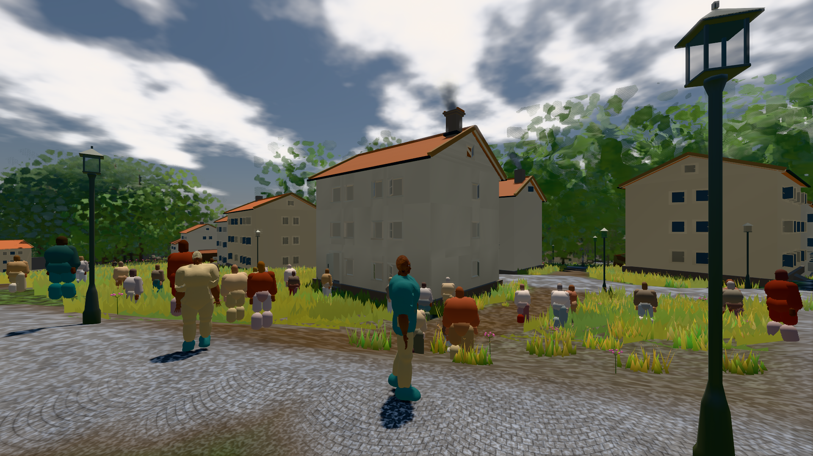
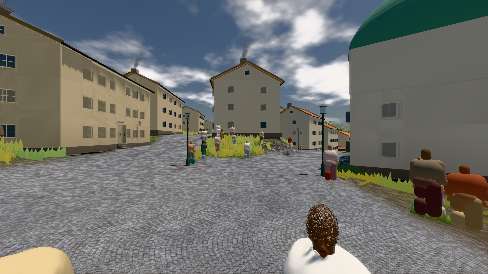

# GPU-PROBE 15d216f3 — GRÜN · ROT wie an main (bekannt): bild:stadt@0.5: stadt.leib (Messort, haushalt.json bekannt) auf gtx1050-desktop

Zweig `w28-mensch-samen` · Kopf 15d216f38d9e4278996e98c51d92154285684999 · Läufer gtx1050-desktop · 12.11. 11:05 · Wanduhr ab Push 753 s · Lauf https://github.com/MiguellD/AnazhRealm/actions/runs/43195386229

Ruf: `bild:stadt-voll@0.5 bild:stadt@0.5`

## Läufer gtx1050-desktop — GRÜN

GPU NVIDIA GeForce GTX 1050 · node_modules bleiben (package-lock db0dbb29)
Schloss /c/Users/User/AppData/Local/Temp/claude/gpu-schloss hält „ci-runner 43195386229/1 probe“
- Hook 2026-11-12 10:53:28 start ci-runner 43195386229/1 probe: wartet auf Schloss von 'hand eingriff leser7 (Claude)'
- Hook 2026-11-12 10:54:29 start ci-runner 43195386229/1 probe: Schloss genommen (refs/heads/w28-mensch-samen 15d216f38d9e4278996e98c51d92154285684999 ws=C:\actions-runner\_work\AnazhRealm\AnazhRealm)

### bild:stadt-voll@0.5 — GRÜN · 273 s · Läufer gtx1050-desktop

Adapter: [linse-gpu] nvidia/pascal

```text
Kamera des Spiels → Blick (14.6 m): 837.84 58.51 445.42 842.31 58.51 459.32
 "abnahme": "ABNAHME GRÜN · bekannt stadt-voll.leib hält jetzt (der Eintrag fällt) · beweis · Sicht 1.9 % (Leib bewohner (≤ 7.3 m) 1.9 %) · Ziel Blickziel im Bild frei 14.6 m, verdeckt nur von Leibern: 1 Punkt, nächster 3.64 m (Leib bewohner) · Luma 113.8 σ 56.7 schwarz 0.0 % weiß 0.0 % · Stand 18.546.261 · Bühne summer sunny 0.50 Tiere gehalten · Gerät WebGPU nvidia pascal · Inhalt bauSatz 19.4 % (≥ 2.0 %) Luma 79, bewohner 1.8 % (≥ 1.0 %) Luma 76",
```



### bild:stadt@0.5 — BEKANNT · 222 s · Läufer gtx1050-desktop

Adapter: [linse-gpu] nvidia/pascal · ROT wie an main (bekannt): stadt.leib (Messort, haushalt.json bekannt)

```text
Kamera des Spiels → Blick (23.9 m): 662.72 63.28 429.48 686.59 63.28 428.39
 "abnahme": "ABNAHME BEKANNT · ROT wie an main (bekannt): stadt.leib Sicht verdeckt 3.5 % (Laub · Rinde · Fels · Böschung näher als 2 m, Bau als 1 m): Leib bewohner (≤ 8 m) 3.5 % · beweis · Sicht 3.5 % (Leib bewohner (≤ 8 m) 3.5 %) · Ziel Blickziel im Bild frei 23.89 m · Luma 114.4 σ 39.5 schwarz 0.0 % weiß 0.0 % · Stand 18.546.261 · Bühne summer sunny 0.50 Tiere gehalten · Gerät WebGPU nvidia pascal · Inhalt bauSatz 35.1 % (≥ 2.0 %) Luma 103",
```


