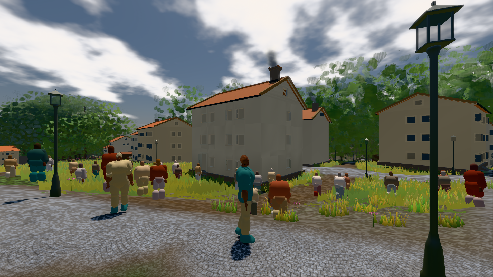
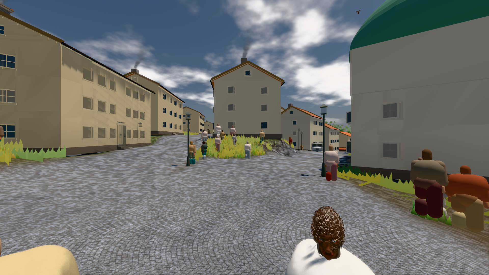

# GPU-PROBE 95370244 — ROT

Zweig `w28-mensch-samen` · Kopf 9537024463476d3ef17da4a38f1c6c8baed252a2 · Läufer gtx1050-desktop + omen-gtx1060 (Band-Gerät) · 12.11. 07:05 · Wanduhr ab Push 648 s · Lauf https://github.com/MiguellD/AnazhRealm/actions/runs/43164498996

Ruf: `bild:stadt-voll@0.5 bild:stadt@0.5 zeit:gate:fahr-leben`

## Läufer gtx1050-desktop — GRÜN

GPU NVIDIA GeForce GTX 1050 · node_modules bleiben (package-lock f5d79618)
Schloss /c/Users/User/AppData/Local/Temp/claude/gpu-schloss hält „ci-runner 43164498996/1 probe“
- Hook 2026-11-12 06:55:01 start ci-runner 43164498996/1 probe: Schloss genommen (refs/heads/w28-mensch-samen 9537024463476d3ef17da4a38f1c6c8baed252a2 ws=C:\actions-runner\_work\AnazhRealm\AnazhRealm)

### bild:stadt-voll@0.5 — GRÜN · 306 s · Läufer gtx1050-desktop

Adapter: [linse-gpu] nvidia/pascal

```text
Kamera des Spiels → Blick (14.6 m): 837.84 58.51 445.42 842.31 58.51 459.32
 "abnahme": "ABNAHME GRÜN · bekannt stadt-voll.leib hält jetzt (der Eintrag fällt) · beweis · Sicht 1.9 % (Leib bewohner (≤ 7.3 m) 1.9 %) · Ziel Blickziel im Bild frei 14.6 m, verdeckt nur von Leibern: 1 Punkt, nächster 3.67 m (Leib bewohner) · Luma 113.7 σ 56.7 schwarz 0.0 % weiß 0.0 % · Stand 18.546.260 · Bühne summer sunny 0.50 Tiere gehalten · Gerät WebGPU nvidia pascal · Inhalt bauSatz 19.5 % (≥ 2.0 %) Luma 79, bewohner 1.8 % (≥ 1.0 %) Luma 76",
```



### bild:stadt@0.5 — BEKANNT · 274 s · Läufer gtx1050-desktop

Adapter: [linse-gpu] nvidia/pascal · ROT wie an main (bekannt): stadt.leib (Messort, haushalt.json bekannt)

```text
Kamera des Spiels → Blick (23.9 m): 662.72 63.28 429.48 686.59 63.28 428.39
 "abnahme": "ABNAHME BEKANNT · ROT wie an main (bekannt): stadt.leib Sicht verdeckt 4.0 % (Laub · Rinde · Fels · Böschung näher als 2 m, Bau als 1 m): Leib bewohner (≤ 8 m) 4.0 % · beweis · Sicht 4.0 % (Leib bewohner (≤ 8 m) 4.0 %) · Ziel Blickziel im Bild frei 23.89 m · Luma 114.5 σ 39.6 schwarz 0.0 % weiß 0.0 % · Stand 18.546.260 · Bühne summer sunny 0.50 Tiere gehalten · Gerät WebGPU nvidia pascal · Inhalt bauSatz 35.0 % (≥ 2.0 %) Luma 103",
```



## Läufer omen-gtx1060 (Band-Gerät) — ROT

GPU NVIDIA GeForce GTX 1060 · npm ci 31 s (package-lock f5d79618)
Schloss /c/Users/micha/AppData/Local/Temp/claude/gpu-schloss hält „ci-runner 43164498996/1 probe“
- Hook 2026-11-12 06:54:57 start ci-runner 43164498996/1 probe: wartet auf Schloss von 'omen-sg-check'
- Hook 2026-11-12 06:55:12 start ci-runner 43164498996/1 probe: Schloss genommen (refs/heads/w28-mensch-samen 9537024463476d3ef17da4a38f1c6c8baed252a2 ws=C:\actions-runner\_work\AnazhRealm\AnazhRealm)

### zeit:gate:fahr-leben — ROT · 506 s · Läufer omen-gtx1060 (Band-Gerät)

Adapter: ungenannt (die Probe nannte keinen Browser-Adapter) · DECKEL 480 s

```text
  ✅ RM3 das Rumble: Schlupf, Boden-Stoß — gekoppelt · Mutante: Schlupf ohne Rumble (Drift 0, Glatt 0) · Boden-Stoß ohne Summen (0.024 auf 27 Stößen)
✅ GRÜN — der Ritt fährt im Sim-Schritt den EINEN Fahr-Schritt des Kerns: kein Teleport, Welt == Labor, Reibkreis, Querhang und Vertikale wirken.
  ✅ K2 Reibkreis längs: kein Rezept steigt steiler als tan α = μ — gt 40.3°/45.0° · supersport 39.6°/40.4° · limousine 26.1°/45.0° · kompakt_fwd 26.1°/45.0° · suv 26.1°/45.0°
  ✅ K3 Halt: 21°-Hang ohne Eingabe hält (≤ 0,01 m, Gier 0), 50° rutscht — 21°: 0.000 m · 50°: -13.12 m
  ✅ K4 Querhang: Fahrt längs 35° ohne Lenkung driftet talwärts, am Stand hält 30°, 50° rutscht — 35° Fahrt 3.39 m · 30° Stand 0.000 m · 50° Stand 37.24 m
  ✅ K7 die Wand ist ein Sprung des Bodens: sie hält EINEN Schritt, dann steigt der Wagen auf sein Gesetz (je Schritt ≤ eine Stufe) — nie für immer darunter — Boden +0,35 m: Höhe je Schritt 0.000 · 0.170 · 0.340 · 0.350 · 0.350 · 0.350 (Stufe 0.170 m)
  ✅ K6 Verwindung: kein Rad tiefer im Boden als sein Federweg (GT: radHub × radR, starr: 0); im Federweg hebt sie nicht — GT tau 0,45: 0.204 m im Boden (Federweg 0.204) · starr tau 0,45: 0.000 m · GT tau 0,10: Hub 0.000 m
  ✅ K8 Reifen (fahrzeug.K1): Spitze je Achse und Rezept bei 6–10°, bis 30° ≥ 15 % Abfall; Takt ≥ 240 Hz, ≤ 50 µs je Schritt — Takt 240 Hz · 2.45 µs 
  ✅ K9 Fahr-Gefühl: Gas, dann voller Einschlag — Fahrt an der Bug-Achse ≤ 10°, v·ω ≤ 1,8 g·μ, Schwimmwinkel ≤ 40° — {"achse":0,"lenk":0.99,"schwimm":1.8}
  ✅ K10 der Tritt ist analog — 0.50
```
