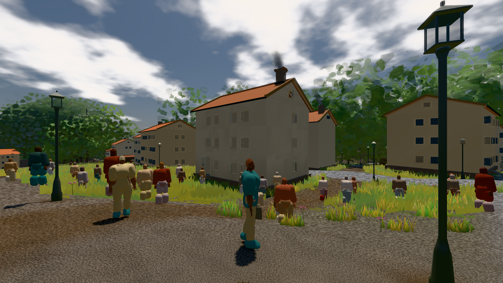
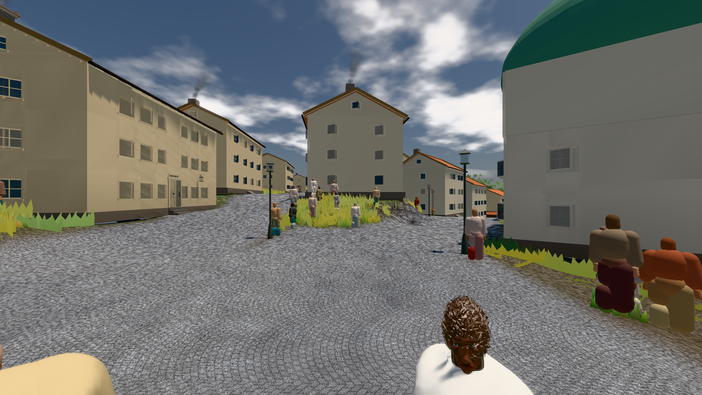

# GPU-PROBE f5e8cfbc — GRÜN

Zweig `w28-mensch-samen` · Kopf f5e8cfbc1139e03acfcb882613fd6666e8ecce46 · Läufer radeon-890m · 12.11. 04:17 · Wanduhr ab Push 706 s · Lauf https://github.com/MiguellD/AnazhRealm/actions/runs/43145817034

Ruf: `bild:stadt-voll@0.5 bild:stadt@0.5`

## Läufer radeon-890m — GRÜN

GPU AMD Radeon(TM) 890M Graphics · node_modules bleiben (package-lock 657462dc)
Schloss /c/Users/micha/AppData/Local/Temp/claude/gpu-schloss hält „ci-runner 43145817034/1 probe“
- Hook 2026-11-12 04:05:45 start ci-runner 43145817034/1 probe: wartet auf Schloss von 'punkte-radeon-sitzung 2026-11-12T04:03:55+01:00 pid=18296'
- Hook 2026-11-12 04:12:21 start ci-runner 43145817034/1 probe: Schloss genommen (refs/heads/w28-mensch-samen f5e8cfbc1139e03acfcb882613fd6666e8ecce46 ws=C:\actions-runner\_work\AnazhRealm\AnazhRealm)

### bild:stadt-voll@0.5 — GRÜN · 148 s · Läufer radeon-890m

Adapter: [linse-gpu] amd/rdna-3

```text
Kamera des Spiels → Blick (14.6 m): 837.84 58.51 445.42 842.31 58.51 459.32
 "abnahme": "ABNAHME GRÜN · beweis · Sicht 0.0 % · Ziel Blickziel im Bild frei 14.6 m, verdeckt nur von Leibern: 1 Punkt, nächster 3.64 m (Leib bewohner) · Luma 105.3 σ 59 schwarz 0.1 % weiß 0.0 % · Stand 18.546.259 · Bühne summer sunny 0.50 · Gerät WebGPU amd rdna-3",
```



### bild:stadt@0.5 — GRÜN · 113 s · Läufer radeon-890m

Adapter: [linse-gpu] amd/rdna-3

```text
Kamera des Spiels → Blick (23.9 m): 662.72 63.28 429.48 686.59 63.28 428.39
 "abnahme": "ABNAHME GRÜN · beweis · Sicht 0.0 % · Ziel Blickziel im Bild frei 23.89 m · Luma 114 σ 40.2 schwarz 0.0 % weiß 0.0 % · Stand 18.546.259 · Bühne summer sunny 0.50 · Gerät WebGPU amd rdna-3",
```


