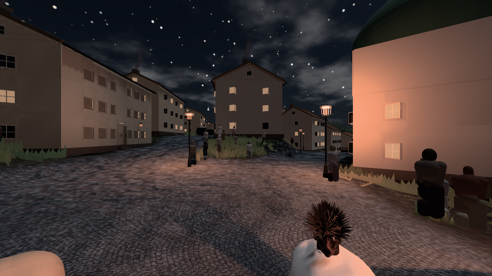
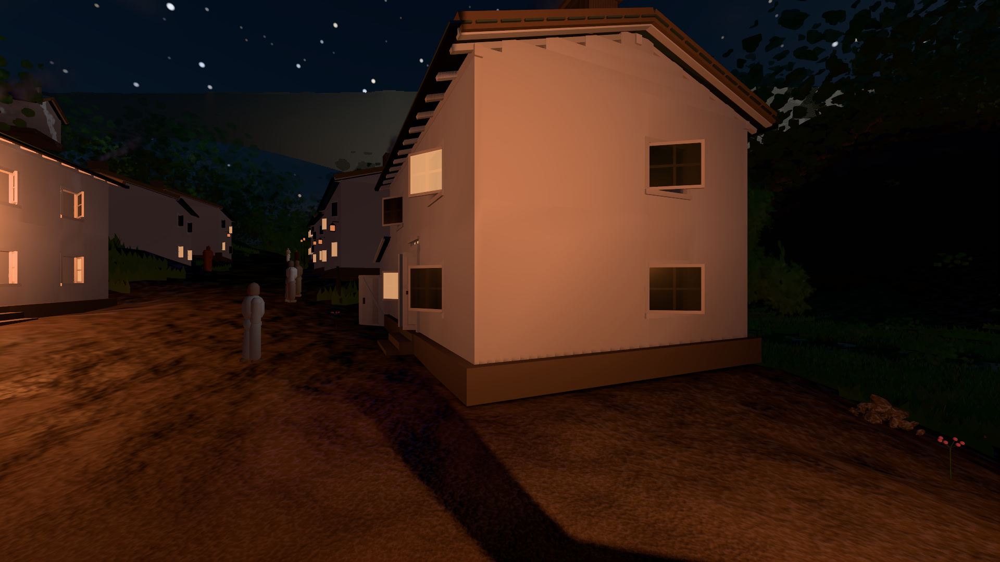

# GPU-PROBE fc583c8d — GRÜN · ROT wie an main (bekannt): bild:stadt@0.0: stadt.leib (Messort, haushalt.json bekannt) auf omen-gtx1060

Zweig `w28-nacht-bilanz` · Kopf fc583c8d7d6508c4db07068144d7e11f69ae3bff · Läufer omen-gtx1060 · 12.11. 13:14 · Wanduhr ab Push 2434 s · Lauf https://github.com/MiguellD/AnazhRealm/actions/runs/43210188463

Ruf: `bild:dorf@0.0 bild:stadt@0.0 bild:dorf@0.2`

## Läufer omen-gtx1060 — GRÜN

GPU NVIDIA GeForce GTX 1060 · node_modules bleiben (package-lock b254a196)
Schloss /c/Users/micha/AppData/Local/Temp/claude/gpu-schloss hält „ci-runner 43210188463/2 probe“
- Hook 2026-11-12 13:09:11 start ci-runner 43210188463/2 probe: Schloss genommen (refs/heads/w28-nacht-bilanz fc583c8d7d6508c4db07068144d7e11f69ae3bff ws=C:\actions-runner\_work\AnazhRealm\AnazhRealm)

### bild:dorf@0.0 — GRÜN · 78 s · Läufer omen-gtx1060

Adapter: [linse-gpu] nvidia/pascal

```text
Kamera des Spiels → Blick (5.2 m): -704.22 39.69 -880.02 -703.03 39.69 -874.96
 "abnahme": "ABNAHME GRÜN · beweis · Sicht 0.0 % · Ziel Blickziel im Bild frei 5.2 m · Luma 38.6 σ 30.4 schwarz 7.8 % weiß 0.0 % · Stand 18.546.263 · Bühne summer sunny 0.00 Tiere gehalten · Gerät WebGPU nvidia pascal · Inhalt bauSatz 28.1 % (≥ 2.0 %) (Nacht: Farbe ungefordert)",
```


### bild:stadt@0.0 — BEKANNT · 114 s · Läufer omen-gtx1060

Adapter: [linse-gpu] nvidia/pascal · ROT wie an main (bekannt): stadt.leib (Messort, haushalt.json bekannt)

```text
Kamera des Spiels → Blick (23.9 m): 662.72 63.28 429.48 686.59 63.28 428.39
 "abnahme": "ABNAHME BEKANNT · ROT wie an main (bekannt): stadt.leib Sicht verdeckt 3.8 % (Laub · Rinde · Fels · Böschung näher als 2 m, Bau als 1 m): Leib bewohner (≤ 8 m) 3.8 % · beweis · Sicht 3.8 % (Leib bewohner (≤ 8 m) 3.8 %) · Ziel Blickziel im Bild frei 23.89 m · Luma 58.4 σ 37 schwarz 1.7 % weiß 0.0 % · Stand 18.546.263 · Bühne summer sunny 0.00 Tiere gehalten · Gerät WebGPU nvidia pascal · Inhalt bauSatz 34.2 % (≥ 2.0 %) (Nacht: Farbe ungefordert)",
```



### bild:dorf@0.2 — GRÜN · 76 s · Läufer omen-gtx1060

Adapter: [linse-gpu] nvidia/pascal

```text
Kamera des Spiels → Blick (5.2 m): -704.22 39.69 -880.02 -703.03 39.69 -874.96
 "abnahme": "ABNAHME GRÜN · beweis · Sicht 0.0 % · Ziel Blickziel im Bild frei 5.2 m · Luma 34.7 σ 34.8 schwarz 11.7 % weiß 0.0 % · Stand 18.546.263 · Bühne summer sunny 0.20 Tiere gehalten · Gerät WebGPU nvidia pascal · Inhalt bauSatz 28.8 % (≥ 2.0 %) (Nacht: Farbe ungefordert)",
```


