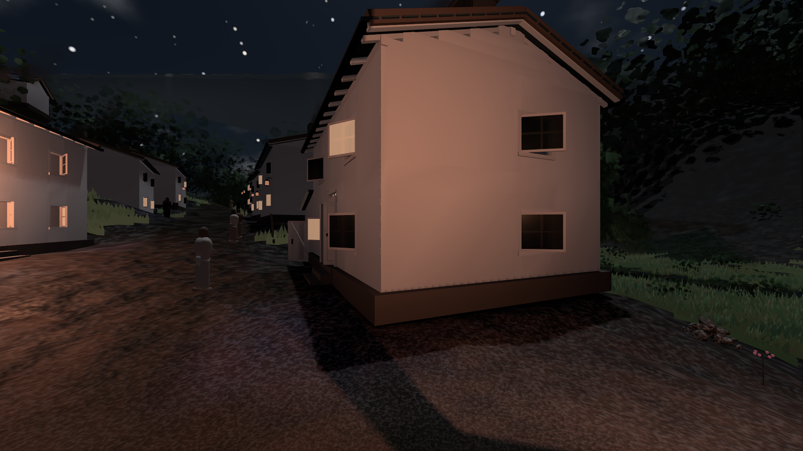

# GPU-PROBE fc583c8d — NACHGEGEBEN

Zweig `w28-nacht-bilanz` · Kopf fc583c8d7d6508c4db07068144d7e11f69ae3bff · Läufer omen-gtx1060 · 12.11. 12:38 · Wanduhr ab Push 313 s · Lauf https://github.com/MiguellD/AnazhRealm/actions/runs/43210188463

Ruf: `bild:dorf@0.0 bild:stadt@0.0 bild:dorf@0.2`

## Läufer omen-gtx1060 — NACHGEGEBEN

GPU NVIDIA GeForce GTX 1060 · npm ci 46 s (package-lock b254a196)
Schloss /c/Users/micha/AppData/Local/Temp/claude/gpu-schloss hält „ci-runner 43210188463/1 probe“
- Hook 2026-11-12 12:33:52 start ci-runner 43210188463/1 probe: wartet auf Schloss von 'omen-punkte-gtx-sitzung'
- Hook 2026-11-12 12:34:07 start ci-runner 43210188463/1 probe: Schloss genommen (refs/heads/w28-nacht-bilanz fc583c8d7d6508c4db07068144d7e11f69ae3bff ws=C:\actions-runner\_work\AnazhRealm\AnazhRealm)

### bild:dorf@0.0 — GRÜN · 89 s · Läufer omen-gtx1060

Adapter: [linse-gpu] nvidia/pascal

```text
Kamera des Spiels → Blick (5.2 m): -704.22 39.69 -880.02 -703.03 39.69 -874.96
 "abnahme": "ABNAHME GRÜN · beweis · Sicht 0.0 % · Ziel Blickziel im Bild frei 5.2 m · Luma 38.6 σ 30.4 schwarz 7.8 % weiß 0.0 % · Stand 18.546.263 · Bühne summer sunny 0.00 Tiere gehalten · Gerät WebGPU nvidia pascal · Inhalt bauSatz 28.0 % (≥ 2.0 %) (Nacht: Farbe ungefordert)",
```



### bild:stadt@0.0 — NACHGEGEBEN · 77 s · Läufer omen-gtx1060

Adapter: [linse-gpu] nvidia/pascal · NACHGEGEBEN: Karten-Job „echt omen (GPU-Wände auf der Karte)“ (Lauf 43210679467) wartet auf diesen Läufer (omen-gpu)

```text
[linse-gpu] nvidia/pascal
```

### bild:dorf@0.2 — NACHGEGEBEN · 2 s · Läufer omen-gtx1060

Adapter: ungenannt (die Probe nannte keinen Browser-Adapter) · NACHGEGEBEN: Karten-Job „echt omen (GPU-Wände auf der Karte)“ (Lauf 43210679467) wartet auf diesen Läufer (omen-gpu)

```text
NACHGEGEBEN: Karten-Job „echt omen (GPU-Wände auf der Karte)“ (Lauf 43210679467) wartet auf diesen Läufer (omen-gpu)
```
