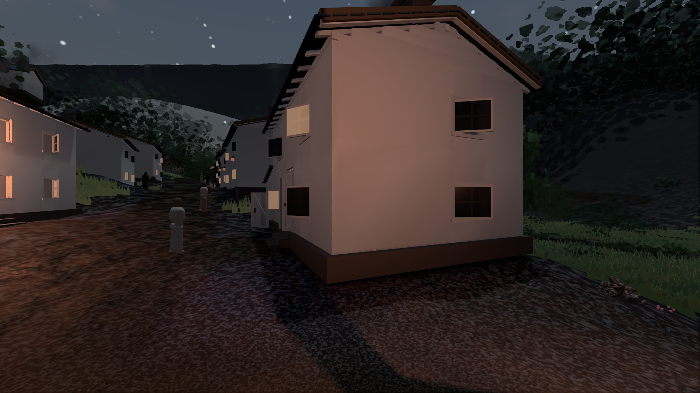
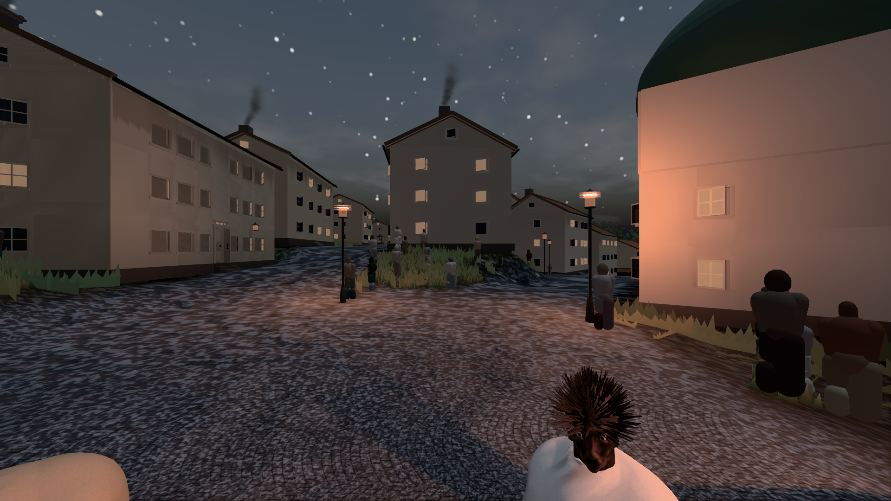
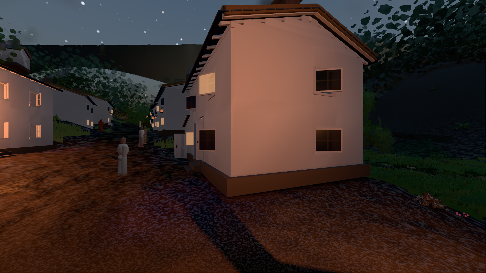

# GPU-PROBE 250b98cb — GRÜN · ROT wie an main (bekannt): bild:stadt@0.0: stadt.leib (Messort, haushalt.json bekannt) auf gtx1050-desktop

Zweig `w28-nacht-licht` · Kopf 250b98cb404f2b6becf4269384925041c593a110 · Läufer gtx1050-desktop · 12.11. 08:39 · Wanduhr ab Push 671 s · Lauf https://github.com/MiguellD/AnazhRealm/actions/runs/43175465287

Ruf: `bild:dorf@0.0 bild:stadt@0.0 bild:dorf@0.2`

## Läufer gtx1050-desktop — GRÜN

GPU NVIDIA GeForce GTX 1050 · node_modules bleiben (package-lock db0dbb29)
Schloss /c/Users/User/AppData/Local/Temp/claude/gpu-schloss hält „ci-runner 43175465287/1 probe“
- Hook 2026-11-12 08:28:22 start ci-runner 43175465287/1 probe: Schloss genommen (refs/heads/w28-nacht-licht 250b98cb404f2b6becf4269384925041c593a110 ws=C:\actions-runner\_work\AnazhRealm\AnazhRealm)

### bild:dorf@0.0 — GRÜN · 224 s · Läufer gtx1050-desktop

Adapter: [linse-gpu] nvidia/pascal

```text
Kamera des Spiels → Blick (5.2 m): -704.22 39.69 -880.02 -703.03 39.69 -874.96
 "abnahme": "ABNAHME GRÜN · beweis · Sicht 0.0 % · Ziel Blickziel im Bild frei 5.2 m · Luma 42.2 σ 30.6 schwarz 4.0 % weiß 0.0 % · Stand 18.546.261 · Bühne summer sunny 0.00 Tiere gehalten · Gerät WebGPU nvidia pascal · Inhalt bauSatz 28.6 % (≥ 2.0 %) (Nacht: Farbe ungefordert)",
```



### bild:stadt@0.0 — BEKANNT · 242 s · Läufer gtx1050-desktop

Adapter: [linse-gpu] nvidia/pascal · ROT wie an main (bekannt): stadt.leib (Messort, haushalt.json bekannt)

```text
Kamera des Spiels → Blick (23.9 m): 662.72 63.28 429.48 686.59 63.28 428.39
 "abnahme": "ABNAHME BEKANNT · ROT wie an main (bekannt): stadt.leib Sicht verdeckt 3.8 % (Laub · Rinde · Fels · Böschung näher als 2 m, Bau als 1 m): Leib bewohner (≤ 8 m) 3.8 % · beweis · Sicht 3.8 % (Leib bewohner (≤ 8 m) 3.8 %) · Ziel Blickziel im Bild frei 23.89 m · Luma 65.2 σ 30.8 schwarz 1.3 % weiß 0.0 % · Stand 18.546.261 · Bühne summer sunny 0.00 Tiere gehalten · Gerät WebGPU nvidia pascal · Inhalt bauSatz 34.4 % (≥ 2.0 %) (Nacht: Farbe ungefordert)",
```



### bild:dorf@0.2 — GRÜN · 145 s · Läufer gtx1050-desktop

Adapter: [linse-gpu] nvidia/pascal

```text
Kamera des Spiels → Blick (5.2 m): -704.22 39.69 -880.02 -703.03 39.69 -874.96
 "abnahme": "ABNAHME GRÜN · beweis · Sicht 0.0 % · Ziel Blickziel im Bild frei 5.2 m · Luma 46 σ 36.6 schwarz 2.8 % weiß 0.0 % · Stand 18.546.261 · Bühne summer sunny 0.20 Tiere gehalten · Gerät WebGPU nvidia pascal · Inhalt bauSatz 29.5 % (≥ 2.0 %) (Nacht: Farbe ungefordert)",
```


