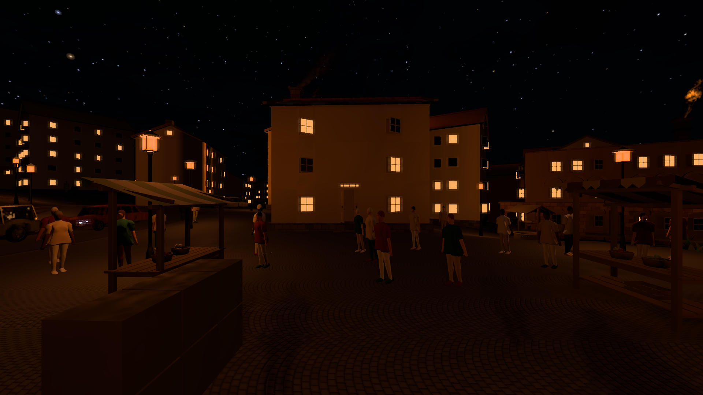

# GPU-PROBE 8d118a76 — GRÜN

Zweig `w28-nacht-lichter-3` · Kopf 8d118a762b69a053c1fdd05a1200107a119eefa8 · Läufer gtx1050-desktop · 22.11. 07:08 · Wanduhr ab Push 1077 s · Lauf https://github.com/MiguellD/AnazhRealm/actions/runs/44991115234

Ruf: `gate:webgl-probe gate:nacht-licht:echt bild:stadt-voll@0`

## Läufer gtx1050-desktop — GRÜN

GPU NVIDIA GeForce GTX 1050 · node_modules bleiben (package-lock bf2c0bf2)
Schloss /c/Users/User/AppData/Local/Temp/claude/gpu-schloss hält „ci-runner 44991115234/1 probe“
- Hook 2026-11-22 06:53:18 start ci-runner 44991115234/1 probe: Schloss genommen (refs/heads/w28-nacht-lichter-3 8d118a762b69a053c1fdd05a1200107a119eefa8 ws=C:\actions-runner\_work\AnazhRealm\AnazhRealm)

### gate:webgl-probe — GRÜN · 94 s · Läufer gtx1050-desktop

Adapter: [linse-gpu] webgl2/NVIDIA GeForce GTX 1050 (0x00001C81) Direct3D11 vs_5_0 ps_5_0

```text
✅ GRÜN — die Kein-WebGPU-Geschichte ist BEWIESEN: der erzwungene WebGL2-Rückfall bootet eine LEBENDE, sichtbare Welt; die WGSL-Konsumenten + Bundles ruhen hinter der EINEN Backend-Wand, der Rückfall ist LAUT benannt, der Fern-Ring trägt auf CPU.
```

### gate:nacht-licht:echt — GRÜN · 459 s · Läufer gtx1050-desktop

Adapter: ungenannt (die Probe nannte keinen Browser-Adapter)

```text
NACHT stadt-voll:third GRUEN: Bodenfleck 12/12 sichtbar (42 in 50 m) = 1 · ohne Karte 3/12 = 0.25 · Kelvin ±33 K (5) · Karte: ein Fleck 3.7 ms, Takt höchstens 76.8 ms, Bau der Mitte 4.66 ms
NACHT dorf:third GRUEN: Bodenfleck 4/4 sichtbar (14 in 50 m) = 1 · ohne Karte 3/4 = 0.75 · Kelvin ±18 K (1) · Karte: ein Fleck 1.5 ms, Takt höchstens 13.04 ms, Bau der Mitte 4.43 ms
NACHT GRUEN
```

### bild:stadt-voll@0 — GRÜN · 321 s · Läufer gtx1050-desktop

Adapter: [linse-gpu] nvidia/pascal

```text
Kamera des Spiels → Blick (14.8 m): 842.49 57.57 451.79 857.27 57.57 451.19
 "abnahme": "ABNAHME GRÜN · beweis · Sicht 0.0 % · Leib im Vordergrund 5.6 % (Leib bewohner 5.6 %) · Ziel Blickziel im Bild frei 14.79 m · Luma 11.6 σ 19.6 schwarz 36.8 % weiß 0.0 % · Stand 18.546.364 · Bühne summer sunny 0.00 Tiere gehalten · Gerät WebGPU nvidia pascal · Inhalt bauSatz 26.7 % (≥ 2.0 %), bewohner 3.1 % (≥ 1.0 %) (Nacht: Farbe ungefordert)",
```


