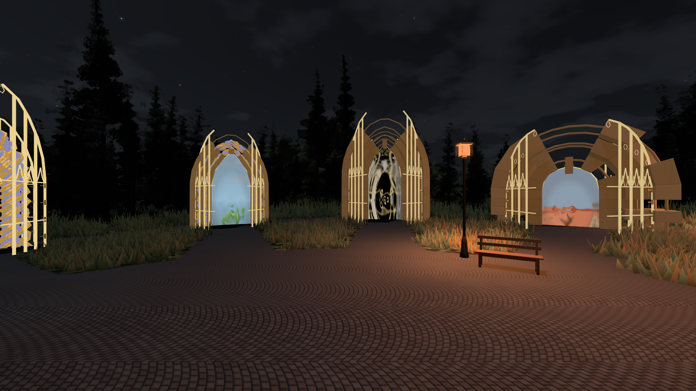

# GPU-PROBE ffd68679 — NACHGEGEBEN

Zweig `w28-nacht-lichter` · Kopf ffd68679e14d125d18597f6003f495266746d874 · Läufer gtx1050-desktop · 20.11. 23:13 · Wanduhr ab Push 2450 s · Lauf https://github.com/MiguellD/AnazhRealm/actions/runs/44821323126

Ruf: `gate:tag-achse:echt gate:studio-begehen bild:genesis@0`

## Läufer gtx1050-desktop — NACHGEGEBEN

GPU NVIDIA GeForce GTX 1050 · node_modules bleiben (package-lock c854f5c1)
Schloss /c/Users/User/AppData/Local/Temp/claude/gpu-schloss hält „ci-runner 44821323126/1 probe“
- Hook 2026-11-20 22:33:34 start ci-runner 44821323126/1 probe: Schloss genommen (refs/heads/w28-nacht-lichter ffd68679e14d125d18597f6003f495266746d874 ws=C:\actions-runner\_work\AnazhRealm\AnazhRealm)

### gate:tag-achse:echt — NACHGEGEBEN · 412 s · Läufer gtx1050-desktop

Adapter: ungenannt (die Probe nannte keinen Browser-Adapter) · NACHGEGEBEN: Vorfahrt-Blick gescheitert: fetch failed

```text

> anazhrealm@18.546.353 gate:tag-achse:echt
> node scripts/werkbank.cjs licht --tag --kurz --eigen --port 4692
```

### gate:studio-begehen — GRÜN · 433 s · Läufer gtx1050-desktop

Adapter: [linse-gpu] nvidia/pascal

```text
  ✅ Selbsttest „kappe" macht B3 Steigen rot — B3 Steigen: 16 von 20 Treppen erreichen ihre Höhe (EG→OG 9/9 · OG→OG 7/7 · Speicher 0/4)
  ✅ Selbsttest „spur" macht B3 Steigen rot — B3 Steigen: 17 von 20 Treppen erreichen ihre Höhe (EG→OG 9/9 · OG→OG 4/7 · Speicher 4/4)
[stall-akte] Stderr [16300:12024:1120/224413.664:ERROR:services\on_device_model\public\cpp\service_client.cc:37] Unexpected on_device_model service disconnect; reason: 1, description: Error loading backend.
  ✅ Selbsttest „austritt" macht B3 Kopfraum rot — B3 Kopfraum: 7 Austritte unter 1.7 m (min 1.01 m — der Kopf steht im Dach)
[stall-akte] Stderr [16300:12024:1120/224413.664:ERROR:services\on_device_model\public\cpp\service_client.cc:37] Unexpected on_device_model service disconnect; reason: 1, description: Error loading backend.
  ✅ Selbsttest „platte" macht B4 Keller-Decke rot — B4 Keller-Decke = Boden-Platte in 3 von 3
[stall-akte] Stderr [16300:12024:1120/224413.664:ERROR:services\on_device_model\public\cpp\service_client.cc:37] Unexpected on_device_model service disconnect; reason: 1, description: Error loading backend.
  ✅ Selbsttest „flach" macht B5 Weltgrund rot — B5 Weltgrund: die Häuser stehen eben (Spanne 0 m)
[stall-akte] Stderr [16300:12024:1120/224413.664:ERROR:services\on_device_model\public\cpp\service_client.cc:37] Unexpected on_device_model service disconnect; reason: 1, description: Error loading backend.
✅ gate:studio-begehen grün
```

### bild:genesis@0 — GRÜN · 199 s · Läufer gtx1050-desktop

Adapter: [linse-gpu] nvidia/pascal

```text
Kamera des Spiels → Blick (10.0 m): 0.00 92.40 0.00 -10.00 92.40 0.00
 "abnahme": "ABNAHME GRÜN · beweis · Sicht 0.0 % · Ziel Blickziel im Bild frei 10 m · Luma 43.2 σ 38.9 schwarz 9.1 % weiß 0.0 % · Stand 18.546.353 · Bühne summer sunny 0.00 Tiere gehalten · Gerät WebGPU nvidia pascal · Inhalt bodenSatz 36.6 % (≥ 15.0 %), portal-membran 2.7 % (≥ 0.3 %) (Nacht: Farbe ungefordert)",
```


