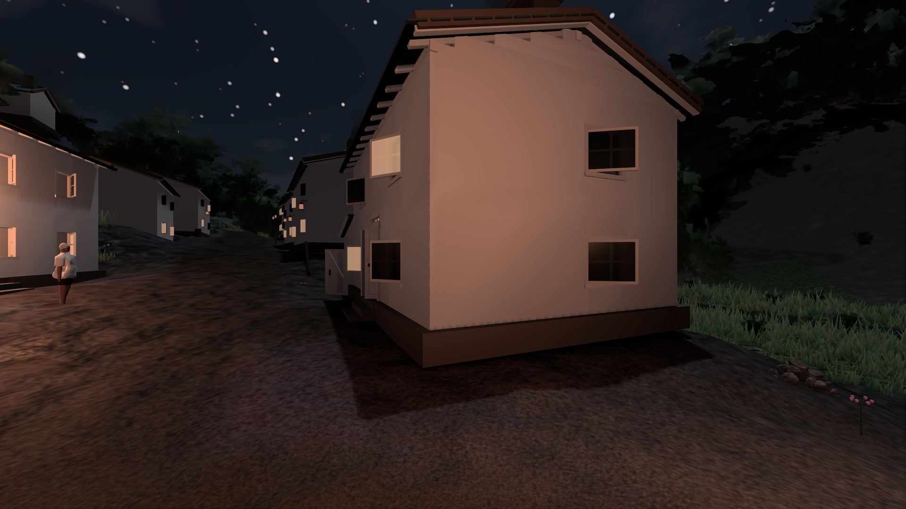
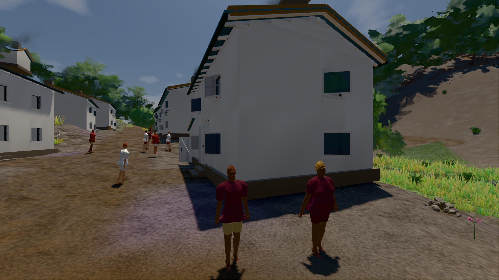

# GPU-PROBE cf821525 — GRÜN

Zweig `w28-nachtbild` · Kopf cf8215258e4685fbd6ccbeb41b9b373c6bf93cee · Läufer gtx1050-desktop · 16.11. 19:20 · Wanduhr ab Push 383 s · Lauf https://github.com/MiguellD/AnazhRealm/actions/runs/43926750384

Ruf: `bild:dorf@0.0 bild:dorf@0.5`

## Läufer gtx1050-desktop — GRÜN

GPU NVIDIA GeForce GTX 1050 · npm ci 34 s (package-lock bfd8203f)
Schloss /c/Users/User/AppData/Local/Temp/claude/gpu-schloss hält „ci-runner 43926750384/1 probe“
- Hook 2026-11-16 19:14:57 start ci-runner 43926750384/1 probe: Schloss genommen (refs/heads/w28-nachtbild cf8215258e4685fbd6ccbeb41b9b373c6bf93cee ws=C:\actions-runner\_work\AnazhRealm\AnazhRealm)

### bild:dorf@0.0 — GRÜN · 151 s · Läufer gtx1050-desktop

Adapter: [linse-gpu] nvidia/pascal

```text
Kamera des Spiels → Blick (5.2 m): -704.22 39.69 -880.02 -703.03 39.69 -874.96
 "abnahme": "ABNAHME GRÜN · beweis · Sicht 0.0 % · Ziel Blickziel im Bild frei 5.2 m · Luma 38.8 σ 30.4 schwarz 7.9 % weiß 0.0 % · Stand 18.546.308 · Bühne summer sunny 0.00 Tiere gehalten · Gerät WebGPU nvidia pascal · Inhalt bauSatz 29.4 % (≥ 2.0 %) (Nacht: Farbe ungefordert)",
```



### bild:dorf@0.5 — GRÜN · 142 s · Läufer gtx1050-desktop

Adapter: [linse-gpu] nvidia/pascal

```text
Kamera des Spiels → Blick (5.2 m): -704.22 39.69 -880.02 -703.03 39.69 -874.96
 "abnahme": "ABNAHME GRÜN · beweis · Sicht 0.0 % · Ziel Blickziel im Bild frei 5.2 m · Luma 77.7 σ 30.9 schwarz 0.2 % weiß 0.0 % · Stand 18.546.308 · Bühne summer sunny 0.50 Tiere gehalten · Gerät WebGPU nvidia pascal · Inhalt bauSatz 28.7 % (≥ 2.0 %) Luma 79",
```


