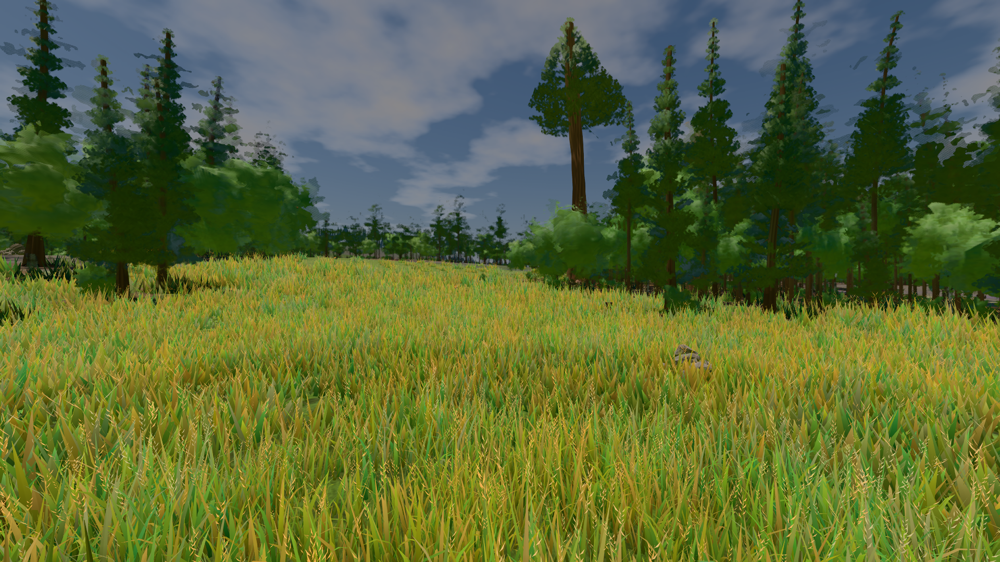

# GPU-PROBE 93331bb5 — NACHGEGEBEN

Zweig `w28-nadel-bestand` · Kopf 93331bb5dc76f8d376641dd447449cd2b78480b0 · Läufer gtx1050-desktop · 20.11. 20:50 · Wanduhr ab Push 334 s · Lauf https://github.com/MiguellD/AnazhRealm/actions/runs/44805025933

Ruf: `gate:pruefbuehne-licht gate:weltbild-frost:echt bild:wiese@0.5`

## Läufer gtx1050-desktop — NACHGEGEBEN

GPU NVIDIA GeForce GTX 1050 · node_modules bleiben (package-lock c854f5c1)
Schloss /c/Users/User/AppData/Local/Temp/claude/gpu-schloss hält „ci-runner 44805025933/1 probe“
- Hook 2026-11-20 20:45:19 start ci-runner 44805025933/1 probe: Schloss genommen (refs/heads/w28-nadel-bestand 93331bb5dc76f8d376641dd447449cd2b78480b0 ws=C:\actions-runner\_work\AnazhRealm\AnazhRealm)

### gate:pruefbuehne-licht — GRÜN · 99 s · Läufer gtx1050-desktop

Adapter: [linse-gpu] nvidia/pascal

```text
  S0 BODEN-PROGRAMM 1/1: 101556 Zeichen WGSL (Ratsche ≤ 104162) · Pipeline asynchron → GRÜN · kalt 2540 · 2863 · 2703 · 2131 · 1830 · 2740 · 2040 · 1949 · 1933 ms, Median 2131 ms · ÷ K17 derselben Sitzung 0,79 (Auskunft, kein Zeit-Urteil)
✅ S0 BILD GRÜN: die Feuerstelle trägt den Feuerkreis aus 2 m in der Ausgabe · Nacht {"luma":22.3,"schwarz":0} (76 s, nvidia/pascal · Holz kienspan)
```

### gate:weltbild-frost:echt — NACHGEGEBEN · 13 s · Läufer gtx1050-desktop

Adapter: ungenannt (die Probe nannte keinen Browser-Adapter) · NACHGEGEBEN: Vorfahrt-Blick gescheitert: 502 https://api.github.com/repos/MiguellD/AnazhRealm/actions/runs/44798631234/jobs?per_page=100

```text
NACHGEGEBEN: Vorfahrt-Blick gescheitert: 502 https://api.github.com/repos/MiguellD/AnazhRealm/actions/runs/44798631234/jobs?per_page=100
```

### bild:wiese@0.5 — GRÜN · 97 s · Läufer gtx1050-desktop

Adapter: [linse-gpu] nvidia/pascal

```text
Kamera des Spiels → Blick (10.0 m): -280.40 29.71 -1045.60 -289.61 29.71 -1049.50
 "abnahme": "ABNAHME GRÜN · beweis · Sicht 0.0 % · Ziel Blickziel im Bild frei 10 m · Luma 99.4 σ 35.4 schwarz 0.0 % weiß 0.0 % · Stand 18.546.353 · Bühne summer sunny 0.50 Tiere gehalten · Gerät WebGPU nvidia pascal · Inhalt nahWiese 48.4 % (≥ 15.0 %) h 107° Luma 123",
```


