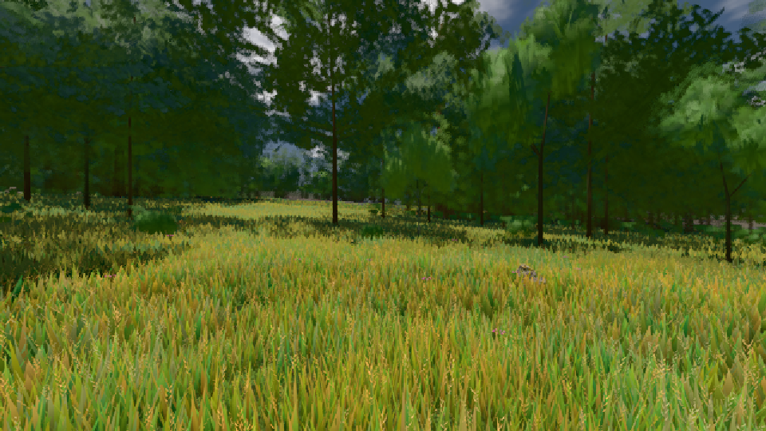

# GPU-PROBE 7c51bdec — GRÜN

Zweig `w28-nadel-stufe` · Kopf 7c51bdec3dd7957bc2b9a92d4cc1c3c82bbc2f31 · Läufer gtx1050-desktop · 11.11. 19:48 · Wanduhr ab Push 429 s · Lauf https://github.com/MiguellD/AnazhRealm/actions/runs/43080102132

Ruf: `bild:wiese@0.5 gate:foundry-impostor gate:streu-wahrheit`

## Läufer gtx1050-desktop — GRÜN

GPU NVIDIA GeForce GTX 1050 · node_modules bleiben (package-lock 50ac1117)
Schloss /c/Users/User/AppData/Local/Temp/claude/gpu-schloss hält „ci-runner 43080102132/1 probe“
- Hook 2026-11-11 19:41:33 start ci-runner 43080102132/1 probe: Schloss genommen (refs/heads/w28-nadel-stufe 7c51bdec3dd7957bc2b9a92d4cc1c3c82bbc2f31 ws=C:\actions-runner\_work\AnazhRealm\AnazhRealm)

### bild:wiese@0.5 — GRÜN · 125 s · Läufer gtx1050-desktop

Adapter: [linse-gpu] nvidia/pascal

```text
Kamera des Spiels → Blick (10.0 m): -280.40 29.71 -1045.60 -289.61 29.71 -1049.50
 "abnahme": "ABNAHME GRÜN · beweis · Sicht 0.0 % · Ziel Blickziel im Bild frei 10 m · Luma 83.7 σ 40.3 schwarz 0.0 % weiß 0.0 % · Stand 18.546.254 · Bühne summer sunny 0.50 · Gerät WebGPU nvidia pascal",
```



### gate:foundry-impostor — GRÜN · 69 s · Läufer gtx1050-desktop

Adapter: [linse-gpu] webgl2/NVIDIA GeForce GTX 1050 (0x00001C81) Direct3D11 vs_5_0 ps_5_0

```text
  C5 WACHSEN: GRÜN · Selbsttest: Vorlage karte-albedo:atlas#46,Vorlage karte-normal:atlas#47,Vorlage karte-albedo:atlas#46,Vorlage karte-normal:atlas#47,Vorlage karte-albedo:atlas#46,Vorlage karte-normal:atlas#47
  C5 WACHSEN: GRÜN · Selbsttest: nur bc
✅ GRÜN — die Welt-Fernstufe liest die im Welt-Renderer gebackene Karte über EINEN Karten-Atlas (eine Gruppe, ein Material, Schicht + Rahmen je Instanz), die Karte steht richtig herum und in der Tiefe ihrer Gestalt, befreite Slots zeichnen nichts (die Gruppe verdichtet), jede Atlas-Stichprobe trägt die Gradienten der stetigen Koordinate (kein Stamm-Strich).
```

### gate:streu-wahrheit — GRÜN · 159 s · Läufer gtx1050-desktop

Adapter: ungenannt (die Probe nannte keinen Browser-Adapter)

```text
  ✅ Selbsttest „Karte ohne Kodierung" → rot: die Karten-Kodierung weicht in 254 von 256 Stufen von linear → sRGB ab (Stufe 0) · Saum eiche: der Umriss franst nicht im Maß des Schirms (kante 0.9443,0.0867 über 0.22) · Saum fichte: der Umriss franst nicht im Maß des Schirms (kante 0.9443,0.0699 über 0.22) · Saum: Laub und Nadel tragen denselben Umriss — der Umriss folgt nicht der Art
  ✅ Selbsttest „Saum stumm" → rot: Saum eiche: der Umriss franst nicht im Maß des Schirms (kante 0.9443,0.7943 über 0.22) · Saum fichte: der Umriss franst nicht im Maß des Schirms (kante 0.9443,0.7943 über 0.22) · Saum: Laub und Nadel tragen denselben Umriss — der Umriss folgt nicht der Art
  ✅ Selbsttest „Ausdünnen in der Ferne" → rot: Saum eiche: Stufe 3 deckt 0 statt 0.220001220703125 — die Karte dünnt aus · Saum eiche: Stufe 4 deckt 0 statt 0.220001220703125 — die Karte dünnt aus · Saum eiche: Stufe 5 deckt 0 statt 0.220001220703125 — die Karte dünnt aus · Saum eiche: die Karte deckt am Schirm 0.862 ihrer Stufe 0 — der Test der Welt dehnt oder dünnt den Saum · Saum fichte: Stufe 3 deckt 0 statt 0.220001220703125 — die Karte dünnt aus · Saum fichte: Stufe 4 deckt 0 statt 0.220001220703125 — die Karte dünnt aus · Saum fichte: Stufe 5 deckt 0 statt
  ✅ Selbsttest „Nadel als Laub" → rot: Saum fichte: Laub und Nadel vertauscht · Saum mammut: Laub und Nadel vertauscht · Saum tanne: Laub und Nadel vertauscht
  ✅ Selbsttest „Ring −20° ohne Saum" → rot: Saum eiche: Ring -20° ohne Saum · Saum fichte: Ring -20° ohne Saum · Saum birke: Ring -20° ohne Saum · Saum weide: Ring -20° ohne Saum · Saum mammut: Ring -20° ohne Saum · Saum tanne: Ring -20° ohne Saum · Saum strauch: Ring -20° ohne Saum · Saum buche: Ring -20° ohne Saum · Saum karst: Ring -20° ohne Saum · Saum totholz: Ring -20° ohne Saum
  ✅ Selbsttest „Saum im Maß eines Texels (w23)" → rot: Saum fichte: der Umriss franst nicht im Maß des Schirms (kante 0.4583,0.4377 über 0.22)
  ✅ Selbsttest „Schwelle 0,34 (bis w24)" → rot: Saum eiche: die Karte deckt am Schirm 1.210 ihrer Stufe 0 — der Test der Welt dehnt oder dünnt den Saum · Saum fichte: die Karte deckt am Schirm 1.202 ihrer Stufe 0 — der Test der Welt dehnt oder dünnt den Saum
  ✅ Selbsttest „Mip-Stufe roh gemittelt" → rot: die gemittelte Mip-Stufe ist nicht linear gemittelt und sRGB-kodiert (64 von 64 Texeln)
✅ SELBSTTEST GRÜN — jeder injizierte Täter fällt rot und wird beim Namen genannt.
✅ DIE STREU-WAHRHEIT steht — 7 Studio-Arten der Nah-Streu (placement.boden ring "nah"), 4 mit weichem Gewebe backen jede Palette über vegFarbe, kein Lambert-Stoff im Stamm (Fundament, Wege, Fern-Ring, Rauch, Gras lesen den EINEN Himmel), der Karten-Codec kodiert die Studio-Karte sRGB, der Saum der Karte deckungstreu je Stufe, 2 Saum-Gesetze mit eigenem Umriss.
```
