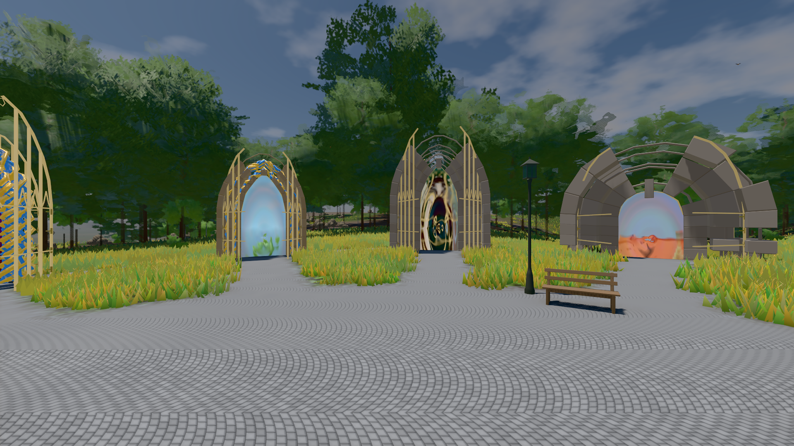

# GPU-PROBE 2f687d72 — GRÜN

Zweig `w28-nexus-uhr` · Kopf 2f687d72232c42260afbc5bdadddb5b98a506264 · Läufer radeon-890m · 14.11. 08:06 · Wanduhr ab Push 278 s · Lauf https://github.com/MiguellD/AnazhRealm/actions/runs/43569168634

Ruf: `gate:kamera-leib:echt bild:genesis@0.5`

## Läufer radeon-890m — GRÜN

GPU AMD Radeon(TM) 890M Graphics · npm ci 64 s (package-lock 5f3fc96f)
Schloss /c/Users/micha/AppData/Local/Temp/claude/gpu-schloss hält „ci-runner 43569168634/1 probe“
- Hook 2026-11-14 08:02:41 start ci-runner 43569168634/1 probe: Schloss genommen (refs/heads/w28-nexus-uhr 2f687d72232c42260afbc5bdadddb5b98a506264 ws=C:\actions-runner\_work\AnazhRealm\AnazhRealm)

### gate:kamera-leib:echt — GRÜN · 75 s · Läufer radeon-890m

Adapter: [linse-gpu] amd/rdna-3

```text
  ✅ K6 Strafe am Prüfplatz — A0 Kopf 1.0 % Leib 1.5 % (2433 px),A1 Kopf 0.0 % Leib 1.5 % (2448 px),A2 Kopf 0.0 % Leib 1.8 % (2469 px),A3 Kopf 1.0 % Leib 1.0 % (2517 px),D0 Kopf 0.0 % Leib 2.8 % (2460 px),D1 Kopf 0.0 % Leib 1.1 % (2378 px),D2 Kopf 0.0 % Leib 2.1 % (2449 px),D3 Kopf 0.0 % Leib 0.9 % (2485 px) · Rückstrahl 0.1 %
✅ GRÜN — die Kamera steckt nie in Laub, Strauch, Fels oder Boden.
```

### bild:genesis@0.5 — GRÜN · 51 s · Läufer radeon-890m

Adapter: [linse-gpu] amd/rdna-3

```text
Kamera des Spiels → Blick (10.0 m): 0.00 92.40 0.00 -10.00 92.40 0.00
 "abnahme": "ABNAHME GRÜN · beweis · Sicht 0.0 % · Ziel Blickziel im Bild frei 10 m · Luma 107.5 σ 39 schwarz 0.0 % weiß 0.0 % · Stand 18.546.281 · Bühne summer sunny 0.50 Tiere gehalten · Gerät WebGPU amd rdna-3 · Inhalt bodenSatz 36.2 % (≥ 15.0 %) Luma 140, portal-membran 2.8 % (≥ 0.3 %) Luma 139",
```


